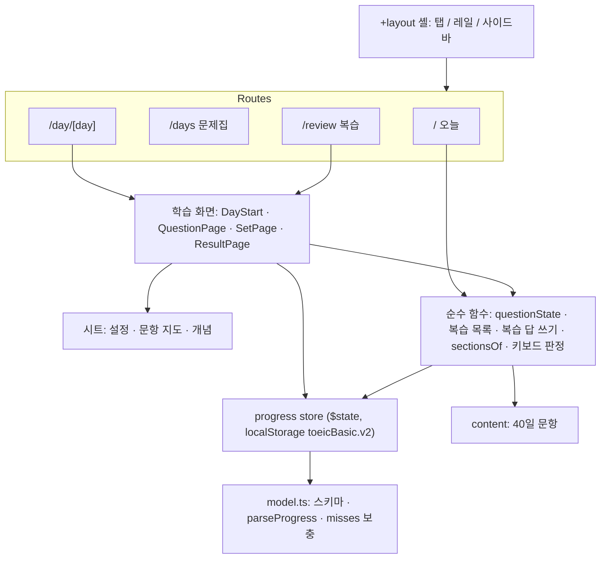
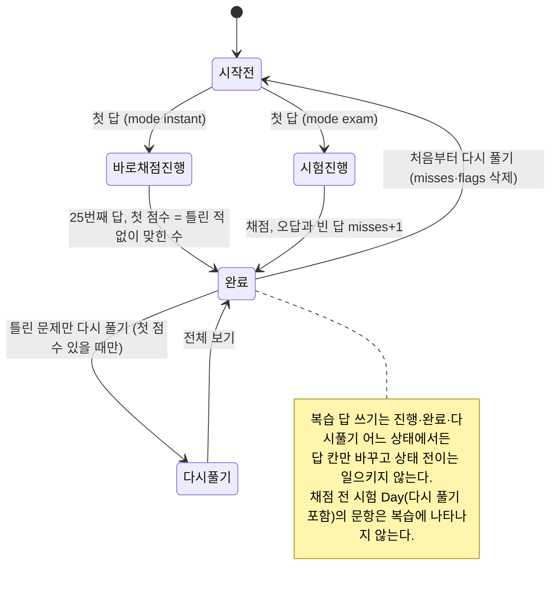
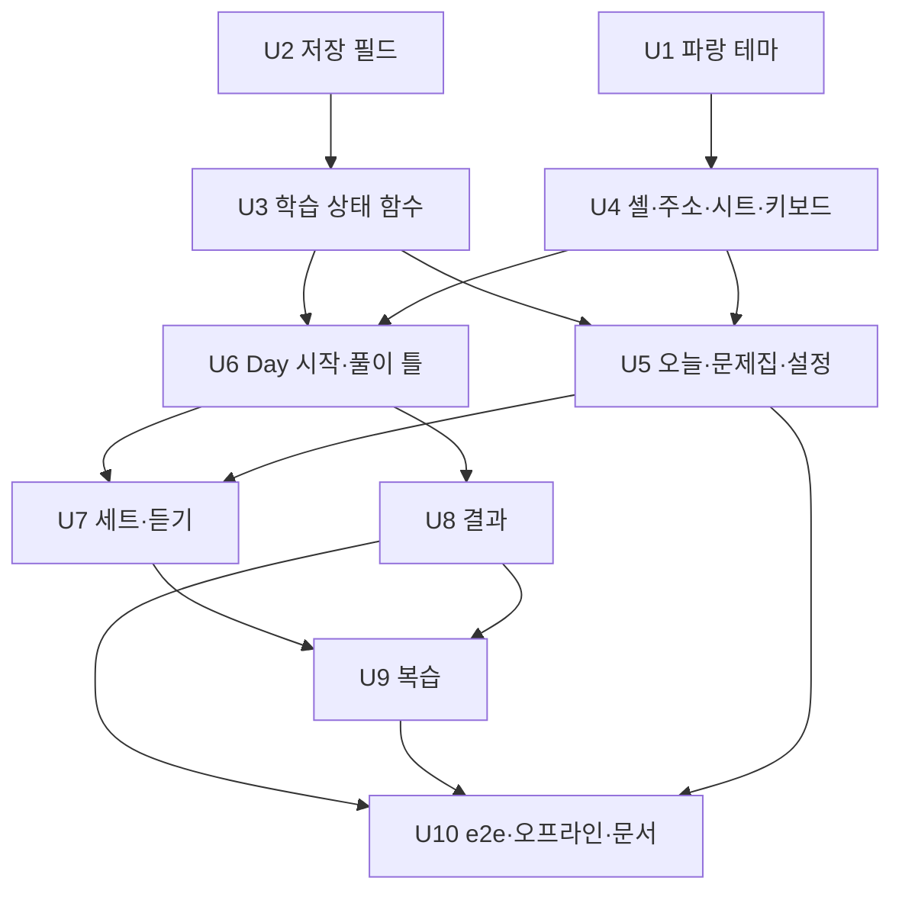

# 토익 학습앱 UI 재설계 1차 - Plan

## Goal Capsule

- **Objective:** 학습자가 휴대폰·아이패드·PC 어디서든 앱을 열자마자 하던 공부를 이어 가고, Day 안에서 원하는 곳으로 바로 가며, 여러 Day에서 틀린 문제를 한곳에서 다시 푼다.
- **Means:** 설계 시안 `docs/design/2026-10-21-ui-ux-canvas/`의 문제집 화면을 지금 SvelteKit 앱 위에 다시 짓는다. 저장 형식은 선택 필드만 더하고, 기존 필드와 페이지 순서는 바꾸지 않는다 (KTD3, KTD4).
- **Authority:** 제품 동작은 Requirements(R)가, 구현 방식은 Key Technical Decisions(KTD)가 정한다. 설계 시안은 배치와 시각의 기준이다. 시안이 R이나 KTD와 다르면 R과 KTD를 따른다 (예: KTD8).
- **Stop conditions:** 다음 중 하나가 생기면 멈추고 보고한다.
  - 기존 기록의 첫 점수·답·채점 방식이 바뀌거나 사라진다.
  - 시험 모드에서 채점 전에 정답 여부가 드러난다.
  - 문항 데이터(`src/lib/content/days/`)를 고쳐야 한다.
  - 새 npm 의존성이 필요하다.
- **Execution profile:** git 없이 로컬 파일만 고친다 (KTD1). 사용자 전역 규칙에 따라 파일을 고치기 전에 목록을 보여 주고 승인을 받는다.
- **Finish:** 구현과 로컬 검증까지가 이 계획이다. 배포는 범위 밖이다.

---

## Product Contract

### Summary

문제집 앱의 화면 구조를 설계 시안대로 바꾼다. 탭 구조와 오늘 화면, 단계별 문제집 목록, Day 시작·풀이·지문·듣기·결과 화면을 새로 짓고, 여러 Day의 틀린 문제를 모으는 복습 화면을 더한다. 문항 내용, 기존 학습 기록, 음성, 오프라인 동작은 그대로 둔다. 단어장은 2차에서 한다.

### Problem Frame

지금 앱은 원본 단일 HTML을 동작 그대로 옮긴 것이다 (`docs/plans/2026-10-21-restructure.md`). 원본을 휴대폰과 PC 크기로 캡처해 확인한 불편은 다음과 같다.

- 첫 화면을 설정 카드가 차지하고, 하던 공부로 바로 갈 길이 없다.
- Day 하나가 표지부터 결과까지 31~35쪽 일직선이고, 이동은 이전/다음뿐이다. 개념만 다시 보거나 특정 문항으로 갈 수 없다.
- 휴대폰에서 고정 하단 버튼이 해설을 가리고, PC에서는 하단 바가 보기를 덮는다.
- Part 6·7은 지문이 위로 밀려나서 문제를 풀 때마다 위아래로 스크롤해야 한다.
- 고른 답과 정답이 둘 다 초록이라 구분이 어렵다.
- 틀린 문제는 그 Day 안에서만 다시 풀 수 있다.

### Requirements

**앱 구조와 홈**

- R1. 휴대폰은 하단 탭(오늘 · 문제집 · 복습)으로, 아이패드 가로와 PC는 왼쪽 메뉴로 이동한다. 단어장 탭은 2차까지 보이지 않는다. 휴대폰에서 Day를 푸는 동안에는 탭을 숨긴다.
- R2. 오늘 화면은 '이어서 하기'(마지막으로 공부한 Day의 저장 위치로 이동), 복습할 문제 수, 단계별 진도를 보여 준다.
- R3. 설정(새 Day의 기본 채점 방식, 음성 속도, 음성 확인, 기록 내보내기·가져오기)은 설정 시트로 옮긴다. 가져오기는 덮어쓰기 전에 확인을 받는다.
- R4. 문제집 목록은 4단계로 묶어 접고 펼 수 있고, Day마다 상태를 보여 준다: 시작 전, 진행 중, 채점 전, 다시 푸는 중, 완료와 점수.

**Day 학습**

- R5. Day 시작 화면은 목표, 주제 묶음별 바로가기(개념 / 따라 풀기 / 실전, 없는 단계는 숨김), 이번 풀이의 채점 방식 선택을 보여 준다. 이미 시작한 Day는 채점 방식을 바꿀 수 없고, '이어서 하기'와 '처음부터 다시 풀기'를 보여 준다.
- R6. 풀이 화면은 25문항 점 진행 막대, 문항 지도(어느 문항으로든 이동, 다시 풀기 중에는 다시 푸는 문항만, 깃발 표시), 개념 다시 보기, 깃발 켜고 끄기를 제공한다. 해설과 보기는 하단 바에 가리지 않는다.
- R7. Part 6·7은 휴대폰에서 지문을 위에 고정하고 문제를 하나씩 넘긴다. 1024px 이상(아이패드 가로·PC)에서는 지문과 문제를 나란히 놓고, 답한 문제는 한 줄로 접는다. Part 3·4는 화면 크기와 상관없이 세트 문제를 한 화면에 모두 보여 준다.
- R8. 듣기 문제는 큰 재생 버튼, 듣는 순서 표시, 처음부터 다시 듣기, 화면 안 속도 조절(0.8배 / 1배)을 제공한다. 답하기 전 '스크립트 보기'는 지금처럼 남긴다.
- R9. 결과 화면은 현재 점수, '첫 점수 → 현재 점수', 파트별 점수, 아직 틀린 문제, 틀린 문제만 다시 풀기(첫 점수가 생긴 뒤에만), 다음 할 일(다음 Day)을 보여 준다.
- R10. 시험 모드에서 채점 전에는 어느 화면에서도 정답 여부가 드러나지 않는다. 점 막대, 문항 지도, 접힌 문제, 복습, 해석이 모두 해당한다.

**복습**

- R11. 복습 화면은 모든 Day의 틀린 문제를 Day별로 모아, 문항 요약·파트·틀린 횟수와 함께 보여 준다. 틀린 문제에는 공개된 오답, 다시 풀기를 기다리는 문제, 채점된 시험의 빈 답이 모두 들어간다. 채점 전 시험 Day의 답은 넣지 않는다.
- R12. 복습에서 문제를 차례로 다시 푼다. 세트 문제는 지문이나 대화와 함께 보여 준다. 맞히면 복습에서 빠지고 그 Day의 현재 점수가 오르며, 첫 점수는 그대로다. 틀리면 틀린 횟수가 늘고 목록에 남는다.
- R13. 기존 기록에 있는 틀린 문제는 새 앱을 처음 열 때 바로 복습에 나타난다.

**공통**

- R14. 화면 배치는 휴대폰 / 아이패드 / PC 세 구간에 맞춰 바뀌고, 휴대폰 폭에서 가로 스크롤이 생기지 않는다.
- R15. 키보드로 공부할 수 있다: 1–4 보기 선택, ←/→ 이동, Space 듣기 재생, F 깃발, G 문항 지도. 시트가 열려 있으면 G와 Esc만 시트를 닫고 나머지 키는 동작하지 않는다. 입력 칸에 있을 때는 동작하지 않는다.
- R16. 강조색은 파랑이다. 정답(초록)과 오답(빨강)은 색과 함께 아이콘과 글자로 구분한다.
- R17. 문항 내용, 기존 기록(v2 저장분과 v1 파일 가져오기), 음성, 오프라인 동작, `/day/숫자` 주소는 지금처럼 동작한다.

### Key Decisions

- **강조색을 초록에서 파랑으로 바꾼다.** 고른 답과 정답이 구분되고, 2차 단어장의 '처음'(초록)과도 겹치지 않는다. Governs R16. (session-settled: user-approved — chosen over 기존 민트 초록 유지: 고른 답과 정답이 같은 초록이라 구분이 안 됨)
- **문제집 먼저, 단어장은 2차.** Governs R1. (session-settled: user-approved — chosen over 단어장까지 한 번에: PDF 1,000단어 판독과 번역 검수가 길고 사용자 확인 단계가 필요함)
- **단어장 탭은 2차까지 숨긴다.** Governs R1. (session-settled: user-approved — chosen over '준비 중' 탭 표시: 쓸 수 없는 탭을 두지 않음)
- **`/day/숫자` 주소를 유지하고 복습은 새 주소로 붙인다.** Governs R17. (session-settled: user-approved — chosen over 주소 체계 변경: 설치한 앱과 북마크가 계속 열려야 함)
- **깃발은 Day 안에서만 쓰고 복습에는 틀린 문제만 모은다.** Governs R6, R11. (session-settled: user-approved — chosen over 깃발 문제도 복습에 포함: 복습을 틀린 문제에 집중)
- **복습에서 맞히면 빠지고, 첫 점수는 그대로 둔 채 현재 점수만 오른다.** Governs R12. (session-settled: user-approved — chosen over 복습 결과를 Day 점수와 분리: 복습이 Day 성적에 반영되어야 함)
- **기존 기록의 틀린 문제는 처음 열 때 바로 복습에 들어간다.** Governs R13. (session-settled: user-approved — chosen over 새 앱에서 틀린 것만 모음: 지금까지의 학습이 바로 쓰여야 함)
- **Part 3·4는 세트 문제를 한 화면에 모두 보여 준다.** 듣는 동안 문제를 미리 읽어야 하기 때문이다. Governs R7.
- **해석은 세트 문제가 모두 공개된 뒤에만 연다.** 시안의 '풀기 전 해석' 버튼은 넣지 않는다. Governs R10.

### Acceptance Examples

- AE1. Covers R11, R13.
  - **Given:** 기존 기록에서 Day 3을 바로 채점으로 풀다 7번을 틀렸다.
  - **When:** 새 앱을 처음 연다.
  - **Then:** 복습에 'Day 3 · 7번 · 1번 틀림'이 보인다.
- AE2. Covers R10, R11.
  - **Given:** Day 5를 시험 모드로 10문항 답했고 아직 채점 전이다.
  - **When:** 복습 화면과 Day 5의 점 막대·문항 지도를 본다.
  - **Then:** Day 5 문항은 복습에 없고, 점 막대와 지도에는 '답함'만 중립색으로 보인다.
- AE3. Covers R12.
  - **Given:** Day 1의 첫 점수가 21, 현재 점수가 22이고, 9번이 틀린 채로 복습에 있다.
  - **When:** 복습에서 9번을 맞힌다.
  - **Then:** 9번이 복습에서 빠지고, Day 1 결과는 '첫 점수 21 → 23'이 된다.
- AE4. Covers R11.
  - **Given:** 바로 채점으로 푼 Day 2 결과에서 '틀린 문제만 다시 풀기'를 시작했다 (틀린 답이 지워진 상태).
  - **When:** 복습 화면을 연다.
  - **Then:** 다시 풀기를 기다리는 문제들이 복습에 남아 있다.
- AE5. Covers R5.
  - **Given:** Day 4를 이미 3문항 풀었다.
  - **When:** Day 4 시작 화면을 연다.
  - **Then:** 채점 방식은 바꿀 수 없게 보이고, '이어서 하기'를 누르면 4번 문항으로 간다.
- AE6. Covers R15.
  - **Given:** 문항 지도 시트가 열려 있다.
  - **When:** → 키나 2를 누른다.
  - **Then:** 뒤 화면의 페이지와 답이 바뀌지 않는다. G나 Esc를 누르면 시트가 닫힌다.

### Success Criteria

- 휴대폰(390×844), 아이패드 가로(1180×820), PC(1440×900) 세 크기에서 e2e로 주요 흐름이 통과한다: 이어서 하기, Day 풀이, 세트, 결과와 다시 풀기, 복습, 설정과 가져오기.
- 작업 전에 저장된 v2 기록을 불러오면 모든 Day의 첫 점수·답·채점 방식이 그대로다.

### Scope Boundaries

- 이번에 하지 않는 것:
  - 간격 반복 일정, 다크 모드, 통계, 타이머
  - 연속 학습일 표시("3일째 이어서 공부 중"): 기록에 날짜가 없다
  - 해설 어휘를 단어장에 담기
  - 배포처 결정과 배포
  - 문항 내용 변경, Part 1 추가
  - 판정 문구 변경: '정답입니다', '오답입니다 · 정답 (X)'를 유지한다
- 검토했지만 만들지 않는 것:
  - 서비스 워커 즉시 교체(skipWaiting)와 새로고침 안내. 예전 코드가 열린 탭이 새 필드를 지우는 일은 드물다. 틀린 횟수는 KTD5로 다시 계산되고 깃발만 사라진다. 깃발이 사라졌다는 보고가 나오면 다시 판단한다.
  - 복습 세션 진행 위치 저장. 다시 열면 남은 첫 문제부터 시작해도 잃는 것이 없다.
  - Noto Sans KR 웹폰트. 서비스 워커가 다른 출처 요청을 캐시하지 않아 오프라인에서 글꼴이 바뀐다. 시스템 글꼴을 유지한다.

#### Deferred to Follow-Up Work

- 2차 단어장: PDF 판독과 번역 검수로 단어 데이터를 만들고, 단어 목록·카드·단어 복습 화면과 단어장 탭, 오늘 화면의 단어 카드를 더한다. 판독 결과와 남은 질문은 `docs/design/2026-10-21-ui-ux-review.md`에 있다.

### Sources

- 설계 시안: `docs/design/2026-10-21-ui-ux-canvas/` (`index.html`에서 화면 15개를 본다)
- 검토 기록 전체: `docs/design/2026-10-21-ui-ux-review.md`
- 선행 계획과 결과: `docs/plans/2026-10-21-restructure.md`

---

## Planning Contract

### Key Technical Decisions

- KTD1. **git 없이 로컬 파일로만 작업한다.** 단위마다 커밋하는 대신 단위마다 검증을 통과시킨다. 되돌릴 기준점은 작업 전에 프로젝트 밖 임시 폴더에 만든 기준 사본이다. (session-settled: user-directed — chosen over git init 후 단위별 커밋: 사용자가 '일단은 로컬에 구현'으로 지시)
- KTD2. **테마 토큰을 파랑으로 바꾼다.** `src/routes/layout.css`에서 바꾸는 값은 다음과 같다. Governs R16. (session-settled: user-approved — chosen over 기존 민트 초록 유지: 고른 답과 정답이 같은 초록이라 구분이 안 됨)
  - primary는 #2556C4(흰 글자), 누름·호버는 #1A3F94, accent와 secondary는 연한 파랑(#EAF0FD, #F3F6FE)
  - ok(#1D7A43)와 ok-soft(#E6F4EB)는 brand와 분리, bad는 #B42318과 #FCEBEA, 깃발 색 #C2410C를 새로 둔다
  - 바탕은 #F5F6F4, 카드는 흰색
  - primary를 '연한 바탕 + 진한 글자'로 쓰던 곳은 연한 파랑 바탕 + 진한 파랑 글자로 바꾼다: OptionList의 고른 답, PageTag, SegmentedSetting, 각 헤더
  - `src/app.html`과 `static/manifest.webmanifest`의 theme-color, `static/icons/`의 아이콘도 파랑으로 바꾼다
- KTD3. **새 저장 필드는 모두 선택 항목이고, 형식이 잘못된 값은 기본값으로 바뀐다.** Day마다 `misses`(문항별 틀린 횟수)와 `flags`(깃발 문항 id)를, 최상위에 `lastDay`를 둔다. 필수로 두거나 검사가 엄격하면 `parseProgress`가 v1 경로로 떨어져 첫 점수를 다시 계산해 버린다. `replaceProgress`와 내보내기도 새 필드를 옮긴다. 버전 번호는 올리지 않는다.
- KTD4. **페이지 순서(`pagesOf`)와 저장된 `page`의 뜻을 바꾸지 않는다.**
  - Day 시작 화면은 표지 자리(0번)에 그린다.
  - 세트에 들어오면 '지금 문제'는 첫 미답 문제이고, 모두 답했으면 마지막 문제다. 세트 안 이동은 저장하지 않는 화면 상태다.
  - 주제 묶음은 페이지 순서로 계산한다: 레슨 앞 페이지가 레슨이 아니면 새 묶음이 시작된다.
- KTD5. **복습 대상은 '틀린 횟수가 1 이상이고 지금 답이 정답이 아닌 문제'다. 단, 채점 전 시험 Day의 문항은 모두 뺀다.** 채점 전 시험 Day는 채점 방식이 시험이고 아직 채점하지 않은 Day이며, 시험 다시 풀기 중인 Day도 포함한다. Governs R10, R11, R13.
  - 틀린 횟수는 오답이 공개되는 순간 는다: 바로 채점에서 오답을 고를 때, 채점할 때(오답과 빈 답 모두), 복습에서 틀릴 때.
  - 틀린 횟수가 없는 기존 기록은 불러올 때 계산해 채운다. 다음 문항이 1이다:
    - 공개된 오답
    - 다시 풀기를 기다리는 문제
    - 첫 점수가 있는 Day에서 지금 답이 정답이 아닌 문항 (채점된 빈 답, '전체 보기'로 다시 풀기를 끝내 비어 있는 답 포함)
  - 시험 다시 풀기 중인 문항은 첫 채점 때 이미 틀린 횟수가 1 이상이다. 이 제외가 없으면 다시 푼 답의 정답 여부가 복습 목록에서 드러난다.
- KTD6. **복습 답은 원래 Day의 같은 답 칸에 쓴다.** Governs R12.
  - 공개된 답은 바꿀 수 없게 막는 `pick` 대신, 복습 전용 쓰기 함수를 새로 둔다.
  - 바로 채점 Day의 첫 점수는 '틀린 적 없이 맞힌 문항 수'로 계산한다. 복습을 쓰지 않았다면 지금 값과 같고, 첫 풀이가 끝나기 전에 복습으로 고친 답이 첫 점수를 부풀리지 않는다.
  - 복습은 Day의 저장 위치, 다시 풀기 목록, 채점 여부를 바꾸지 않는다.
- KTD7. **문항 상태는 순수 함수 하나에서만 나온다: 맞힘 / 틀림 / 답함 / 안 풂.** 점 막대, 문항 지도, 접힌 문제, 복습이 모두 이 함수를 쓴다. 공개 전 답은 '답함'이다. Governs R10.
- KTD8. **해석은 그 세트 문제가 모두 공개된 뒤에만 열린다.** 지금 규칙(`SetPage`의 `reviewed`)을 그대로 쓴다. Part 6 해석에는 정답 단어가 그대로 들어 있다 (예: d17-13). Governs R10.
- KTD9. **주소는 `/` 오늘, `/days` 문제집 목록, `/day/[day]` Day, `/review` 복습이다.** 모두 prerender되어 서비스 워커가 자동으로 미리 캐시한다. Day에서 뒤로 가기는 `/days`로 가는 고정 링크다 (`history.back` 아님). Governs R17.
- KTD10. **시트는 bits-ui Dialog 위에 직접 만든다.** shadcn의 sheet 템플릿은 인터넷 레지스트리에서만 받을 수 있다. `src/lib/components/ui/sheet/`에 기존 `ui/button`과 같은 구조로 쓴다. 문제집 단계 접기는 bits-ui Collapsible을 쓴다. 새 의존성은 없다.
- KTD11. **키보드 동작은 순수 함수(키 → 동작)가 정한다.** Governs R15.
  - `event.code`로 판정해서 한글 입력 상태에서도 F와 G가 동작한다.
  - 시트가 열렸거나 입력 칸·라디오·토글 그룹에 포커스가 있으면 무시한다. 시트가 열렸을 때 Esc와 G는 시트를 닫는다.
  - Space는 버튼에 포커스가 없을 때만 재생한다.
  - ←/→는 페이지를 옮긴다. 아이패드·PC 세트에서는 ↑/↓가 문제를 옮기고, 휴대폰 세트에서는 →가 세트 안 다음 문제를 먼저 보여 준다.
  - 복습 세션에서는 F와 G가 동작하지 않는다.
- KTD12. **화면 구간: 768px 미만은 하단 탭, 768–1279px은 왼쪽 레일, 1280px 이상은 사이드바다.** 세트를 나란히 놓는 배치는 1024px 이상에서 쓴다. 768–1023px(아이패드 세로)은 왼쪽 레일에 휴대폰 세트 배치와 휴대폰 키보드 규칙을 쓴다. 스크롤은 창 대신 내용 영역이 맡는다. Day 안에서 페이지를 옮길 때와 주소가 바뀔 때마다 그 영역을 맨 위로 돌린다 (SvelteKit은 창 스크롤만 되돌린다).
- KTD13. **다시 풀기 중에는 문항 지도에서 다시 푸는 문제만 누를 수 있다.** 나머지 칸은 상태만 보인다. 다시 풀기는 '전체 보기' 버튼 하나로만 끝낸다 (지금 동작과 같음). 채점 방식은 다시 풀기에서 바뀌지 않고, 처음부터 다시 풀기(초기화) 뒤에만 바뀐다.
- KTD14. **결과 화면의 '틀린 문제만 다시 풀기'는 첫 점수가 생긴 뒤에만 보인다.** 그래서 '지금까지 결과 보기'로 중간에 다시 풀기를 시작해 부분 점수가 첫 점수로 굳는 일이 없다. 시험 모드 채점 전에는 '답안 n / 25 작성'과 채점하기만 보인다.
- KTD15. **이어서 하기 대상은 `lastDay`다.** 없으면 시작했지만 끝나지 않은 가장 앞 Day, 그다음은 시작하지 않은 첫 Day 순이다. 모두 끝났으면 '모두 완료'를 보인다.
- KTD16. **듣기 플레이어에 '지금 읽는 줄' 상태를 더한다.** Governs R8.
  - 화면 안 속도 조절은 `settings.rate`를 바꾸고 다음 재생부터 적용한다.
  - 순서 표시는 Part 2가 질문/A/B/C, Part 3·4가 줄 번호다.
  - 복습에서도 Day 안 문항 번호를 seed로 써서 같은 음성이 나온다.
- KTD17. **새 로직은 순수 TS로 쓰고 단위 테스트한다.** 컴포넌트 테스트 도구가 없고 새 의존성은 쓰지 않는다. 화면은 Playwright e2e를 세 화면 크기로 돌려 확인한다.

### High-Level Technical Design

**구성 요소와 데이터 흐름**

**Day 풀이 상태와 복습**

**문항 상태 규칙 (KTD7)**

| 조건                                                    | 상태  | 점 막대·지도 표시      |
| ------------------------------------------------------- | ----- | ---------------------- |
| 답 없음                                                 | 안 풂 | 회색                   |
| 답 있음, 공개 전 (시험 모드 채점 전, 시험 다시 풀기 중) | 답함  | 중립색, 정답 여부 없음 |
| 답 있음, 공개됨, 정답                                   | 맞힘  | 초록 + 체크            |
| 답 있음, 공개됨, 오답                                   | 틀림  | 빨강 + X               |

공개 여부는 기존 `isRevealed`를 따른다 (채점됨, 또는 바로 채점에서 답함).

**키보드 판정 (KTD11)**

| 맥락                            | ←/→                              | ↑/↓       | 1–4                 | Space                    | F              | G         | Esc       |
| ------------------------------- | -------------------------------- | --------- | ------------------- | ------------------------ | -------------- | --------- | --------- |
| 시트 열림                       | 무시                             | 무시      | 무시                | 무시                     | 무시           | 시트 닫기 | 시트 닫기 |
| 입력 칸·라디오·토글 그룹 포커스 | 무시                             | 무시      | 무시                | 무시                     | 무시           | 무시      | 기본      |
| 문항 페이지                     | 페이지 이동                      | 없음      | 보기 선택           | 버튼 포커스 없을 때 재생 | 깃발           | 지도 열기 | 없음      |
| 세트, 휴대폰                    | 세트 안 문제 먼저, 끝이면 페이지 | 없음      | 지금 문제 보기 선택 | 재생                     | 지금 문제 깃발 | 지도      | 없음      |
| 세트, 아이패드·PC               | 세트 단위 이동                   | 문제 이동 | 지금 문제 보기 선택 | 재생                     | 지금 문제 깃발 | 지도      | 없음      |
| 레슨·따라 풀기·결과             | 페이지 이동                      | 없음      | 없음                | 없음                     | 없음           | 지도      | 없음      |
| 복습 세션                       | 문제 이동                        | 없음      | 보기 선택           | 재생                     | 없음           | 없음      | 없음      |

### Sequencing

기반(U1–U3) → 구조(U4–U5) → Day 화면(U6–U8) → 복습(U9) → 마무리(U10) 순이다. 원래 e2e(`e2e/study.e2e.ts`)는 화면이 바뀌면서 깨진다. 각 단위가 자기 화면에 해당하는 원래 검사를 새 파일로 옮기고, U10이 남은 것을 정리한다.

---

## Implementation Units

| U-ID | 제목                      | 주요 파일                                                                                                            | 선행           |
| ---- | ------------------------- | -------------------------------------------------------------------------------------------------------------------- | -------------- |
| U1   | 파랑 테마와 아이콘        | `src/routes/layout.css`, `src/app.html`, `static/`                                                                   | —              |
| U2   | 저장 필드와 너그러운 검사 | `src/lib/progress/model.ts`, `store.svelte.ts`, `attempt.ts`                                                         | —              |
| U3   | 학습 상태 함수            | `src/lib/progress/attempt.ts`, `review.ts`, `src/lib/content/index.ts`                                               | U2             |
| U4   | 셸·주소·시트·키보드       | `src/routes/+layout.svelte`, `src/lib/components/shell/`, `ui/sheet/`, `src/lib/keyboard.ts`, `playwright.config.ts` | U1             |
| U5   | 오늘·문제집·설정          | `src/routes/+page.svelte`, `src/routes/days/`, `components/home/`, `components/settings/`                            | U3, U4         |
| U6   | Day 시작과 풀이 틀        | `components/study/DayView.svelte`, `DayStart.svelte`, 시트들                                                         | U3, U4         |
| U7   | 세트와 듣기               | `components/study/SetPage.svelte`, `ListenControls.svelte`, `speech/player.svelte.ts`                                | U5, U6         |
| U8   | 결과 화면                 | `components/study/ResultPage.svelte`                                                                                 | U3, U6         |
| U9   | 복습 화면                 | `src/routes/review/`, `components/review/`                                                                           | U3, U6, U7, U8 |
| U10  | e2e 정리·오프라인·문서    | `e2e/`, `README.md`                                                                                                  | U5, U8, U9     |

### U1. Blue theme and icons

- **Goal:** 강조색을 파랑으로 바꾸고 정답·오답·깃발 색을 분리한다.
- **Requirements:** R16 (KTD2)
- **Dependencies:** 없음
- **Files:**
  - `src/routes/layout.css`
  - `src/app.html`, `static/manifest.webmanifest`, `static/icons/*.png`
  - `src/lib/components/study/OptionList.svelte`, `src/lib/components/study/PageTag.svelte`, `src/lib/components/SegmentedSetting.svelte`
  - `text-brand`·`border-brand`·`bg-primary`를 쓰는 나머지 컴포넌트 (LessonPage, PassageView, ScriptView, ResultPage, DayView, `src/routes/+page.svelte`)
- **Approach:**
  1. `layout.css`의 토큰 값을 KTD2대로 바꾸고, `--ok`를 `--brand`와 분리하고, 깃발 토큰을 더한다.
  2. primary를 연한 바탕으로 쓰던 곳을 accent 바탕과 진한 파랑 글자로 바꾼다.
  3. theme-color 두 곳을 바꾼다. 아이콘은 같은 크기와 같은 글자로 파랑 버전을 한 번 만든다. 만드는 스크립트는 프로젝트 밖 임시 폴더에 둔다.
- **Patterns to follow:** `layout.css`의 `@theme inline` 매핑과 `@layer components` 클래스(`.box`, `.explain`)
- **Test expectation:** none -- 색과 그림 파일만 바뀐다. 구조와 문구가 그대로라 원래 e2e 10개가 그대로 통과해야 한다.
- **Verification:**
  - 원래 e2e가 모두 통과한다.
  - 고른 보기와 PageTag의 글자 대비가 4.5:1 이상이다.
  - 아이콘 네 개와 theme-color가 파랑이다.

### U2. Optional progress fields and lenient parsing

- **Goal:** 틀린 횟수, 깃발, 마지막 Day를 저장하고, 기존 기록과 가져오는 파일이 깨지지 않게 한다.
- **Requirements:** R2, R6, R11, R13, R17 (KTD3, KTD5)
- **Dependencies:** 없음
- **Files:**
  - `src/lib/progress/model.ts`, `src/lib/progress/store.svelte.ts`, `src/lib/progress/attempt.ts`
  - `src/lib/progress/model.test.ts`, `src/lib/progress/attempt.test.ts`
- **Approach:**
  1. v2 Day 스키마에 `misses`와 `flags`, 최상위에 `lastDay`를 선택 항목으로 더한다. 형식이 잘못된 값은 그 필드만 기본값이 되게 한다.
  2. 불러올 때 `misses`가 없는 Day는 KTD5 규칙으로 계산해 채운다. v1 변환 결과에도 같은 계산을 적용한다.
  3. `pick`(바로 채점 오답)과 `grade`(오답과 빈 답)에서 `misses`를 늘린다.
  4. store에 더하는 것:
     - 깃발 켜고 끄기
     - `goToPage`·`pickAnswer`에서 `lastDay` 기록
     - 시작 전 Day에만 채점 방식을 미리 쓰는 함수. 시작 전은 답·첫 점수·다시 풀기가 없고 채점하지 않은 Day다 (`statusText`의 '시작 전'과 같은 기준).
     - `replaceProgress`가 새 필드를 옮기는 것
     - `resetDay`가 `misses`·`flags`를 지우는 것
  5. `settings.mode`는 스키마에 남긴다 (새 Day의 기본값으로 쓴다).
- **Execution note:** 저장 형식 회귀를 먼저 테스트로 고정한 뒤 스키마를 바꾼다.
- **Patterns to follow:** `dayV2Schema = dayV1Schema.extend(...)`, `migrateV1`, `attempt.test.ts`의 `// Regression:` 주석 방식
- **Test scenarios:**
  - 새 필드가 없는 v2 기록이 v2로 읽히고, 다시 풀기 중인 Day의 `firstScore`와 `mode`가 그대로다.
  - `misses`에 문자열 같은 잘못된 값이 있어도 기록은 v2로 읽히고 그 필드만 기본값이 된다.
  - `misses`·`flags`·`lastDay`가 내보내기 후 가져오기를 거쳐도 그대로다.
  - `misses`가 없는 기록을 불러오면 바로 채점 Day의 공개된 오답 두 개가 1씩이다.
  - `misses`가 없는 기록에서 다시 풀기를 기다리는 문제(답이 지워짐)는 1이다.
  - `misses`가 없는 기록에서 첫 채점 전(첫 점수 없음) 시험 Day의 오답은 0이고, 시험 다시 풀기 중인 Day의 다시 풀 문항은 1이다.
  - `misses`가 없는 기록에서 채점된 시험 Day의 빈 답은 1이다.
  - `misses`가 없는 기록에서 바로 채점 Day의 다시 풀기를 '전체 보기'로 끝내 비어 있는 답은 1이다.
  - 바로 채점에서 오답을 고르면 그 문항의 `misses`가 1 늘고, 정답이면 그대로다.
  - 시험 모드 채점 때 오답과 빈 답의 `misses`가 1씩 늘고, 채점 전에 답을 바꾸는 것은 `misses`를 바꾸지 않는다.
  - 시작 전 Day에 채점 방식을 exam으로 미리 쓰면 첫 답 뒤에도 mode가 exam이다. 답이 있는 Day에서는 바뀌지 않는다.
  - 답 없이 채점된 시험 Day에는 채점 방식을 미리 쓸 수 없다.
  - `resetDay` 뒤에는 그 Day의 `misses`와 `flags`가 없다.
  - v1 파일을 가져오면 `misses`가 계산되어 있다.
- **Verification:** 단위 테스트가 통과하고, 작업 전 형식의 기록을 불러온 결과에서 모든 Day의 첫 점수가 같다.

### U3. Study-state helpers

- **Goal:** 여러 화면이 함께 쓰는 상태 계산을 순수 함수로 만든다.
- **Requirements:** R5, R6, R9, R10, R11, R12, R13 (KTD4–KTD7, KTD13, KTD15)
- **Dependencies:** U2
- **Files:**
  - `src/lib/progress/attempt.ts` (문항 상태, 첫 점수 규칙, 문항 → 페이지 위치, 다음 Day·이어서 하기 Day)
  - `src/lib/progress/review.ts` (복습 목록, 복습 답 쓰기)
  - `src/lib/content/index.ts` (주제 묶음 `sectionsOf`)
  - `src/lib/progress/attempt.test.ts`, `src/lib/progress/review.test.ts`, `src/lib/content/content.test.ts`
- **Approach:**
  1. 문항 상태 함수(KTD7)를 기존 `isRevealed` 위에 만든다.
  2. 복습 목록: 모든 Day를 돌며 KTD5 규칙에 맞는 문항을 Day 순, 문항 순으로 모으고 개수를 낸다.
  3. 복습 답 쓰기(KTD6): 답을 쓰고, 오답이면 `misses`를 늘린다.
  4. 바로 채점 첫 풀이가 끝날 때 첫 점수를 '틀린 적 없이 맞힌 수'로 계산한다.
  5. 문항 id → 페이지 위치 함수를 `showAllPages`에서 떼어 낸다. 다시 풀기 중이면 다시 푸는 페이지 기준이고, 다시 풀지 않는 문항은 위치가 없다.
  6. `sectionsOf(Day 내용)`이 돌려주는 묶음마다 담는 것:
     - 이름: 묶음 수가 커리큘럼 주제 수와 같으면 주제, 다르면 첫 레슨 제목
     - RC/LC와 파트
     - 개념·따라 풀기·실전 시작 페이지 (없으면 비움)
  7. 다음 Day와 이어서 하기 Day를 KTD15 순서로 고른다.
- **Execution note:** 복습 규칙은 Acceptance Example을 그대로 테스트로 먼저 쓴다.
- **Patterns to follow:** `attempt.ts`의 순수 함수(`scoreOf`, `missedOf`, `pagesOf`), `content/index.ts`의 `questionsOnPage` 캐시
- **Test scenarios:**
  - 문항 상태: 바로 채점 오답은 틀림이다.
  - 문항 상태: 시험 채점 전 답은 답함이고, 채점 뒤에는 맞힘이나 틀림이다.
  - 문항 상태: 시험 다시 풀기 중(`graded=false`) 이전에 맞힌 답은 답함이다 (정답이 드러나지 않음).
  - Covers AE1. 바로 채점으로 7번을 틀린 기록에서 복습 목록에 Day 3 · 7번(틀린 횟수 1)이 있다.
  - Covers AE2. 채점 전 시험 Day의 답은 복습 목록에 없다.
  - Covers AE4. 바로 채점 Day에서 다시 풀기를 시작해 답이 지워진 문제가 복습 목록에 있다.
  - 복습 목록은 Day 순, 같은 Day 안에서는 문항 순이다.
  - Covers AE3. 복습 답 쓰기로 맞히면 목록에서 빠지고, 현재 점수가 1 오르고, 첫 점수는 그대로다.
  - 복습 답 쓰기로 틀리면 `misses`가 1 늘고 목록에 남는다.
  - 첫 풀이가 끝나지 않은 바로 채점 Day에서 복습으로 5번을 고친 뒤 마지막 문항을 답하면, 첫 점수에 5번이 들어가지 않는다.
  - 시험 Day에서 다시 풀기를 시작해 한 문항은 맞게, 한 문항은 틀리게 답하면, 다시 채점하기 전에는 그 Day의 문항이 복습 목록과 개수에 하나도 없다. 다시 채점한 뒤에는 틀린 문항만 나타난다.
  - 문항 위치: Day 1의 1번은 일반 모드에서 첫 실전 페이지 위치다. 다시 풀기 중에는 다시 푸는 문항만 위치가 있다.
  - `sectionsOf`, 40일 전체: 1–16일은 2묶음, 17–24일은 3묶음(셋째 이름은 레슨 제목), 25–36일은 따라 풀기 없음, 37–40일은 1묶음이다.
  - `sectionsOf`, 모든 Day: 묶음이 1개 이상이고, 실전 문항 합이 25다.
  - 이어서 하기 Day: `lastDay`가 있으면 그 Day다.
  - 이어서 하기 Day: `lastDay`가 없으면 진행 중인 가장 앞 Day, 모두 시작 전이면 Day 1, 모두 끝났으면 없음이다.
- **Verification:** 단위 테스트가 통과한다.

### U4. App shell, routes, sheet and keyboard

- **Goal:** 탭·레일·사이드바 셸, 새 주소, 시트 부품, 키보드 판정 함수를 만든다.
- **Requirements:** R1, R14, R15, R17 (KTD9–KTD12)
- **Dependencies:** U1
- **Files:**
  - `src/routes/+layout.svelte`
  - `src/routes/days/+page.svelte`, `src/routes/review/+page.svelte` (자리만 만들고 U5·U9에서 채움)
  - `src/lib/components/shell/AppNav.svelte`
  - `src/lib/components/ui/sheet/` (index와 시트 구성 파일)
  - `src/lib/keyboard.ts`, `src/lib/keyboard.test.ts`
  - `playwright.config.ts` (세 화면 크기 프로젝트)
  - `README.md` (주소 목록)
- **Approach:**
  1. `+layout.svelte`에 셸을 두고, 화면 구간별로 탭·레일·사이드바를 보인다(KTD12). 지금 탭은 `$app/state`의 route id로 정한다. 주소가 바뀌면 내용 영역을 맨 위로 돌린다.
  2. 휴대폰 Day 화면에서는 탭을 숨기고, 레일과 사이드바는 남긴다 (R1).
  3. 페이지마다 `h1`과 `main`은 하나씩만 둔다. 셸에는 둘 다 두지 않는다 (e2e strict mode).
  4. 시트 부품(KTD10): 휴대폰은 아래에서 올라오고 큰 화면은 옆에서 나온다. 포커스 가두기와 Esc 닫기는 Dialog 기본 동작을 쓴다.
  5. `keyboard.ts`: 키 code와 맥락(시트 열림, 포커스 요소 종류, 페이지 종류, 화면 구간, 복습 여부)을 받아 동작을 돌려준다(KTD11 표).
  6. Playwright 프로젝트를 세 개(휴대폰 390×844, 아이패드 1180×820, PC 1440×900)로 둔다. 이 단위부터 모든 e2e가 세 크기에서 돈다.
- **Patterns to follow:** `ui/button` 폴더 구조, `resolve()`로 만든 링크 (eslint `svelte/no-navigation-without-resolve`)
- **Test scenarios (`keyboard.test.ts`):**
  - `KeyF`와 `KeyG`는 한글 입력 상태의 key 값('ㄹ', 'ㅎ')이어도 깃발과 지도를 돌려준다.
  - Covers AE6. 시트가 열렸을 때 `ArrowRight`와 `Digit2`는 동작이 없고, `KeyG`와 `Escape`는 시트 닫기다.
  - 입력 칸, 라디오, 토글 그룹에 포커스가 있으면 `ArrowLeft`는 동작이 없다.
  - `Space`는 버튼에 포커스가 있으면 동작이 없고, 포커스가 없는 듣기 페이지에서는 재생이다.
  - 큰 화면 세트에서 `ArrowDown`은 다음 문제다.
  - 휴대폰 세트에서 `ArrowRight`는 세트 안 다음 문제이고, 마지막 문제에서는 다음 페이지다.
  - Ctrl·Alt·Meta 조합과 키 반복 입력은 무시한다.
  - 레슨 페이지와 복습 세션에서 `KeyF`는 동작이 없다.
- **Verification:**
  - 키보드 단위 테스트가 통과한다.
  - 세 화면 크기에서 탭·레일·사이드바가 맞게 보인다.
  - 빌드 결과에 `days.html`과 `review.html`이 있다.

### U5. Today, workbook list and settings sheet

- **Goal:** 오늘 화면과 단계별 문제집 목록을 만들고, 설정을 시트로 옮긴다.
- **Requirements:** R2, R3, R4 (KTD15)
- **Dependencies:** U3, U4
- **Files:**
  - `src/routes/+page.svelte` (오늘), `src/routes/days/+page.svelte`
  - `src/lib/components/home/` (이어서 하기 카드, 복습 요약, 진도 요약)
  - `src/lib/components/workbook/` (단계 묶음, Day 행)
  - `src/lib/components/settings/SettingsSheet.svelte`, `src/lib/components/SegmentedSetting.svelte`
  - `src/lib/progress/attempt.ts`, `src/lib/progress/attempt.test.ts` (`statusText` 검사 순서)
  - `e2e/home.e2e.ts`
- **Approach:**
  1. 오늘: 이어서 하기 카드(U3), 복습 문제 수(U3), 단계별 진도를 보인다. 단어 카드는 넣지 않는다 (2차).
  2. 문제집: 4단계를 Collapsible로 묶고, 진행 중인 Day가 있는 단계를 펼친 채로 시작한다. Day 행 상태 문구는 기존 `statusText`를 쓰고 다듬는다. 이때 '시험 모드이고 채점 전'(시험 다시 풀기 포함) 검사를 완료·점수 검사보다 먼저 해서, 그런 Day는 '첫 점수 a / 25 · 채점 전'으로 보인다 (R10).
  3. 설정 시트: 지금 홈의 설정, 음성 확인, 내보내기·가져오기를 옮긴다.
     - 가져오기 확인은 지금처럼 브라우저 확인 창을 쓴다.
     - 시트가 닫히면 음성을 멈춘다.
     - 채점 방식 설명은 '새로 시작하는 Day의 기본값'으로 바꾼다.
  4. 원래 e2e의 홈·모드 고정·내보내기/가져오기 검사를 `e2e/home.e2e.ts`로 옮긴다.
- **Patterns to follow:** 지금 `src/routes/+page.svelte`의 내보내기/가져오기 흐름, `statusText`
- **Test scenarios (`e2e/home.e2e.ts`):**
  - 기록이 없으면 오늘에 'Day 1 시작하기'가 보이고 복습은 0이다.
  - `lastDay`가 3인 기록이면 '이어서 하기'를 눌러 Day 3의 저장된 페이지가 열린다.
  - 문제집에서 진행 중인 Day의 단계가 펼쳐져 있고, 단계를 모두 펼치면 Day 링크 40개가 있다.
  - 설정에서 기본 채점 방식을 바꿔도 진행 중인 Day의 채점 방식은 그대로다 (원래 '모드 고정' 회귀).
  - `attempt.test.ts`: 다시 풀기 문항을 모두 답했지만 다시 채점하기 전인 시험 Day의 상태 문구는 '채점 전'이고 현재 점수를 보이지 않는다.
  - 내보내기를 누르면 파일이 내려받아진다.
  - 잘못된 파일을 가져오면 '기록 파일을 읽을 수 없습니다.'가 보인다.
  - 올바른 파일을 가져오면 확인 뒤 '기록을 가져왔습니다.'가 보이고 진도에 반영된다.
- **Verification:** `e2e/home.e2e.ts`가 세 화면 크기에서 통과한다.

### U6. Day start and solving frame

- **Goal:** Day 시작 화면, 상단 막대와 점 진행 막대, 문항 지도·개념 시트, 깃발, 하단 바, 내용 영역 스크롤을 만든다.
- **Requirements:** R5, R6, R10, R14, R15 (KTD4, KTD7, KTD11–KTD14)
- **Dependencies:** U3, U4
- **Files:**
  - `src/lib/components/study/DayView.svelte`
  - `src/lib/components/study/CoverPage.svelte`를 `DayStart.svelte`로 교체
  - 새 파일: `DayTopBar.svelte`, `DotProgress.svelte`, `QuestionMapSheet.svelte`, `ConceptSheet.svelte`, `ActionBar.svelte` (모두 `src/lib/components/study/`)
  - `src/lib/components/study/QuestionPage.svelte`
  - `e2e/day.e2e.ts`
- **Approach:**
  1. DayStart를 표지 자리(0번)에 그린다(KTD4).
     - 묶음과 바로가기는 `sectionsOf`로 만든다.
     - 채점 방식 선택은 시작 전 Day에서만 보이고 쓴다 (U2 함수와 같은 기준). 그 밖의 Day는 '이어서 하기'와 '처음부터 다시 풀기'를 보인다.
     - 이미 시작한 Day는 AE5대로 보인다.
  2. 상단에 제목, '실전 n / 25', 점 막대를 둔다. 점 막대는 문항 상태 함수로 그리고, 누르면 문항 지도가 열린다. 개념 버튼과 지도 버튼도 둔다.
  3. 문항 지도 시트에 넣는 것 (KTD13, KTD14):
     - 묶음별 문항 칸과 깃발 표시
     - 개념·따라 풀기 링크
     - '지금까지 결과 보기'
  4. 개념 시트는 지금 묶음의 레슨을 겹쳐 보여 준다. 페이지 이동이 아니다.
  5. 하단 바에는 깃발, 이전, 다음을 둔다. 내용 영역은 하단 바 높이만큼 아래 여백을 둔다.
  6. 키 입력을 `keyboard.ts` 결과대로 실행한다.
  7. `QuestionPage`가 store를 직접 읽던 부분을 props(상태와 선택 함수)로 받게 바꾼다. 복습에서 재사용하기 위해서다.
  8. 원래 e2e의 바로 채점·포커스·새로고침, 시험 채점 검사를 `e2e/day.e2e.ts`로 옮긴다.
  9. 접근성:
     - 점 막대 전체가 높이 44px 이상인 버튼 하나이고, '실전 25문항 중 n문항 풂' 같은 이름을 갖는다.
     - 문항 지도 칸은 44px 이상이고, '7번, 틀림, 깃발'처럼 상태를 글자로 읽어 준다.
     - 페이지를 옮기면 포커스를 새 페이지 제목으로 옮긴다.
- **Patterns to follow:** 지금 `DayView`의 `pagesOf`·`goToPage` 흐름, `OptionList`의 `aria-disabled` 포커스 유지, `Verdict`의 `role="status"`
- **Test scenarios (`e2e/day.e2e.ts`):**
  - 새 Day 시작 화면에서 '다 풀고 한 번에 채점'을 고르면, 첫 답 뒤 보기는 `aria-pressed`이고 판정 문구가 없다.
  - 설정에서 기본 채점 방식을 바꾸면 새 Day 시작 화면의 기본 선택이 바뀐다.
  - 문항 지도 칸의 접근 이름에 번호와 상태가 들어 있다 (예: '4번, 틀림').
  - 바로 채점에서 오답을 고르면 '오답입니다 · 정답 (B)'가 보이고, 점 막대의 그 칸이 틀림이 된다. 고른 보기에 포커스가 남고, 새로고침해도 같은 페이지다.
  - Covers AE2. 시험 모드 채점 전에는 점 막대와 문항 지도에 맞힘·틀림 표시가 없다.
  - 문항 지도에서 12번을 누르면 12번 페이지로 간다.
  - 깃발을 켠 문항은 지도 칸에 깃발이 보이고, 새로고침 뒤에도 남는다.
  - 다시 풀기 중에는 문항 지도에서 다시 풀지 않는 칸을 누를 수 없다.
  - Covers AE6. 개념 시트를 연 채 →를 누르면 뒤 페이지가 그대로다.
  - 휴대폰 크기에서 해설 마지막 줄이 하단 바 위에 보인다.
  - Covers AE5. 이미 시작한 Day의 시작 화면에서 채점 방식은 바꿀 수 없고, '이어서 하기'를 누르면 첫 미답 문항으로 간다.
  - 시작 화면에서 둘째 묶음의 '실전'을 누르면 그 묶음의 첫 실전 문항이 열린다.
  - 작업 전 기록의 저장된 `page`로 Day를 열면 같은 페이지가 열린다.
- **Verification:** `e2e/day.e2e.ts`가 세 화면 크기에서 통과한다.

### U7. Sets and listening layouts

- **Goal:** Part 6·7의 지문 고정·나란히 배치, Part 3·4 한 화면 배치, 새 듣기 조작을 만든다.
- **Requirements:** R7, R8, R10, R14 (KTD4, KTD7, KTD8, KTD12, KTD16)
- **Dependencies:** U5, U6
- **Files:**
  - `src/lib/components/study/SetPage.svelte`, `PassageView.svelte`, `ListenControls.svelte`, `ScriptView.svelte`
  - 새 파일: `src/lib/components/study/SetQuestion.svelte` (문제 하나와 접힌 요약)
  - `src/lib/speech/player.svelte.ts`
  - `e2e/sets.e2e.ts`
- **Approach:**
  1. `SetPage`도 store 대신 props로 상태와 선택 함수를 받게 바꾼다 (복습 재사용).
  2. 휴대폰 Part 6·7: 지문 패널을 위에 고정한다.
     - 패널 높이는 내용 영역의 약 40%이고, 패널 안에서 스크롤한다.
     - '크게 보기'는 패널을 내용 영역 전체 높이로 키우고, 다시 누르면 같은 스크롤 위치로 돌아온다.
     - 지금 문제는 KTD4대로 정한다. 문제 위에 '문제 n / m'을 보이고, 하단 바의 이전/다음도 세트 안 문제를 먼저 옮긴다 (키보드 규칙과 같음).
     - Part 6은 지금 빈칸이 보이게 지문을 스크롤하고 강조한다.
     - 지문이 두 개인 세트(Day 36)는 패널 안에 제목을 붙여 차례로 쌓는다.
  3. 1024px 이상: 두 칸으로 놓는다. 공개된 문제는 한 줄 요약으로 접고, 시험 채점 전에는 '답함'만 보인다.
  4. Part 3·4는 세트 문제를 모두 한 화면에 둔다.
  5. 해석은 세트 문제가 모두 공개된 뒤에만 연다 (KTD8).
  6. 플레이어에 '지금 읽는 줄' 상태를 더한다. 큰 재생 버튼, 순서 표시, 처음부터, 화면 안 속도 조절을 만들고 '스크립트 보기'는 유지한다.
  7. 원래 e2e의 Part 7, Part 3 스크립트 검사를 `e2e/sets.e2e.ts`로 옮긴다.
- **Patterns to follow:** 지금 `SetPage`의 `reviewed` 계산, `spoken.ts`의 `responseLines`·`scriptLines`, `speech.play`의 취소 토큰
- **Test scenarios (`e2e/sets.e2e.ts`):**
  - Day 25 Part 7, 휴대폰: 1번을 답하고 2번으로 넘어가도 지문 패널이 그대로 보인다.
  - Day 25 Part 7, 휴대폰: 하단 '다음'을 누르면 세트 안 다음 문제로 가고, 마지막 문제에서 누르면 다음 페이지로 간다.
  - Day 25 Part 7: 세 문제를 모두 답한 뒤에만 '지문 해석'이 보인다.
  - 아이패드 크기: 지문과 문제가 나란히 있고, 답한 1번이 한 줄 요약으로 접힌다.
  - 아이패드 세로(820×1180) 크기: 왼쪽 레일이 보이고, 세트는 휴대폰처럼 지문이 위에 고정된다.
  - 시험 모드 Part 6: 답한 문제 요약에 맞힘·틀림 표시가 없고, 해석 버튼도 없다.
  - Part 3 대화: 세 문제가 한 화면에 있다.
  - Part 3 대화: '스크립트 보기'를 누르면 화자 이름이 보인다.
  - 화면 안에서 0.8배를 고르면 설정 시트의 음성 속도도 0.8배다.
- **Verification:** `e2e/sets.e2e.ts`가 세 화면 크기에서 통과한다. 실제 음성 재생은 자동 테스트가 흉내 낼 수 없어서 실제 기기에서 따로 확인한다.

### U8. Result screen

- **Goal:** 결과 화면을 새 배치로 바꾸고 다음 할 일을 붙인다.
- **Requirements:** R9, R11, R12 (KTD13, KTD14)
- **Dependencies:** U3, U6
- **Files:** `src/lib/components/study/ResultPage.svelte`, `e2e/day.e2e.ts`
- **Approach:**
  1. 현재 점수, '첫 점수 → 현재 점수', 파트별 막대를 보인다.
  2. 아직 틀린 문제를 보인다. 문항 상태가 틀림인 문제와 다시 풀기를 기다리는 문제다. 누르면 그 문항으로 가는데, 다시 풀기 중이 아닐 때만 간다.
  3. '틀린 문제만 다시 풀기'는 KTD14 규칙대로 보인다.
  4. 다음 할 일로 다음 Day를 보인다.
  5. '처음부터 다시 풀기'의 확인 문구에 틀린 기록과 깃발도 지워진다고 적는다.
  6. 원래 e2e의 '첫 점수 → 다시 풀기' 검사를 옮긴다.
- **Patterns to follow:** 지금 `ResultPage`의 채점 전·후 분기, `retryMissed`, `showAllPages`
- **Test scenarios:**
  - 24/25로 끝내고 다시 풀기에서 1문항을 맞히면 '첫 점수 24 → 25'가 보인다.
  - 바로 채점으로 10문항만 푼 뒤 '지금까지 결과 보기'를 열면 '틀린 문제만 다시 풀기'가 없다.
  - 시험 모드 채점 전 결과에는 '답안 1 / 25 작성'과 채점하기가 보인다.
  - Day 3 결과의 다음 할 일은 Day 4 링크다. Day 40 결과에는 다음 할 일이 없다.
- **Verification:** 결과 관련 e2e가 세 화면 크기에서 통과한다.

### U9. Review page and session

- **Goal:** 복습 목록과 다시 풀기 세션을 만든다.
- **Requirements:** R10, R11, R12, R13 (KTD5–KTD7, KTD11, KTD16)
- **Dependencies:** U3, U6, U7, U8
- **Files:**
  - `src/routes/review/+page.svelte`
  - `src/lib/components/review/` (목록, 세션, 끝난 뒤 요약)
  - `e2e/review.e2e.ts`
- **Approach:**
  1. 목록: U3의 복습 목록을 Day별로 묶어 보인다. 문항 요약은 파트마다 다르다.
     - Part 2: '듣기 · 질문 응답' (스크립트는 숨긴다)
     - Part 6: '빈칸 (n) · 세트 이름'
     - 그 밖의 파트: 문제 글
  2. 세션: 목록의 '틀린 문제 N개 다시 풀기'로 시작하고, Day 순, 문항 순으로 진행한다.
     - 세션 문항 목록은 시작할 때 고정한다. 맞혀서 복습 목록에서 빠져도 세션 순서는 바뀌지 않는다.
     - 같은 세트의 문제가 이어지면 지문(또는 대화)과 복습 대상 문제만 한 화면에 `SetPage`로 보인다. 같은 세트의 나머지 문제는 보이지 않는다.
     - 단독 문제는 `QuestionPage`로 보인다. 둘 다 U6·U7에서 바꾼 props를 쓴다.
     - 답은 U3의 복습 답 쓰기로 즉시 채점하고, 판정과 해설을 보인 뒤 '다음'으로 넘어간다. 자동으로 넘어가지 않는다.
     - '나가기'로 언제든 목록으로 돌아간다.
     - 음성 seed는 Day 안 문항 번호다.
  3. 진행 위치는 저장하지 않는다. 끝나면 'n개 중 m개 맞힘'과 '복습으로'·'오늘로'를 보인다.
  4. 복습할 문제가 없으면 빈 상태 문구와 문제집 링크를 보인다.
- **Patterns to follow:** `DayView`의 페이지 렌더링 분기, `ListenControls`의 seed 전달
- **Test scenarios (`e2e/review.e2e.ts`):**
  - Covers AE1. 공개된 오답이 있는 기록(misses 없음)을 심으면 `/review`에 'Day 3 · 7번 · 1번 틀림'이 보인다.
  - Covers AE2. 채점 전 시험 Day의 답은 복습에 없다.
  - Covers AE3. 복습에서 맞히면 목록에서 빠지고, `/day/1` 결과에 '첫 점수 21 → 23'이 보인다.
  - 복습에서 다시 틀리면 '2번 틀림'으로 남는다.
  - Covers AE4. 다시 풀기를 기다리는 문제가 목록에 있다.
  - Part 7 세트에서 2번만 틀렸으면, 복습에서 지문과 2번만 보인다.
  - 세션 중 한 문제를 맞혀도 다음 문제가 건너뛰어지지 않는다.
  - 복습할 문제가 없으면 빈 상태 문구와 문제집 링크가 보인다.
- **Verification:** `e2e/review.e2e.ts`가 세 화면 크기에서 통과한다.

### U10. E2E cleanup, offline and docs

- **Goal:** 남은 e2e를 정리하고, 오프라인과 휴대폰 맞춤을 검사하고, 문서를 고친다.
- **Requirements:** R14, R17, Success Criteria
- **Dependencies:** U5, U8, U9
- **Files:**
  - `e2e/study.e2e.ts` (남은 검사를 옮긴 뒤 삭제), `e2e/offline.e2e.ts`
  - `README.md`, 이 계획 문서의 결과 절
- **Approach:**
  1. U4에서 만든 세 화면 크기 프로젝트로 전체 e2e를 돌린다.
  2. `study.e2e.ts`에 남은 검사를 행동 기준으로 새 파일에 옮기고 원본을 지운다. 선택자는 CSS 클래스 대신 역할과 이름을 쓴다.
  3. 오프라인 검사와 가로 스크롤 검사를 둔다.
  4. README의 주소와 구조를 고치고, 이 계획 끝에 결과 절을 더한다 (선행 계획과 같은 방식).
- **Test scenarios (`e2e/offline.e2e.ts`):**
  - 한 번 연 뒤 오프라인으로 바꿔도 `/`, `/days`, `/day/2`, `/review`가 열린다.
  - 휴대폰 375px 폭에서 오늘, 문제집, Day 31, 복습 화면 모두 가로 스크롤이 없다. 문서 폭뿐 아니라 내용 스크롤 영역의 `scrollWidth`가 `clientWidth`보다 크지 않은지도 본다.
- **Verification:** Verification Contract 전체가 통과한다.

---

## Verification Contract

| 검사        | 명령                                                          | 시점                                                                        |
| ----------- | ------------------------------------------------------------- | --------------------------------------------------------------------------- |
| 타입        | `npm run check`                                               | 매 단위                                                                     |
| 형식·린트   | `npm run lint`                                                | 매 단위                                                                     |
| 단위 테스트 | `npm run test:unit -- --run`                                  | 매 단위 (U2·U3·U4에서 새 테스트)                                            |
| e2e         | `npx playwright test` (빌드 후 4173 포트 preview를 자동 실행) | 매 단위: 그때까지 남은 원래 검사와 새로 옮긴 파일 전체. U4부터 세 화면 크기 |
| 빌드        | `npm run build`                                               | U10                                                                         |

- `npm run test:e2e`는 `playwright install`을 먼저 실행해 인터넷이 필요할 수 있다. 브라우저가 이미 있으면 `npx playwright test`를 바로 쓴다.
- 기록 호환은 `model.test.ts`의 회귀 테스트로 증명한다: 새 필드 없는 v2, 잘못된 새 필드, 내보내기·가져오기 왕복, v1 가져오기.
- 실제 기기 확인(안드로이드·iOS의 음성과 설치 동작)은 자동 테스트로 대신할 수 없다. 사용자가 직접 확인한다.

---

## Definition of Done

- 모든 단위의 Verification을 채웠고, Verification Contract 전체가 통과한다.
- R1–R17과 AE1–AE6이 테스트로 덮여 있다.
- `package.json`의 의존성이 그대로다.
- 문항 데이터(`src/lib/content/days/`)와 원본 HTML이 그대로다.
- 쓰다 만 코드, 임시 로그, TODO가 없다. 아이콘 생성 같은 일회용 스크립트는 프로젝트 밖에 있다.
- 파일은 300줄 안팎이고, 500줄을 넘는 파일은 역할별로 나눴다.
- README와 이 계획의 결과 절을 고쳤다.

---

## System-Wide Impact

- **저장 데이터:** 기존 사용자의 localStorage 기록이 새 필드를 얻는다(KTD3, KTD5). 예전 기록 파일도 계속 가져올 수 있다.
- **설치한 PWA:** 새 서비스 워커는 다음 실행부터 적용된다. theme-color는 다시 설치할 때까지 예전 색일 수 있다.
- **e2e:** 원래 10개 검사는 화면이 바뀌면서 모두 새 파일로 옮겨진다. 검사하는 행동은 유지한다.

## Risks & Dependencies

| 위험                                                    | 대응                                                       |
| ------------------------------------------------------- | ---------------------------------------------------------- |
| 새 필드 때문에 기록이 v1 경로로 떨어져 첫 점수가 사라짐 | KTD3, U2 회귀 테스트                                       |
| 시험 모드에서 새 화면이 정답을 드러냄                   | KTD7, KTD8, AE2                                            |
| 저장된 `page`가 한 칸씩 어긋남                          | KTD4, U6의 저장 위치 검사                                  |
| 시트 뒤나 토글 그룹에서 키가 두 번 동작함               | KTD11, U4 테스트                                           |
| 스크롤 영역이 둘이 되어 페이지를 옮겨도 맨 위로 안 감   | KTD12                                                      |
| 다른 Claude 세션(eng-03)이 같은 폴더를 동시에 고침      | 구현을 시작하기 전에 그 세션이 쉬고 있는지 확인하고 알린다 |

---

## 결과 (2026-10-22)

- 구현: U1–U10 완료. 오늘·문제집·Day 시작·풀이·세트·듣기·결과·복습 화면, 탭·레일·사이드바 셸, 설정 시트, 키보드 조작
- 저장: Day에 `misses`·`flags`, 최상위에 `lastDay`를 선택 필드로 더함. 버전은 그대로이고, 틀린 횟수가 없는 기존 기록은 불러올 때 계산
- 테스트: 단위 427개, Playwright 149개 통과(휴대폰·아이패드·PC 세 크기, 크기별로 해당 없는 7개는 건너뜀). 타입 검사·린트·빌드 통과
- 정리: 동작을 바꾸지 않는 단순화 5건 (문항 상태 색, '처음부터 다시 풀기' 확인 문구, 제목 포커스 함수를 한곳에서 씀)
- 코드 리뷰: 6개 관점으로 검토하고 독립 검증으로 확정한 3건을 모두 고침. 각각 회귀 테스트를 더함
  - 복습에서 세트 일부만 보일 때, 같은 세트에 아직 공개되지 않은 문제가 있으면 해석을 열지 않음 (KTD8)
  - 기록의 `lastDay`가 문제집에 없는 Day면 무시함 (오늘 화면 오류 방지)
  - 다시 풀기 중 문항 지도에서 세트의 다시 풀지 않는 문항은 누를 수 없음 (KTD13)
- 고치지 않은 위험:
  - 손으로 고친 기록 파일의 `07` 같은 Day 키는 오늘·복습 화면에서 오류를 낼 수 있음. 앱이 내보낸 파일로는 생기지 않음
  - 예전 앱이 열린 탭이 기록을 다시 쓰면 깃발과 함께 틀린 횟수도 사라짐. 틀린 횟수는 1로 다시 계산되고, 복습에서 이미 맞힌 문항은 빠짐
  - Day와 복습을 두 탭에서 함께 열면 나중에 저장한 탭의 기록이 남음 (작업 전부터 있던 동작)
  - v1 기록에서 바로 채점 Day를 다시 풀던 중이었다면 첫 점수가 생기지 않을 수 있음 (재현하지 않음)
- 테스트가 없는 부분: 채점 전 점·지도 색이 중립인지는 색 대신 상태 함수와 접근 이름으로만 확인. 읽는 도중 페이지를 옮길 때 음성이 멈추는지
- 보류한 문서 검토 제안 3건: v1 가져오기에서 다시 풀던 Day의 첫 점수 채우기, 작업 전 기록 백업 내보내기, Scope Boundaries의 '깃발만 사라진다' 문장 고치기
- 남은 확인: 실제 폰(안드로이드·iOS)에서 음성과 설치 동작. 설치한 앱의 theme-color는 다시 설치해야 바뀔 수 있음
