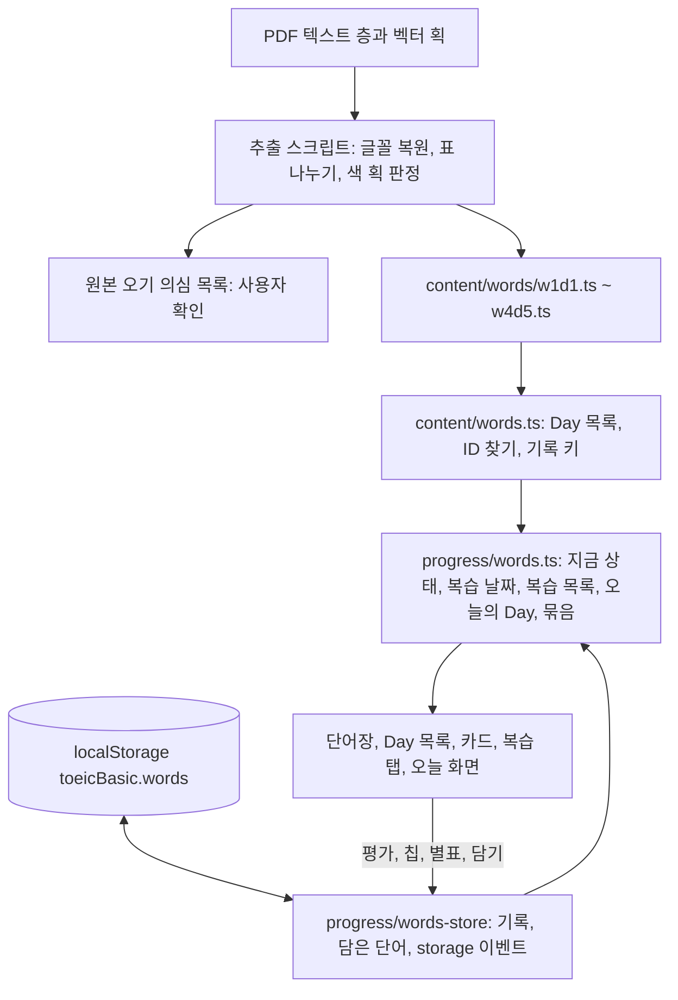
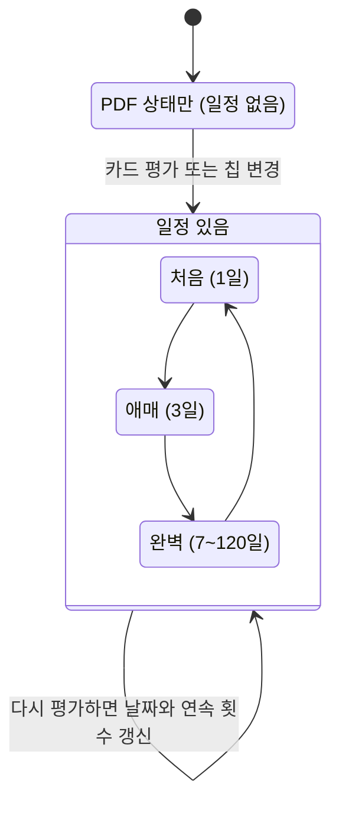
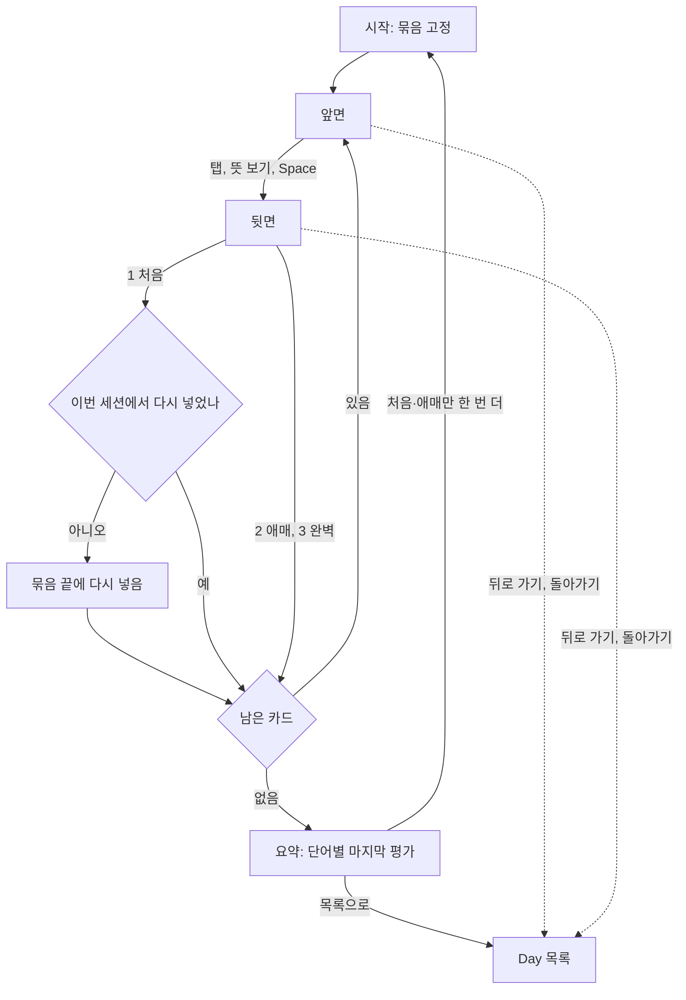
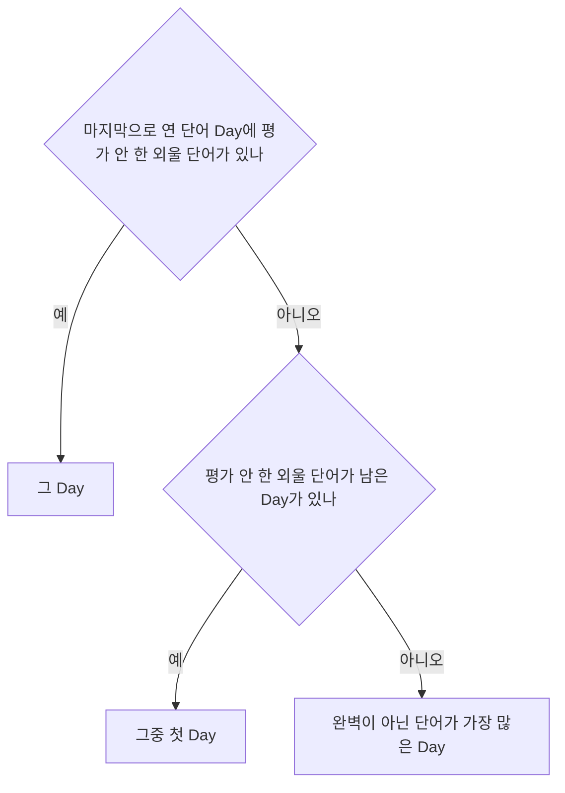

# 토익 학습앱 단어장 2차 - Plan

## Goal Capsule

- **Objective:** 학습자가 PDF 단어장의 1,000단어를 앱 안에서 보고, 듣고, 카드로 외운다. 덜 외운 단어는 잊을 때쯤 다시 나오고, PDF에 칠해 둔 학습 상태와 중요 표시는 그대로 이어진다. 앱 전체를 어두운 화면으로도 볼 수 있다.
- **Means:** PDF 텍스트 층에서 단어를 한 번 추출해 콘텐츠 모듈로 넣는다 (KTD1). 단어 기록은 문제집 기록과 다른 저장 키에 둔다 (KTD4). 화면은 설계 시안의 단어장·목록·카드·복습을 지금 앱 셸 위에 짓는다.
- **Authority:** 제품 동작은 Requirements(R)가, 구현 방식은 Key Technical Decisions(KTD)가 정한다. 설계 시안은 배치와 시각의 기준이다. 시안의 숫자(218·563·168·54, 1,003단어, 781)는 옛 판정값이므로 R과 이 계획의 값을 따른다.
- **Stop conditions:** 다음 중 하나가 생기면 멈추고 보고한다.
  - 기존 문제집 기록(답, 첫 점수, 채점 방식, 틀린 횟수, 깃발)이 바뀌거나 사라진다.
  - 추출 결과가 1,006줄 · 고유 1,000단어 · Day별 줄 수(U1)와 맞지 않는다.
  - 문항 데이터(`src/lib/content/days/`)를 고쳐야 한다.
  - 새 npm 의존성이 필요하다.
  - 한 번 배포한 단어 ID 체계(KTD2)를 바꿔야 한다.
- **Execution profile:** git 저장소다. `main`에 푸시하면 GitHub Pages에 배포되므로 기능 브랜치에서 작업한다 (KTD16). 사용자 전역 규칙에 따라 파일을 고치기 전에 목록을 보여 주고 승인을 받는다. 모든 실행은 로컬에서 하고, claude.ai 웹에서 보이는 기능은 쓰지 않는다.
- **Finish:** 구현, 로컬 검증, 코드 리뷰까지가 이 계획이다. `main` 병합과 푸시(배포)는 사용자 확인을 받은 뒤 한다.

---

## Product Contract

### Summary

PDF 단어장의 1,000단어를 앱의 단어장으로 옮긴다. 단어장 탭, Day 단어 목록, 카드, 단어 복습, 오늘 화면의 단어 카드를 더하고, PDF의 상태 색·파란 형광펜·회색 핵심 뜻을 가져온다. 간격 반복 일정, 앱 전체 다크 모드, 문제 해설 어휘 담기도 함께 넣는다.

### Problem Frame

단어 공부는 지금 PDF(`D:\Eng\2026 단어장 2.pdf`, 21쪽, iOS에서 만든 표)로만 한다. 번호 동그라미에 칠한 색으로 외운 정도를 표시하지만, 다시 칠하기 어렵고 덜 외운 단어만 골라 볼 수도 없다. 발음도 들을 수 없다.

1차 계획은 PDF 판독과 번역 검수가 길다는 이유로 단어장을 2차로 미뤘다 (`docs/plans/2026-10-21-2317-feat-ui-redesign-phase1-plan.md`). 판독 방법과 화면 시안은 `docs/design/2026-10-21-ui-ux-review.md` §6에 있다. 그때는 한글 뜻과 발음기호를 이미지로 읽어야 한다고 봤다. 이번 조사에서 텍스트 층의 깨진 글자를 Windows 시스템 글꼴로 정확히 복원할 수 있음을 확인했다. 판독 오류 위험이 줄었으므로 데이터 작업을 화면 작업과 한 계획으로 묶는다.

### Requirements

**단어 데이터**

- R1. 단어장은 PDF의 단어만 담는다: 20 Day(Week 1–4 × Day 1–5), 1,006줄, 고유 1,000단어. 각 단어는 PDF 번호, 영어, 발음기호, 품사별 뜻(용법 괄호 포함)을 PDF 그대로 가진다. 원본 오기로 의심되는 것은 고치지 않고 목록으로 사용자에게 보인다.
- R2. 한 Day 끝의 두 단어가 다음 Day 끝에 다시 나오는 3쌍(take off · temporary, value · voucher, troubleshooting · urban)은 두 Day 목록에 모두 보이되 같은 단어로 다룬다. 상태, 별표, 복습 일정을 함께 쓴다. 전체 수는 고유 단어로, Day의 단어 수는 그 Day의 줄 수로 센다.
- R3. 단어 상태는 안 봄 · 처음 · 애매 · 완벽 네 가지다. 앱 기록이 없는 단어는 PDF 번호 동그라미 색을 상태로 쓴다. 동그라미가 없으면 안 봄이고, 중복 단어는 뒤 Day의 색을 쓴다. 앱에서 바꾼 상태가 PDF 색보다 우선한다.
- R4. 별표(중요 표시)는 PDF의 파란 형광펜 8단어에서 가져오고, 목록과 카드에서 켜고 끈다. 앱에서 끈 별표는 다시 켜지지 않는다.
- R5. 회색 형광펜이 칠해진 뜻 15곳은 목록과 카드에서 핵심 뜻으로 강조한다. 단어 칸의 회색 형광펜, 여백의 점, 빨간 낙서는 무시한다.

**단어장 화면**

- R6. 탭은 오늘 · 문제집 · 단어장 · 복습 순서다. 단어장 화면은 다음을 보여 준다:
  - 전체 상태 막대와 상태별 개수
  - Week별로 접는 Day 목록. Day마다 단어 수, 외울 단어 수, 상태 막대를 보인다.
  - 담은 단어 묶음
- R7. Day 단어 목록은 PDF 순서로 보인다.
  - 보기 방식은 다 보기 / 뜻 가리기 / 단어 가리기다. 가린 줄은 눌러서 하나씩 확인하고, 방식을 바꾸면 다시 가려진다.
  - 상태 칩을 누르면 안 봄 → 처음 → 애매 → 완벽 → 처음 순서로 바뀐다.
  - 상태나 별표로 거르고, 줄마다 발음을 듣는다.
  - 휴대폰에서는 하단 탭 대신 '카드로 외우기' 버튼이 화면 아래에 고정된다.
- R8. 카드 세션:
  - 앞면(영어·발음기호)을 뒤집으면 뒷면(품사별 뜻)이 나온다. 뒷면에서 처음 / 애매 / 완벽을 고른다.
  - 방향(영어 → 뜻 / 뜻 → 영어)을 바꿀 수 있고, 고른 방향은 다음 세션에도 남는다.
  - '처음'을 고른 카드는 세션 끝에 한 번 더 나온다.
  - 끝나면 처음·애매·완벽 수를 보여 주고 '처음·애매만 한 번 더'와 '목록으로'를 제공한다.
- R9. Day 카드 묶음은 그 Day에서 완벽이 아닌 단어(안 봄 포함)다. 외울 단어가 없으면 시작 버튼이 꺼지고 그 이유를 글로 보인다.
- R10. 카드는 키보드로도 쓴다: Space로 뒤집고, 뒤집은 뒤 1 · 2 · 3으로 처음 · 애매 · 완벽을 고른다. 휴대폰의 뒤로 가기는 카드를 닫고 단어 목록으로 돌아간다. 이미 고른 평가는 남는다.

**간격 반복과 복습**

- R11. 카드에서 평가하거나 목록에서 상태를 바꾸면 그날을 기준으로 다음 복습 날짜가 정해진다 (간격은 KTD6). PDF 상태만 있는 단어는 앱에서 처음 평가하기 전까지 복습 대상이 아니다.
- R12. 복습 탭은 '틀린 문제'와 '단어' 두 탭을 둔다. 단어 탭은 복습 날짜가 된 단어를 오래 기다린 것부터 보여 주고, 카드로 20개씩 복습한다.
- R13. 오늘 화면:
  - '오늘의 단어' 카드: 공부할 Day(KTD8), 상태 막대, '카드로 외우기'와 '목록'
  - 복습 카드: 틀린 문제 수와 복습할 단어 수를 함께 보인다.
  - 전체 진도: 단어장 완벽 수를 더한다.

**해설 어휘 담기**

- R14. 문제 해설과 세트 해석의 어휘 칩에서 '담기'로 어휘를 담는다. 담은 어휘는 PDF 단어와 섞이지 않는 '담은 단어' 묶음에 모이고, 상태·별표·카드·복습 규칙이 PDF 단어와 같다. 영어가 같은 어휘는 하나로 합치고 뜻은 모아 보인다.
- R15. 아직 평가하지 않은 담은 단어는 칩을 다시 눌러 뺄 수 있다. 평가한 담은 단어는 담은 단어 목록에서만 뺀다. PDF에도 있는 어휘에는 그 Week · Day를 알려 주고, 상태·별표·복습 일정은 그 PDF 단어와 함께 쓴다. 담은 단어 묶음에는 따로 보인다.

**다크 모드**

- R16. 설정에서 화면 테마(시스템 · 밝게 · 어둡게)를 고른다. 기본은 시스템 설정을 따른다. 고른 테마로 첫 화면부터 그려지고, 밝게 깜빡이지 않는다. 모든 화면의 글자 대비는 WCAG AA를 지키고, 상태는 색만으로 구분하지 않는다(글자와 아이콘을 함께 쓴다).

**기록과 오프라인**

- R17. 단어 기록(상태, 별표, 복습 날짜), 담은 단어, 테마는 기록 내보내기·가져오기에 들어간다. 단어 기록이 없는 예전 백업을 가져오면 지금 단어 기록은 그대로 남는다. 단어장 기능은 기존 문제집 기록과 첫 점수를 바꾸지 않는다. 가져오기는 지금처럼 문제집 기록을 파일 내용으로 바꾼다.
- R18. 오프라인에서도 단어장의 모든 화면이 열린다. 발음이 나오지 않으면 그렇다고 알려 준다.

### Key Decisions

- **단어 데이터는 PDF의 1,000단어만 쓰고 공개 사이트에 함께 배포한다.** 출제 기관(ETS)과 시행처(YBM)에는 무료 공식 목록이 없고, 직접 칠한 상태와 형광펜을 이어받아야 한다. Governs R1. (session-settled: user-directed — chosen over 공개 라이선스 목록(TSL 1.2)이나 데이터를 기기에만 넣는 방식: 개인 비영리 사용이고 PDF의 학습 표시를 이어받기 위해)
- **파란 형광펜은 별표다.** Governs R4. (session-settled: user-directed — chosen over 무시: 사용자가 중요 표시라고 확인)
- **회색 형광펜은 뜻 칸만 핵심 뜻으로 살리고 단어 칸은 무시한다. 여백의 점과 빨간 낙서도 무시한다.** Governs R4, R5. (session-settled: user-directed — chosen over 회색 단어도 별표, 회색 뜻 무시: 사용자가 표시별 의미를 답함)
- **중복 단어는 두 Day에 모두 보이고 기록은 하나다.** Governs R2, R3. (session-settled: user-approved — chosen over 앞 Day에만 두기, Day마다 따로 기록: 같은 단어가 복습에 두 번 나오지 않게)
- **PDF에도 있는 담은 단어는 그 PDF 단어와 기록을 함께 쓴다.** Governs R14, R15. (session-settled: user-approved — chosen over 담은 단어 기록을 따로 두기: 같은 단어가 복습에 두 번 나오지 않게, 해설 어휘 156개가 PDF 단어와 같음)
- **PDF 색은 기록이 없을 때만 첫 상태로 쓴다.** Governs R3. (see origin: `docs/design/2026-10-21-ui-ux-review.md` §6.4)
- **간격 반복, 다크 모드, 해설 어휘 담기를 이번 2차에 넣는다.** Governs R11–R16. (session-settled: user-directed — chosen over 시안 범위만 구현: 사용자가 세 기능을 모두 골랐음)
- **PDF 상태만 있는 단어는 앱에서 평가한 뒤에 복습 일정에 들어간다.** Governs R11, R12. (session-settled: user-approved — chosen over 처음부터 모두 복습 대상: 첫날 약 850개가 복습에 쌓여 숫자가 오래 줄지 않음)

### Acceptance Examples

- AE1. 처음 평가가 일정을 연다.
  - **Covers:** R3, R11, R12
  - **Given:** 앱 기록이 없는 Week 1 · Day 1의 beforehand가 PDF에서 애매다.
  - **When:** 단어장과 복습 탭을 연다. 그다음 카드에서 처음을 고른다.
  - **Then:** 처음에는 애매로 보이고 복습할 단어 수에 들어가지 않는다. 처음을 고른 다음 날 복습 탭 단어 목록에 나온다.
- AE2. 중복 단어는 하나로 움직인다.
  - **Covers:** R2, R3
  - **Given:** temporary가 Week 3 · Day 2와 Week 3 · Day 3에 있고, 앱 기록이 없다.
  - **When:** 두 Day를 연 뒤 Day 2 목록에서 temporary의 상태 칩을 한 번 누른다.
  - **Then:** 처음에는 두 Day 모두 Day 3 동그라미의 상태인 완벽이다 (Day 2 동그라미는 애매). 누른 뒤에는 두 Day 모두 처음이고, 전체 완벽 수는 1만 줄고 처음 수는 1만 는다.
- AE3. 끈 별표는 다시 켜지지 않는다.
  - **Covers:** R4
  - **Given:** desirable이 PDF 파란 형광펜으로 별표다.
  - **When:** 별표를 끄고 새로고침한다.
  - **Then:** 별표가 꺼진 채다.
- AE4. '처음'은 세션 끝에 한 번만 다시 나온다.
  - **Covers:** R8, R9
  - **Given:** 외울 단어가 3개(A, B, C)인 Day의 카드 세션이다.
  - **When:** A에 처음, B에 애매, C에 완벽을 고르고, 다시 나온 A에 또 처음을 고른다.
  - **Then:** A는 더 나오지 않고 요약이 나온다. 요약은 처음 1 · 애매 1 · 완벽 1이고, '한 번 더'는 A와 B로 시작한다.
- AE5. 예전 백업은 단어 기록을 지우지 않는다.
  - **Covers:** R17
  - **Given:** 단어 기록과 담은 단어가 있다.
  - **When:** 2차 전에 내보낸 기록 파일을 가져온다.
  - **Then:** 문제집 기록은 파일대로 바뀌고, 단어 기록, 담은 단어, 테마는 그대로다.
- AE6. 어두운 테마는 첫 그림부터 어둡다.
  - **Covers:** R16
  - **Given:** 설정에서 '어둡게'를 골랐다.
  - **When:** 아무 주소나 새로고침한다.
  - **Then:** 첫 그림부터 어두운 배경이고, 브라우저 상단 색도 어둡다.
- AE7. 같은 어휘는 어디서 담아도 하나다.
  - **Covers:** R14, R15
  - **Given:** 서로 다른 두 문제의 해설에 delay 칩이 있다.
  - **When:** 첫 문제에서 delay를 담는다.
  - **Then:** 담은 단어는 1개다. 두 번째 문제의 delay 칩도 담김으로 보인다. delay는 PDF에도 있으므로 그 Week · Day가 함께 보인다. 담은 delay를 완벽으로 바꾸면 PDF Day 목록의 delay도 완벽이고, 복습 목록에는 delay가 한 번만 나온다.

### Success Criteria

- 사용자가 원본 오기 의심 목록을 보고 데이터를 확정한다. 확정 전에는 `main`에 병합하지 않는다 (배포 전 확인).
- 첫 화면이 지금처럼 3초 안에 뜬다. 단어 데이터 때문에 첫 로드 JS가 gzip 기준 60KB 넘게 늘지 않는다 (KTD17).

### Scope Boundaries

- PDF에 없는 예문, PDF 밖의 단어 목록
- 단어 직접 입력·편집 (해설 어휘 담기는 예외)
- 기기 사이 기록 동기화
- 문항 콘텐츠(`src/lib/content/days/`) 변경
- 여러 Day의 별표 단어를 모아 보는 화면. 별표 거르기는 Day 목록 안에서만 한다.
- 카드 평가 되돌리기, 카드 순서 섞기, 단어 기록 초기화
- 설치한 앱의 시작 화면(매니페스트 배경색) 어둡게 하기. 매니페스트는 테마별로 바꿀 수 없다.
- 시안의 '키보드로 공부하기' 카드, 앱 이름을 '토익 학습'으로 바꾸기
- 검토했지만 만들지 않는 것:
  - 한 단어 발음에 기기 내장 음성을 우선 고르기. 실패하면 알려 주는 것(R18)으로 충분하다고 본다. 오프라인에서 발음이 자주 안 나온다는 보고가 있으면 다시 본다.
  - 문제집 기록(`toeicBasic.v2`)의 여러 탭 동시 저장 보호. 1차부터 있던 동작이고 단어 기록은 KTD4로 분리된다.

#### Deferred to Follow-Up Work

- 실제 기기(안드로이드·iOS)에서 단어 발음과 다크 모드 확인

### Sources

- `docs/design/2026-10-21-ui-ux-review.md` §6 (PDF 구조, 색 표시, 화면 시안), §7 (질문)
- 시안: `docs/design/2026-10-21-ui-ux-canvas/` — `Wordbook.dc.html`, `WordList.dc.html`, `CardFront.dc.html`, `CardBack.dc.html`, `Review.dc.html`, `Main.dc.html`, `DesktopToday.dc.html`
- 1차 계획: `docs/plans/2026-10-21-2317-feat-ui-redesign-phase1-plan.md` (R1 단어장 탭 숨김, KTD3 너그러운 필드, KTD5 복습 목록, KTD15 이어서 할 Day)
- TOEIC Service List 1.2 (CC BY-SA 4.0, newgeneralservicelist.com): 검토 후 쓰지 않음

---

## Planning Contract

### Key Technical Decisions

- KTD1. **단어 데이터는 PDF 텍스트 층에서 한 번 추출해 TS 콘텐츠 모듈로 넣는다.** 한글 뜻과 발음기호는 글리프 ID로만 들어 있지만, 임베디드 글꼴의 글리프가 Windows 글꼴(`malgun.ttf`, `malgunbd.ttf`, `l_10646.ttf`, `calibri.ttf`, `arial.ttf`, `msgothic.ttc`)과 바이트 단위로 같다. 그래서 시스템 글꼴의 cmap을 거꾸로 읽으면 정확히 복원된다 (표의 1,012줄 = 번호 있는 1,006줄 + 이어진 줄 6줄, 복원 못 한 글자 0). 이미지 판독은 표본 확인에만 쓴다. 추출에는 이 PC의 Python과 pdfplumber·pypdfium2·numpy를 쓰고, 스크립트는 1차 DoD처럼 프로젝트 밖에 둔다. 추출 규칙:
  1. 글꼴 이름이 `.SFUI`, `AppleSDGothicNeo`, `AppleSymbols`인 글자(iOS 손글씨 인식으로 숨은 글자)를 버린다.
  2. 표의 세로선을 쪽마다 읽어 열을 나눈다. 아래 테두리가 없는 3쪽은 마지막 줄을 따로 처리한다.
  3. 번호 없는 이어진 줄은 앞 단어의 품사 묶음으로 붙인다.
  4. 뜻 안의 `(명)`·`(타)` 같은 품사 표시로 품사 묶음을 나누고, 괄호 밖의 `, `로 뜻을 나눈다.
  5. 상태는 번호 칸의 작은 색 획(굵기 10.65, 너비 30pt 미만)으로 정한다. 16·36번 줄의 노란 띠와 2쪽 위 범례는 뺀다.
  6. 별표는 파란 획(#B8DEFF), 핵심 뜻은 뜻 칸 위의 회색 획(#C6C6C6)으로 정한다. 회색 획은 겹치는 뜻 하나에 붙인다.
  7. 1쪽은 2쪽의 표시 없는 사본이므로 건너뛴다.
- KTD2. **단어 ID는 `w{주}d{일}-{PDF 번호 두 자리}`다** (예: `w1d1-05`). ID는 기록의 키라서 배포한 뒤에는 바꾸지 않는다. 번호는 PDF가 보이는 그대로 쓴다. 3주 3일(14쪽)은 원본이 49번을 건너뛰므로 그 Day에는 `-49`가 없다. 중복 단어의 뒤 줄은 자기 ID와 함께 앞 줄 ID를 `same`으로 가진다. 기록 키는 `same`이 있으면 그것, 없으면 자기 ID다. 뒤 Day의 동그라미 색을 두 줄 모두의 첫 상태로 쓴다 (R3).
- KTD3. **단어 콘텐츠 형식:** Day 파일마다 단어 배열을 `satisfies`로 검사한다.
  - 필드: `id`, `no`, `word`, `ipa`, 품사 묶음 배열, `initial`(안 봄·처음·애매·완벽), 선택 항목 `star`, `same`
  - 품사 묶음은 품사와 뜻 목록이고, 뜻은 글자와 선택 항목 `key`(핵심 뜻)를 가진다.
  - 품사는 명·형·부·자·타·동·전 일곱 가지다. 전치사 `전`이 PDF에 3번 있다.
  - 스키마는 `z.strictObject`를 쓰고, 런타임에는 검사하지 않고 단위 테스트에서만 검사한다. 문항 콘텐츠와 같은 방식이다.
  - 발음기호의 그리스·키릴 문자(Λ, ӕ 등)는 원본 그대로 둔다.
- KTD4. **단어 기록은 별도 localStorage 키 `toeicBasic.words`에 둔다.** 그 안에 버전 번호, 단어별 기록, 담은 단어, 마지막으로 연 단어 Day, 카드 방향을 둔다. 이유는 셋이다.
  - 문제집 기록 형식이 그대로라서 v2 검사가 실패해 v1 경로로 떨어질 위험(1차 KTD3)이 없다.
  - 예전 코드의 탭이 `toeicBasic.v2`를 저장해도 모르는 필드를 지우는 방식(`z.object`)에 단어 기록이 걸리지 않는다.
  - 다른 탭이 이 키를 바꾸면 `storage` 이벤트로 받아 메모리의 단어 기록을 다시 읽는다. 그래서 두 탭에서 카드를 풀어도 서로 지우지 않는다.

  테마는 `settings.theme`에 너그러운 선택 필드(1차의 `addedField`)로 둔다. 예전 탭이 지우면 '시스템'으로 돌아갈 뿐이다.

- KTD5. **단어별 기록은 손댄 단어만 저장한다.** 필드는 상태, 마지막 평가 날짜(현지 `YYYY-MM-DD`), 연속 완벽 횟수, 별표(켬·끔·없음)다. 별표가 없으면 PDF 값을 쓴다. 화면의 상태는 `기록 ?? PDF 첫 상태`로 읽을 때 계산하고, PDF 값을 기록에 미리 써 넣지 않는다. 잘못된 항목 하나는 그 항목만 버린다.
- KTD6. **간격 반복은 상태별 고정 간격이다.** 처음 1일, 애매 3일, 완벽은 연속 횟수에 따라 7 · 14 · 30 · 60 · 120일(120일에서 멈춤)이다. 복습 날짜는 마지막 평가 날짜에 간격을 더한 날이다. 오늘이 그날 이후면 복습 대상이다. SM-2 같은 점수형 알고리즘은 쓰지 않는다. 평가가 세 단계뿐이라 이점이 작고, 고정 간격이면 다음 복습 날짜를 학습자가 예상할 수 있다. 계산 규칙:
  - 날짜는 현지 날짜 문자열로 다룬다. 23:59에 평가한 단어가 1분 뒤에 대상이 되지 않게 24시간 단위로 계산하지 않는다.
  - 카드 평가는 상태와 평가 날짜를 쓴다. 완벽이면 앞 상태가 완벽일 때 연속 횟수 +1, 아니면 1이다. 처음·애매면 0이다.
  - 목록 상태 칩도 평가로 친다 (R11). 칩으로 완벽이 되면 연속 횟수는 1이다.
  - 한 세션에서 같은 단어를 두 번 평가하면 마지막 평가가 남는다.
  - '오늘'은 주입받는다. 앱이 다시 보이거나(`visibilitychange`) 포커스를 받으면 다시 계산한다.
- KTD7. **복습할 단어 목록은 순수 함수 하나가 만들고, 오늘 화면과 복습 탭이 같이 쓴다.** 1차 KTD5의 `reviewList`와 같은 방식이다. 목록은 복습 날짜가 지난 단어(PDF 단어와 담은 단어)이고, 복습 날짜가 이른 순, 같으면 PDF 순서다. 중복 단어는 기록 키로 한 번만 넣는다. 복습 세션은 시작할 때 앞의 20개를 고정한다.
- KTD8. **오늘의 단어 Day는 순수 함수로 고른다.**
  1. 마지막으로 연 단어 Day에 아직 평가하지 않은 외울 단어가 남아 있으면 그 Day
  2. 아니면 그런 단어가 남은 첫 Day
  3. 그런 단어가 어디에도 없으면 완벽이 아닌 단어가 가장 많은 Day
     '아직 평가하지 않은 외울 단어'는 Day 카드 묶음(R9, 지금 상태가 완벽이 아닌 단어) 가운데 앱 기록에 평가 날짜가 없는 단어다. PDF에서 완벽인 단어는 카드에 나오지 않으므로 세지 않는다. 그래서 카드 묶음을 한 번 다 평가하면 다음 Day로 넘어간다. 단어장 화면은 이 Day가 든 Week를 펼친 채 연다 (1차 `/days`와 같다).
- KTD9. **주소와 화면 상태:**
  - 주소는 `/words`(단어장), `/words/[day]`(Day 목록, `w1d1`…`w4d5`, `entries`로 미리 렌더), `/words/saved`(담은 단어)다.
  - 카드는 연 화면 주소 안의 화면 상태다. SvelteKit 얕은 라우팅(`goto`의 `shallow`·`state` 옵션, 설치된 Kit 3.1에서 `pushState`는 폐기 예정)으로 히스토리 항목을 하나 더해 연다. 그래서 뒤로 가기는 카드를 닫고 카드를 연 화면으로 돌아간다. 새로고침하면 그 화면이 카드 없이 열린다.
  - 카드를 닫거나 끝낸 뒤 돌아가는 곳은 연 화면이다: Day 목록에서 열면 그 목록, 복습 탭에서 열면 `/review?tab=words`, 담은 단어 화면에서 열면 `/words/saved`. 머리의 돌아가기와 요약의 버튼 이름도 그 화면 이름을 쓴다 ('목록으로', '복습으로', '담은 단어로').
  - 오늘 화면의 '카드로 외우기'는 그 Day 목록으로 이동한 뒤 카드 상태를 얕게 한 번 더 넣는다. 그래서 뒤로 가기는 Day 목록에 먼저 닿는다.
  - 휴대폰에서 단어 목록과 카드를 보는 동안 하단 탭을 숨긴다. AppNav의 `studying` 조건을 넓히고, 돌아가기 링크는 고정 주소를 쓴다 (1차 KTD9).
  - 복습 탭의 '틀린 문제 / 단어'는 WAI-ARIA 탭 패턴이고, 고른 탭은 `?tab=words`로 주소에 남는다. 기본은 항목이 있는 첫 탭이고, 둘 다 있으면 틀린 문제다.
- KTD10. **카드 세션 규칙은 순수 모듈로 만든다.**
  - 시작할 때 묶음을 고정한다. Day 묶음은 PDF 순서, 복습 묶음은 KTD7 순서다.
  - '처음'을 고른 단어는 세션에서 한 번만 끝에 다시 넣는다. 그만큼 전체 수가 는다 ("9 / 43").
  - 요약은 단어마다 마지막 평가로 센다. '한 번 더'는 이번 세션에서 마지막 평가가 처음·애매인 단어로 시작한다.
  - 평가는 바로 저장하고, 세션 진행 위치는 저장하지 않는다 (1차 U9와 같다).
  - 뜻 → 영어 방향에서는 앞면에 뜻을, 뒷면에 영어와 발음기호를 보인다. 앞면의 발음 버튼은 숨긴다.
- KTD11. **카드 키는 `keyAction`에 `card` 페이지 종류를 더해 다룬다.**
  - Space는 앞면이고 버튼에 포커스가 없을 때만 뒤집는다. 앞면 카드 자체가 버튼이므로, 그 버튼에 포커스가 있으면 브라우저 기본 동작으로 한 번만 뒤집힌다.
  - 1·2·3은 뒷면에서만, 포커스와 상관없이 평가한다. 4는 무시한다.
  - 뒤집은 뒤에는 포커스를 버튼이 아닌 뒷면 영역(`tabindex="-1"`)으로 옮긴다. 그래야 Space가 평가 버튼을 누르지 않는다. 평가한 뒤에는 새 앞면 버튼으로 옮긴다.
  - "8 / 42" 진행 표시는 따로 `role="status"` 줄에 둔다. 카드 전체를 알림 영역으로 두지 않는다.
- KTD12. **다크 모드는 `<html data-theme>`와 토큰으로 만든다.**
  - `layout.css`에 `@custom-variant dark`를 `[data-theme=dark]`에 묶는다. 지금은 shadcn `ui/button`·`ui/toggle`의 `dark:` 클래스가 OS 설정만 따르는데, 이것도 함께 고쳐진다.
  - `[data-theme=dark]` 토큰 묶음을 더하고, `color-scheme`도 테마를 따른다.
  - `app.html`의 작은 인라인 스크립트가 `toeicBasic.v2`의 `settings.theme`와 `matchMedia`로 첫 그림 전에 `data-theme`를 건다. 같은 스크립트가 기존 `theme-color` 메타의 `content`도 테마 색으로 바꾼다. 저장소를 막았거나 JSON이 깨졌으면 시스템 설정을 쓴다.
  - `+layout.svelte`는 새 메타를 더하지 않고 같은 `theme-color` 메타의 `content`만 고친다. 문서에서 앞선 메타가 쓰이므로 메타가 둘이 되면 안 된다. '시스템'일 때는 OS 변경을 따른다(`MediaQuery`).
  - `QuestionMapSheet.svelte`의 `text-white`는 토큰으로 바꾼다.
- KTD13. **단어 상태 색은 PDF 범례에서 온 토큰이다.** 안 봄·처음·애매·완벽마다 막대색, 칩 바탕, 칩 글자 토큰을 밝게·어둡게 둘 다 둔다. 글자 대비는 4.5:1 이상이다. 상태마다 아이콘과 글자를 함께 쓴다. 강조색 파랑은 그대로다 (1차 KD: '처음' 초록과 겹치지 않게).
- KTD14. **해설 어휘 담기:**
  - `VocabChips`를 `aria-pressed` 토글 버튼으로 바꾸고, 문항 ID(세트는 첫 문항 ID)를 출처로 넘긴다.
  - 담은 단어의 키는 정규화한 영어(소문자, 공백 하나, 앞뒤 공백 제거)다. 처음 담은 표기를 보이고, 다른 뜻은 담은 순서로 모은다.
  - 기록 키: 정규화한 영어가 PDF 단어의 영어와 같으면 그 PDF 단어의 기록 키(KTD2)를 쓴다. 아니면 `saved:` + 정규화한 영어다. 담은 단어 내용(표기, 뜻, 출처)은 PDF 단어와 별도로 저장한다.
  - 평가 여부와 빼기 규칙(R15)은 함께 쓰는 기록으로 판정한다. 이미 평가한 PDF 단어를 담으면 처음부터 평가한 담은 단어로 다룬다.
  - 담은 단어의 첫 상태는 안 봄이다.
  - 같은 정규화 영어가 PDF에 있으면 그 Week · Day를 보인다.
  - 칩은 지금처럼 정답이 공개된 뒤에만 보이므로 시험 모드의 규칙(1차 R10)이 그대로 지켜진다.
  - 발음할 때 `~`와 `A … B` 같은 자리 표시는 뺀다.
- KTD15. **발음은 기존 음성 모듈에 재생 실패 상태 하나를 더해 쓴다.** 지금 `speech.play()`는 결과를 돌려주지 않고 `onerror`에서 조용히 멈추므로, 실패를 알리려면 `onerror`에서 켜지고 다음 재생에서 꺼지는 `$state` 값이 필요하다. 한 단어를 한 줄로 재생한다. 음성이 없거나 재생이 실패하면 `role="status"`로 짧게 알린다. 화면이나 카드가 바뀌면 `speech.stop()`을 부른다.
- KTD16. **작업은 기능 브랜치에서 하고, `main` 병합은 사용자 확인 뒤에 한다.** `main`에 푸시하면 Pages 배포 워크플로가 돈다. CI는 테스트를 돌리지 않으므로 로컬 검증이 유일한 관문이다.
- KTD17. **단어 데이터는 처음에는 한 덩어리로 바로 불러온다.** 오늘 화면이 전체 개수를 필요로 하고, 서비스 워커가 모든 청크를 미리 캐시하므로 나눠도 오프라인 이득이 없다. gzip 증가가 60KB를 넘으면 단어 데이터만 동적 import로 나누고, 오늘 화면의 단어 카드는 불러온 뒤에 그린다.

### High-Level Technical Design

단어 데이터와 기록의 흐름. 추출은 한 번만 하고, 앱은 콘텐츠와 기록을 읽을 때 합친다.



단어 상태와 일정. 안 봄 단어와 PDF 상태만 있는 단어는 일정이 없다. 첫 평가부터 일정이 생긴다 (R11). 일정이 생긴 뒤 복습 날짜는 마지막 평가 날짜에 간격을 더한 날이다 (KTD6).



카드 세션 흐름 (KTD10, KTD11).



오늘의 단어 Day 고르기 (KTD8).



기록 가져오기 규칙 (R17, KTD4).

| 가져온 파일에 있는 것                    | 문제집 기록       | 단어 기록·담은 단어 | 테마         |
| ---------------------------------------- | ----------------- | ------------------- | ------------ |
| 2차 이후 파일 (모두 있음)                | 파일대로          | 파일대로            | 파일대로     |
| 2차 전 파일 (`words` 없음, `theme` 없음) | 파일대로          | 지금 것 유지        | 지금 것 유지 |
| 원본 앱 v1 파일                          | 1차 변환 규칙대로 | 지금 것 유지        | 지금 것 유지 |

### Output Structure

새로 생기는 주요 파일. 각 단위의 Files가 기준이다.

```text
src/lib/content/
  word-schema.ts
  words.ts
  words.test.ts
  words/w1d1.ts … w4d5.ts
src/lib/progress/
  words.ts
  words.test.ts
  words-store.svelte.ts
  words-store.test.ts
src/lib/components/words/
  WordbookView.svelte, WeekSection.svelte, StatusBar.svelte, StatusChip.svelte
  WordList.svelte, WordRow.svelte, WordListFilters.svelte
  CardSession.svelte, WordCard.svelte, CardSummary.svelte
  card-session.ts, card-session.test.ts
  status-labels.ts
src/lib/components/home/WordSummary.svelte
src/lib/components/review/WordReviewList.svelte
src/routes/words/+page.svelte
src/routes/words/[day]/+page.svelte, +page.ts
src/routes/words/saved/+page.svelte
e2e/words.e2e.ts, e2e/cards.e2e.ts, e2e/theme.e2e.ts, e2e/vocab.e2e.ts
```

### Sequencing

1. U1 데이터를 먼저 만들고 사용자가 의심 목록을 확인한다. ID와 개수가 테스트로 고정된다.
2. U2·U3 기록 규칙과 저장을 화면보다 먼저 테스트로 고정한다.
3. U4 다크 모드와 상태 토큰을 화면 단위 전에 넣는다. 새 화면이 처음부터 토큰을 쓰게 하기 위해서다.
4. U5 → U6 → U7 → U8 순서로 화면을 짓고, U9 담기, U10 정리 순서로 간다.

---

## Implementation Units

| U-ID | 제목                  | 주요 파일                                                                         | 선행       |
| ---- | --------------------- | --------------------------------------------------------------------------------- | ---------- |
| U1   | 단어 데이터와 검수    | `src/lib/content/word-schema.ts`, `words.ts`, `words/*.ts`                        | —          |
| U2   | 단어 상태와 일정 규칙 | `src/lib/progress/words.ts`                                                       | U1         |
| U3   | 단어 저장 키와 백업   | `src/lib/progress/words-store.svelte.ts`, `model.ts`, `store.svelte.ts`           | U2         |
| U4   | 다크 모드와 상태 토큰 | `src/routes/layout.css`, `src/app.html`, `+layout.svelte`, `SettingsSheet.svelte` | U3         |
| U5   | 단어장 탭과 화면      | `AppNav.svelte`, `src/routes/words/`, `components/words/WordbookView.svelte`      | U1, U3, U4 |
| U6   | Day 단어 목록         | `components/words/WordList.svelte`, `WordRow.svelte`                              | U5         |
| U7   | 카드 세션             | `components/words/CardSession.svelte`, `card-session.ts`, `src/lib/keyboard.ts`   | U6         |
| U8   | 단어 복습과 오늘 화면 | `src/routes/review/+page.svelte`, `components/review/`, `components/home/`        | U7         |
| U9   | 해설 어휘 담기        | `components/study/VocabChips.svelte`, `src/routes/words/saved/`                   | U6, U7     |
| U10  | 오프라인·문서·정리    | `e2e/offline.e2e.ts`, `README.md`, `docs/design/2026-10-21-ui-ux-review.md`       | U8, U9     |

### U1. Word data extraction and review

- **Goal:** PDF의 단어를 앱 데이터로 만들고, 사용자가 원본 오기 의심 목록을 확인한다.
- **Requirements:** R1, R2, R3, R4, R5 (KTD1, KTD2, KTD3)
- **Dependencies:** 없음
- **Files:**
  - `src/lib/content/word-schema.ts`, `src/lib/content/words.ts`, `src/lib/content/words.test.ts`
  - `src/lib/content/words/w1d1.ts` … `src/lib/content/words/w4d5.ts` (20개)
- **Approach:**
  1. 프로젝트 밖 임시 폴더에서 KTD1 규칙으로 추출한다. 조사 때 만든 분석 스크립트를 출발점으로 쓴다.
  2. Day 파일 20개를 만든다. 파일마다 `export default [...] satisfies WordDay` 형태다.
  3. `words.ts`에 Day 목록(Week·Day 이름 포함), Day별 단어, ID로 찾기, 기록 키 구하기를 둔다. 문항 콘텐츠처럼 `import.meta.glob` eager로 불러오고 결과를 메모해 둔다.
  4. 원본 오기 의심 목록을 만든다. 단어마다 뜻과 품사가 그 단어에 맞는지 다른 에이전트가 판정한다. 일치·원본 오기 의심 두 가지로 나누고, 의심 항목만 사용자에게 보인다. 기본값은 원본 그대로다 (R1).
  5. 사용자가 의심 목록을 확인하기 전에는 `main`에 병합하지 않는다. 오기를 고쳐도 ID는 바뀌지 않으므로 화면 단위는 기다리지 않고 진행한다.
- **Execution note:** 개수와 ID 규칙을 테스트로 먼저 고정한 뒤 데이터 파일을 넣는다.
- **Patterns to follow:** `src/lib/content/schema.ts`(`z.strictObject`), `src/lib/content/index.ts`(eager glob, 메모), `src/lib/content/content.test.ts`(`describe.each`, ID 순서 검사, 잘못된 필드 거부)
- **Test scenarios:**
  - 20개 Day가 Week 1–4 × Day 1–5 순서로 빠짐없이 있다.
  - 모든 Day 파일이 스키마를 통과하고, 일부러 넣은 잘못된 필드는 거부된다.
  - Day별 줄 수가 PDF와 같다: 50, 50, 50, 49, 51, 52, 49, 52, 50, 50, 50, 51, 50, 51, 51, 51, 50, 50, 50, 49. 모두 1,006줄이다.
  - ID가 PDF 번호 순서이고, Week 3 · Day 3에만 `-49`가 없다.
  - 기록 키 기준 고유 단어가 1,000개이고, `same`이 있는 줄은 정확히 6개다. 각 `same`은 앞 Day의 같은 단어를 가리킨다.
  - 중복 쌍의 두 줄은 영어, 발음기호, 뜻, 첫 상태가 같다.
  - 별표는 desirable, incidental, relevant, exemplary, intensive, prospective, speculation, suitable 8개다.
  - 핵심 뜻은 15개이고 Week 1 · Day 3과 Week 2 · Day 2에만 있다.
  - PDF 동그라미를 줄 기준으로 세면 처음 248 · 애매 608 · 완벽 148 · 안 봄 2다. 중복 쌍의 앞 줄은 뒤 줄의 색을 쓰므로, 데이터의 상태별 수는 추출 때 확정해 테스트에 적는다.
  - 모든 뜻의 괄호가 짝이 맞고, 빈 뜻이 없다.
  - p3 50번 versatile이 `[və́ːrsətl]`, `(형) 다재다능한, 다용도의, 다양한`으로 들어 있다.
  - 이어진 줄이 앞 단어의 품사 묶음으로 붙었다: Week 3 · Day 3의 account에 `(자) (비율을) 차지하다, 해명하다 (for)`가 있다.
- **Verification:**
  - 단위 테스트가 통과한다.
  - 이미지로 판독한 표본 4줄(14쪽 3·4·5번과 이어진 줄)이 데이터와 같다.
  - 사용자가 원본 오기 의심 목록을 확인했다.

### U2. Word status and schedule rules

- **Goal:** 단어의 지금 상태, 복습 날짜, 복습 목록, 오늘의 Day, 카드 묶음을 순수 함수로 정한다.
- **Requirements:** R2, R3, R4, R9, R11, R12, R13 (KTD5, KTD6, KTD7, KTD8)
- **Dependencies:** U1
- **Files:**
  - `src/lib/progress/words.ts`, `src/lib/progress/words.test.ts`
- **Approach:**
  1. 단어별 기록 형식과 스키마(KTD5)를 둔다. 담은 단어 형식(KTD14)도 여기 둔다.
  2. 함수: 지금 상태와 별표 읽기, 카드 평가 적용, 칩 상태 변경 적용, 복습 날짜 구하기, 복습 목록, 오늘의 Day, Day·담은 단어 묶음(완벽 아닌 단어), 상태별 개수.
  3. '오늘'과 단어 데이터는 인자로 받는다. 저장은 하지 않는다.
- **Execution note:** 규칙을 테스트로 먼저 쓴 뒤 구현한다.
- **Patterns to follow:** `src/lib/progress/review.ts`(`reviewList`가 개수의 유일한 출처), `src/lib/progress/attempt.ts`(`resumeDay`), 주입받는 `questionsOfDay`
- **Test scenarios:**
  - Covers AE1. 기록 없는 PDF 애매 단어는 애매로 읽히고 복습 목록에 없다.
  - Covers AE1. 그 단어를 카드에서 처음으로 평가하면 다음 날부터 복습 목록에 있고, 평가한 날에는 없다.
  - 애매 평가는 3일 뒤, 완벽 평가는 7일 뒤에 대상이 된다.
  - 완벽을 연달아 평가하면 간격이 7 · 14 · 30 · 60 · 120일로 늘고, 그 뒤로는 120일이다.
  - 완벽 연속 중에 애매를 평가하면 연속 횟수가 0이 되고 다음 완벽은 다시 7일이다.
  - 칩으로 완벽이 되면 연속 횟수는 1이고 7일 뒤에 대상이 된다.
  - 칩 순서는 안 봄 → 처음 → 애매 → 완벽 → 처음이다.
  - 23:59에 평가한 처음 단어는 다음 날 00:00부터 대상이다.
  - Covers AE2. 중복 단어의 두 줄은 같은 기록 키를 쓰고, 복습 목록에는 한 번만 나온다.
  - Covers AE3. PDF 별표 단어의 별표를 끄면 읽을 때 꺼져 있고, 기록이 없으면 PDF 값을 쓴다.
  - 복습 목록은 복습 날짜가 이른 순이고, 같으면 PDF 순서다. 담은 단어도 들어간다.
  - Day 묶음은 완벽을 뺀 단어이고 안 봄을 포함한다. 모두 완벽이면 비어 있다.
  - 오늘의 Day: 마지막으로 연 Day에 평가 안 한 외울 단어가 있으면 그 Day다.
  - 오늘의 Day: 마지막으로 연 Day의 카드 묶음을 다 평가했으면 평가 안 한 외울 단어가 남은 첫 Day다.
  - 오늘의 Day: 실제 데이터의 Week 1 · Day 1에서 카드 묶음(완벽이 아닌 단어)만 모두 평가하면, PDF 완벽 단어가 평가 없이 남아 있어도 오늘의 Day가 Week 1 · Day 2다.
  - 오늘의 Day: 평가 안 한 외울 단어가 어디에도 없으면 완벽 아닌 단어가 가장 많은 Day다.
  - 오늘의 Day: 마지막으로 연 Day 값이 없는 Day(직접 고친 파일)면 무시한다.
  - 상태별 개수는 전체에서 고유 단어로, Day에서는 줄로 센다.
- **Verification:** 단위 테스트가 통과한다.

### U3. Word storage key and backup

- **Goal:** 단어 기록을 별도 키에 저장하고, 내보내기·가져오기와 테마 설정을 단어 기록까지 넓힌다.
- **Requirements:** R4, R8, R17 (KTD4, KTD5)
- **Dependencies:** U2
- **Files:**
  - `src/lib/progress/words-store.svelte.ts`, `src/lib/progress/words-store.test.ts`
  - `src/lib/progress/model.ts`, `src/lib/progress/store.svelte.ts`, `src/lib/progress/model.test.ts`
- **Approach:**
  1. `words-store.svelte.ts`: `toeicBasic.words`를 읽고 쓰는 `$state` 기록. 변경 함수는 카드 평가, 칩 변경, 별표, 담기·빼기, 마지막 단어 Day, 카드 방향이다. 다른 탭이 이 키를 바꾸면 `storage` 이벤트로 다시 읽는다.
  2. `model.ts`의 `settingsSchema`에 `theme`을 너그러운 선택 필드로 더하고, 기본값은 '시스템'으로 읽는다.
  3. 내보내기 파일은 지금 기록에 `words` 묶음을 더한다. 가져오기는 KTD4 표대로 한다: 파일에 있는 묶음만 바꾼다. 예전 앱은 `words` 묶음을 모르는 필드로 무시한다.
  4. 가져오기 확인 문구가 바뀌는 범위(문제집 기록, 단어 기록)를 말하게 한다.
- **Execution note:** 저장 형식 회귀 테스트를 먼저 쓴다.
- **Patterns to follow:** `model.ts`의 `addedField`, `model.test.ts`의 `savedV2()` 회귀 방식, store 테스트 'keeps misses, flags and the last day through export and import'
- **Test scenarios:**
  - `theme`이 없는 v2 기록이 v2로 읽히고, 다시 풀기 중인 Day의 첫 점수와 채점 방식이 그대로다.
  - `theme`이 잘못된 값이면 그 필드만 '시스템'이 되고 기록은 v2로 읽힌다.
  - 단어 기록의 잘못된 항목 하나는 그 항목만 버려지고 나머지는 남는다.
  - 단어 키가 깨진 JSON이면 빈 단어 기록으로 시작하고 문제집 기록은 그대로다.
  - 단어 기록, 담은 단어, 테마가 내보내기 후 가져오기를 거쳐도 그대로다.
  - Covers AE5. `words`가 없는 파일을 가져오면 문제집 기록은 파일대로 바뀌고 단어 기록과 담은 단어는 그대로다.
  - v1 파일을 가져와도 단어 기록이 그대로다.
  - 다른 탭이 단어 키를 바꾼 `storage` 이벤트를 받으면 메모리의 단어 기록이 새 값이 된다.
  - 문제집 저장(`toeicBasic.v2`)은 단어 키를 건드리지 않는다.
- **Verification:** 단위 테스트가 통과하고, 작업 전 형식의 기록을 불러온 결과에서 모든 Day의 첫 점수가 같다.

### U4. Dark mode and status tokens

- **Goal:** 앱 전체에 다크 모드를 넣고, 단어 상태 색을 토큰으로 만든다.
- **Requirements:** R16 (KTD12, KTD13)
- **Dependencies:** U3
- **Files:**
  - `src/routes/layout.css`, `src/app.html`, `src/routes/+layout.svelte`
  - `src/lib/components/settings/SettingsSheet.svelte`, `src/lib/progress/store.svelte.ts`
  - `src/lib/components/study/QuestionMapSheet.svelte`
  - `src/lib/components/words/status-labels.ts`
  - `e2e/theme.e2e.ts`
- **Approach:**
  1. `layout.css`: `@custom-variant dark`, `[data-theme=dark]` 토큰 묶음, `color-scheme` 전환, 단어 상태 토큰(KTD13).
  2. `app.html`: 첫 그림 전 테마 스크립트(KTD12). `try/catch`로 감싼다.
  3. `+layout.svelte`: 고른 테마를 `<html>`에 반영하고, 기존 `theme-color` 메타의 색을 맞춘다 (KTD12). '시스템'이면 OS 변경을 따른다.
  4. 설정 시트에 화면 테마 항목을 더한다 (`SegmentedSetting`: 시스템 · 밝게 · 어둡게).
  5. 상태 이름·아이콘·토큰을 한곳(`status-labels.ts`)에 둔다. 아이콘은 Lucide에서 고른다.
  6. 화면을 하나씩 열어 하드코딩 색과 대비를 확인한다.
- **Patterns to follow:** `layout.css`의 `:root`와 `@theme inline` 매핑, `SegmentedSetting.svelte`, `DayView.svelte`의 `MediaQuery`
- **Test scenarios:**
  - Covers AE6. '어둡게'를 고르고 새로고침하면 첫 그림의 `<html>`에 `data-theme=dark`가 있고 배경이 어둡다.
  - OS가 어두움(`colorScheme: 'dark'`)이고 테마가 '시스템'이면 어둡게, '밝게'면 밝게 그린다.
  - '시스템'에서 OS 설정이 바뀌면 다시 불러오지 않아도 테마가 바뀐다.
  - '어둡게'로 새로고침하면 앱이 뜨기 전(첫 그림)부터 `theme-color` 메타가 어두운 색이고, 문서에 `theme-color` 메타가 하나뿐이다.
  - 저장소 JSON이 깨졌어도 첫 그림이 시스템 설정으로 그려지고 오류가 없다.
  - 테마가 기록 내보내기 파일에 들어간다.
- **Verification:**
  - e2e가 세 화면 크기에서 통과한다.
  - 밝게·어둡게 모두에서 본문, 칩, 상태 글자의 대비가 4.5:1 이상이다. 토큰 값으로 계산해 확인한다.
  - 원래 e2e가 모두 통과한다.

### U5. Wordbook tab and overview

- **Goal:** 단어장 탭과 단어장 화면(전체 상태, Week·Day 목록, 담은 단어 묶음)을 만든다.
- **Requirements:** R2, R6 (KTD8, KTD9, KTD13)
- **Dependencies:** U1, U3, U4
- **Files:**
  - `src/lib/components/shell/AppNav.svelte`
  - `src/routes/words/+page.svelte`, `src/routes/words/[day]/+page.ts`
  - `src/lib/components/words/WordbookView.svelte`, `WeekSection.svelte`, `StatusBar.svelte`
  - `e2e/words.e2e.ts`, `e2e/home.e2e.ts`
- **Approach:**
  1. AppNav에 단어장 탭을 문제집과 복습 사이에 넣는다. 단어 목록 주소에서는 휴대폰 하단 탭을 숨긴다 (KTD9).
  2. `/words/[day]`의 `entries`와 `load`는 `/day/[day]`와 같은 방식이다. 없는 Day는 404다.
  3. 단어장 화면: 제목, "4주 · 20일 · 1,000단어", 전체 상태 막대(`role="img"`, 개수를 말하는 이름), 상태 칩, PDF에서 가져왔다는 안내.
  4. Week 카드는 접고 펼친다. 오늘의 Day가 든 Week를 펼친 채 연다. Day 줄은 단어 수, 외울 단어 수, 작은 상태 막대를 보이고 목록으로 간다.
  5. 담은 단어가 있으면 Week 위에 '담은 단어 N' 줄을 둔다.
  6. 아이패드·PC에서는 `max-w-[760px]` 가운데 배치다 (`/days`와 같다).
- **Patterns to follow:** `src/routes/days/+page.svelte`, `components/workbook/PhaseSection.svelte`(bits-ui Collapsible), `phase-progress.ts`
- **Test scenarios:**
  - 탭이 오늘 · 문제집 · 단어장 · 복습 순서이고, 단어장 탭에서 단어장 화면이 열린다.
  - 기록이 없을 때 전체 막대의 이름이 U1에서 확정한 상태별 고유 단어 수를 말한다.
  - 오늘의 Day가 든 Week가 펼쳐져 있고, Day 줄을 누르면 그 Day 목록으로 간다.
  - Week 3의 Day 줄 수는 줄 수로 센다(중복 포함).
  - 담은 단어가 없으면 담은 단어 줄이 없다.
  - 휴대폰에서 단어 목록 주소로 가면 하단 탭이 숨는다.
  - `home.e2e.ts`의 탭 검사가 네 탭을 기대한다.
- **Verification:** e2e가 세 화면 크기에서 통과하고, `main`과 `h1`이 한 개씩이다.

### U6. Day word list

- **Goal:** Day 단어 목록에서 가리기, 상태 바꾸기, 거르기, 별표, 발음을 쓴다.
- **Requirements:** R4, R5, R7, R9, R18 (KTD5, KTD6, KTD15)
- **Dependencies:** U5
- **Files:**
  - `src/routes/words/[day]/+page.svelte`
  - `src/lib/components/words/WordList.svelte`, `WordRow.svelte`, `WordListFilters.svelte`, `StatusChip.svelte`
  - `src/lib/speech/player.svelte.ts` (재생 실패 상태, KTD15)
  - `e2e/words.e2e.ts`
- **Approach:**
  1. 머리: 돌아가기(`/words` 고정 주소), "Week w · Day d", 단어 수.
  2. 보기 방식 묶음(`aria-pressed`), 기본은 뜻 가리기다. 바꾸면 펼친 줄이 다시 가려진다.
  3. 거르기 칩: 전체, 안 봄(있을 때만), 처음, 애매, 완벽, 별표(있을 때만). 칩을 고른 순간의 줄 목록을 고정하고, 칩의 숫자만 바로 바뀐다. 상태를 바꾼 줄이 그 자리에서 사라지지 않게 하기 위해서다.
  4. 줄: 번호, 영어(`lang="en"`), 발음기호, 품사별 뜻 한 줄씩(핵심 뜻은 굵게), 상태 칩, 별표 버튼, 발음 버튼.
  5. 가린 부분은 "{번호}번 뜻 보기" / "{번호}번 단어 보기" 버튼이다. 단어 가리기에서는 이름에 단어를 넣지 않는다. 누르면 버튼이 사라지므로 포커스를 드러난 뜻(또는 단어) 영역(`tabindex="-1"`)으로 옮긴다. 상태 칩은 누른 뒤에도 같은 버튼에 포커스가 남고, 이름이 새 상태를 말한다 ("상태 완벽, 눌러서 바꾸기").
  6. 고정 버튼 '카드로 외우기 · 외울 단어 N개'. 외울 단어가 없으면 꺼지고 "외울 단어가 없어요"를 보인다 (R9).
  7. 목록을 열면 마지막 단어 Day를 기록한다 (KTD8).
- **Patterns to follow:** `components/review/ReviewList.svelte`(고정 하단 버튼, `aboveTabs`), `components/study/DayTopBar.svelte`(고정 주소 돌아가기), `SettingsSheet`의 음성 재생
- **Test scenarios:**
  - 뜻 가리기에서 줄의 '3번 뜻 보기'를 누르면 그 줄의 뜻만 보이고 포커스가 그 뜻에 있다. 단어 가리기로 바꾸면 모든 줄이 다시 가려진다.
  - 상태 칩을 누른 뒤 포커스가 같은 칩에 있고, 칩 이름이 새 상태를 말한다.
  - 상태 칩을 누르면 애매 → 완벽으로 바뀌고, 새로고침해도 완벽이다.
  - 처음 거르기에서 한 줄을 완벽으로 바꿔도 그 줄이 목록에 남고, 처음 칩의 숫자는 1 준다.
  - 별표 칩은 별표가 있는 Day(Week 1 · Day 1)에만 있고, 누르면 별표 단어만 보인다.
  - 핵심 뜻이 있는 Week 1 · Day 3의 1번 줄에 강조된 뜻이 있다.
  - 발음 버튼을 누르면 음성 재생이 한 번 시작된다. 음성이 없으면 알림 문구가 나온다.
  - 말하기 오류(`onerror`)가 나면 알림 문구가 나오고, 다음 재생을 시작하면 문구가 사라진다.
  - 모든 단어가 완벽인 Day에서는 카드 버튼이 꺼져 있고 이유 문구가 있다.
  - 휴대폰에서 고정 버튼이 마지막 줄을 가리지 않는다.
- **Verification:** e2e가 세 화면 크기에서 통과한다.

### U7. Card session

- **Goal:** Day 카드 세션(방향, 뒤집기, 평가, 다시 넣기, 요약, 키보드, 뒤로 가기)을 만든다.
- **Requirements:** R8, R9, R10, R11 (KTD9, KTD10, KTD11)
- **Dependencies:** U6
- **Files:**
  - `src/lib/components/words/card-session.ts`, `src/lib/components/words/card-session.test.ts`
  - `src/lib/components/words/CardSession.svelte`, `WordCard.svelte`, `CardSummary.svelte`
  - `src/lib/keyboard.ts`, `src/lib/keyboard.test.ts`
  - `src/routes/words/[day]/+page.svelte`
  - `e2e/cards.e2e.ts`
- **Approach:**
  1. `card-session.ts`: 묶음 고정, 다음 카드, 평가 적용(처음 다시 넣기 한 번), 진행 수, 요약, '한 번 더' 묶음 (KTD10).
  2. `CardSession.svelte`: 머리(그만하고 목록으로, 제목, "n / N", 진행 막대), 방향 토글, 카드, 평가 세 버튼. 평가는 words-store에 바로 쓴다.
  3. 얕은 라우팅으로 카드를 열고 닫는다. 연 화면으로 돌아가는 규칙과 오늘 화면에서 바로 여는 경로도 여기서 만든다 (KTD9).
  4. `keyAction`에 `card` 종류와 뒤집기·평가 동작을 더한다. 포커스 규칙은 KTD11대로다.
  5. 카드를 바꾸거나 닫을 때 음성을 멈춘다.
- **Execution note:** 세션 규칙과 키 규칙을 순수 테스트로 먼저 쓴다.
- **Patterns to follow:** `components/review/ReviewSession.svelte`(고정 목록, 화면 상태, `focusMainHeading`), `src/lib/keyboard.ts`의 `KeyPage`·`KeyAction` 표, `focus-kind.ts`
- **Test scenarios:**
  - Covers AE4. A 처음, B 애매, C 완벽, 다시 나온 A 처음이면 요약은 처음 1 · 애매 1 · 완벽 1이고, '한 번 더'는 A, B로 시작한다.
  - 처음을 고르면 전체 수가 1 늘어난다 ("2 / 4").
  - 같은 단어를 처음 뒤에 완벽으로 평가하면 기록은 완벽이다.
  - 뜻 → 영어 방향이면 앞면에 뜻이 보이고 발음 버튼이 없다. 방향은 새 세션에도 남는다.
  - 키: 앞면에서 Space는 뒤집기, 뒷면에서 Space는 아무것도 안 한다. 1·2·3은 뒷면에서만 평가하고 4는 무시한다.
  - 키: 입력란이나 토글 묶음에 포커스가 있으면 1·2·3이 평가하지 않는다.
  - 뒤집으면 포커스가 뒷면 영역에 있고, Space를 눌러도 평가가 일어나지 않는다.
  - 평가하면 포커스가 새 앞면에 있다.
  - 세션 중 뒤로 가기를 누르면 단어 목록이 보이고, 이미 평가한 단어의 상태는 남아 있다.
  - 오늘 화면의 '카드로 외우기'로 연 카드에서 뒤로 가기를 누르면 그 Day 목록이 보이고, 한 번 더 누르면 오늘 화면이다.
  - 카드가 열린 상태에서 새로고침하면 목록이 열린다.
  - 휴대폰에서 카드 화면에 하단 탭이 없다.
- **Verification:** 단위 테스트와 e2e가 세 화면 크기에서 통과한다.

### U8. Word review and Today

- **Goal:** 복습 탭에 단어 탭을, 오늘 화면에 오늘의 단어 카드와 단어 개수를 더한다.
- **Requirements:** R12, R13 (KTD7, KTD8, KTD9)
- **Dependencies:** U7
- **Files:**
  - `src/routes/review/+page.svelte`, `src/lib/components/review/ReviewList.svelte`, `src/lib/components/review/WordReviewList.svelte`
  - `src/routes/+page.svelte`, `src/lib/components/home/WordSummary.svelte`, `ReviewSummary.svelte`, `ProgressSummary.svelte`
  - `e2e/review.e2e.ts`, `e2e/home.e2e.ts`, `e2e/words.e2e.ts`
- **Approach:**
  1. 복습 화면에 '틀린 문제 N / 단어 N' 탭(WAI-ARIA 탭, `?tab=words`)을 둔다. 기본 탭은 KTD9대로다.
  2. 단어 탭: 복습 목록(KTD7)의 단어, 한 줄 뜻, 상태 칩, 고정 버튼 '카드로 20개 복습'. 칩을 바꾸면 복습 날짜가 밀려 목록에서 빠지므로, 탭을 연 순간의 줄 목록을 고정하고 탭 제목과 버튼의 숫자만 바로 바꾼다 (U6의 거르기와 같은 이유). 세션은 U7의 `CardSession`을 복습 묶음으로, 같은 얕은 라우팅으로 연다 (KTD9).
  3. 오늘 화면에 `WordSummary`를 이어서 하기와 복습 사이에 둔다. 내용은 "Week w · Day d · N단어", 상태 막대, '카드로 외우기 · M개', '목록'이다. 외울 단어가 없으면 R9처럼 '카드로 외우기'를 끄고 이유 문구를 보인다. 넓은 화면은 시안 `DesktopToday`처럼 첫 줄 세 칸이다.
  4. `ReviewSummary`는 틀린 문제와 복습할 단어 두 숫자를 보이고, 버튼은 항목이 있는 탭으로 간다. `ProgressSummary`에 '단어장 완벽 n / 1,000' 줄을 더한다.
  5. 오늘 날짜는 화면이 다시 보일 때 다시 계산한다 (KTD6).
- **Patterns to follow:** `routes/review/+page.svelte`의 화면 상태(list/session/end), `components/home/ReviewSummary.svelte`, `home.e2e.ts`의 영역 이름 검사
- **Test scenarios:**
  - 3일 전에 애매로 평가한 단어 25개가 있으면 단어 탭과 오늘 화면이 모두 25개를 말한다.
  - '카드로 20개 복습'은 20장으로 시작하고, 세션 중에 날짜가 된 단어가 늘어도 묶음은 그대로다.
  - 틀린 문제가 없고 복습할 단어가 있으면 복습 화면이 단어 탭으로 열린다.
  - 둘 다 없으면 지금의 '틀린 문제가 없어요' 화면이 그대로다.
  - 오늘의 단어 카드의 '카드로 외우기'가 그 Day의 카드를 연다.
  - 기록이 없으면 오늘의 단어는 Week 1 · Day 1이다. 그 Day의 카드 묶음을 카드 세션으로 모두 평가하면 Week 1 · Day 2가 된다.
  - 단어 탭에서 한 줄의 칩을 바꿔도 그 줄이 남고, 탭 제목의 숫자는 1 준다.
  - 복습 탭에서 연 단어 카드에서 뒤로 가기를 누르면 단어 탭 목록이 보인다.
  - 모든 단어가 완벽이면 오늘의 단어 카드의 '카드로 외우기'가 꺼져 있고 이유 문구가 있다.
  - `home.e2e.ts`의 복습 영역 숫자 검사가 두 숫자를 이름으로 구분해 검사한다.
  - 전체 진도에 단어장 완벽 수가 있다.
- **Verification:** e2e가 세 화면 크기에서 통과한다.

### U9. Explanation vocabulary capture

- **Goal:** 해설 어휘를 담고, 담은 단어 묶음을 목록과 카드로 공부한다.
- **Requirements:** R14, R15 (KTD14)
- **Dependencies:** U6, U7
- **Files:**
  - `src/lib/components/study/VocabChips.svelte`, `src/lib/components/study/Explanation.svelte`, `src/lib/components/study/SetPage.svelte`
  - `src/routes/words/saved/+page.svelte`
  - `src/lib/progress/words.ts`, `src/lib/progress/words.test.ts`
  - `e2e/vocab.e2e.ts`
- **Approach:**
  1. `VocabChips`에 출처 ID를 받는 속성을 더하고, 칩을 '담기/담김' 토글로 바꾼다. 누르는 영역은 44px 이상이다.
  2. `Explanation`(문항)과 `SetPage`(세트 해석)가 출처 ID를 넘긴다. 복습 세션에서도 같은 컴포넌트를 쓰므로 그대로 된다.
  3. 담은 단어 화면은 U6의 목록 컴포넌트를 담은 단어 데이터로 쓴다. 발음기호와 품사가 없으므로 그 칸을 비운다. PDF에도 있는 단어에는 "Week w · Day d에도 있어요"를 보인다. 담은 단어가 없으면 해설의 어휘 칩에서 담는 방법을 안내한다.
  4. 빼기: 평가 전이면 칩으로, 평가 뒤면 담은 단어 목록의 빼기 버튼으로만 뺀다 (R15). 평가한 담은 단어의 칩은 토글이 아니라 '담김' 표시로 바뀌고, 누르면 담은 단어 화면으로 간다. 눌러도 아무 일이 없는 토글 버튼을 남기지 않기 위해서다.
- **Patterns to follow:** `focus-kind.ts`(버튼은 Day 키를 막지 않음), `SetPage`의 `reviewed` 조건
- **Test scenarios:**
  - Covers AE7. 두 문제의 delay 칩 중 하나를 담으면 담은 단어는 1개이고, 다른 칩도 담김이다. 그 단어에 PDF Week · Day 안내가 있다.
  - Covers AE7. 담은 delay를 완벽으로 바꾸면 PDF Day 목록의 delay도 완벽이고, 복습 목록에 delay는 한 번만 있다.
  - PDF에 없는 어휘(예: take leave)를 담으면 `saved:` 기록 키를 쓰고 PDF 단어 기록에 영향이 없다.
  - 같은 영어에 뜻이 다른 칩을 담으면 담은 단어 하나에 뜻이 둘이다.
  - 정규화: 'Take Leave'와 'take leave'는 같은 단어다.
  - 평가 전에는 칩을 다시 눌러 빼진다. 평가한 뒤에는 칩이 '담김' 표시이고, 누르면 담은 단어 화면이 열린다. 목록의 빼기 버튼으로만 빠진다.
  - 담은 단어가 없을 때 `/words/saved`를 열면 담는 방법 안내가 보인다.
  - 시험 모드에서 채점 전에는 어휘 칩이 보이지 않는다.
  - 담은 단어의 카드 세션이 안 봄 단어로 시작한다.
  - `~`가 있는 어휘를 발음하면 `~` 없이 읽는다.
  - 칩에 포커스가 있을 때 Day의 숫자 키가 그대로 보기를 고른다.
- **Verification:** 단위 테스트와 e2e가 세 화면 크기에서 통과한다.

### U10. Offline, docs and cleanup

- **Goal:** 새 화면의 오프라인 동작을 확인하고 문서를 고친다.
- **Requirements:** R18
- **Dependencies:** U8, U9
- **Files:**
  - `e2e/offline.e2e.ts`
  - `README.md`, `docs/design/2026-10-21-ui-ux-review.md`
  - 이 계획의 결과 절
- **Approach:**
  1. 오프라인 e2e 주소 목록에 `/words`, `/words/w1d1`, `/words/saved`를 더한다.
  2. README의 구조와 주소 표에 단어장을 더한다.
  3. 검토 문서 §6·§7을 확정값과 답으로 고친다: 텍스트 층 복원 방법, 상태·별표·핵심 뜻 개수, 회색 형광펜 결정, 중복 규칙.
  4. 빌드 후 첫 로드 JS의 gzip 크기를 작업 전과 비교해 결과 절에 적는다 (KTD17).
- **Test scenarios:**
  - 오프라인에서 새로고침해도 단어장, Day 목록, 담은 단어 화면이 열린다.
  - 오프라인에서 카드 세션을 끝까지 할 수 있다.
- **Verification:** 전체 Verification Contract가 통과하고, gzip 증가가 60KB 이하다.

---

## Verification Contract

| 검사        | 명령                                                                              | 시점                                   |
| ----------- | --------------------------------------------------------------------------------- | -------------------------------------- |
| 타입        | `npm run check`                                                                   | 매 단위                                |
| 형식·린트   | `npm run lint`                                                                    | 매 단위                                |
| 단위 테스트 | `npm run test:unit -- --run`                                                      | 매 단위 (U1·U2·U3·U7·U9에서 새 테스트) |
| e2e         | `npx playwright test` (빌드 후 4173 포트 preview를 자동 실행, 휴대폰·아이패드·PC) | U4부터 매 단위                         |
| 빌드와 크기 | `npm run build` 뒤 첫 로드 청크의 gzip 크기 비교                                  | U10                                    |

- `npm run test:e2e`는 `playwright install`을 먼저 실행해 인터넷이 필요할 수 있다. 브라우저가 이미 있으면 `npx playwright test`를 쓴다.
- 데이터 정확성은 `src/lib/content/words.test.ts`의 개수·ID·표본 검사와 사용자 확인으로 증명한다.
- 기록 호환은 `model.test.ts`와 `words-store.test.ts`의 회귀 테스트로 증명한다: 새 필드 없는 v2, 잘못된 새 필드, 2차 전 백업, v1 가져오기.
- 실제 기기의 발음과 다크 모드는 자동 테스트로 대신할 수 없다. 사용자가 직접 확인한다.

---

## Definition of Done

- 모든 단위의 Verification을 채웠고, Verification Contract 전체가 통과한다.
- R1–R18과 AE1–AE7이 테스트로 덮여 있다.
- 사용자가 원본 오기 의심 목록을 확인했다.
- `package.json`의 의존성이 그대로다.
- 문항 데이터(`src/lib/content/days/`)가 그대로다. 문제집 기록 형식은 `settings.theme` 선택 필드 하나만 늘었다.
- 쓰다 만 코드, 임시 로그, TODO가 없다. 추출 스크립트 같은 일회용 스크립트는 프로젝트 밖에 있다.
- 파일은 300줄 안팎이고, 500줄을 넘는 파일은 역할별로 나눴다. 새 동작은 이미 300줄 근처인 파일(`e2e/day.e2e.ts`, `attempt.test.ts`, `home.e2e.ts`, `DayView.svelte`)에 더하지 않는다.
- README, 검토 문서, 이 계획의 결과 절을 고쳤다.
- 작업은 기능 브랜치에 있고, `main` 병합은 사용자 확인을 기다린다.

---

## System-Wide Impact

- **저장 데이터:** 새 localStorage 키 `toeicBasic.words`가 생긴다. `toeicBasic.v2`에는 `settings.theme`만 늘어난다. 같은 `vincenkim.github.io` 출처의 다른 사이트와 저장소를 나눠 쓰는 것은 전과 같다.
- **기록 파일:** 내보낸 파일에 `words` 묶음이 생긴다. 예전 앱과 1차 앱은 이 묶음을 무시하고 문제집 기록만 읽는다.
- **모든 화면:** 다크 모드 토큰과 `dark:` 변형이 앱 설정을 따르게 바뀐다. 지금 OS가 어두운 사용자가 보는 일부 버튼의 어두운 스타일도 함께 바뀐다.
- **설치한 PWA:** 새 서비스 워커는 다음 실행부터 적용된다. 그 전까지 열려 있던 예전 탭은 단어장 없이 동작하고, 단어 기록은 건드리지 않는다.
- **첫 로드:** 단어 데이터가 첫 로드 청크에 들어간다 (KTD17).
- **e2e:** `home.e2e.ts`의 탭·복습 검사와 `offline.e2e.ts`의 주소 목록이 바뀐다. 검사하는 행동은 유지한다.

## Risks & Dependencies

| 위험                                                                 | 대응                                                                                   |
| -------------------------------------------------------------------- | -------------------------------------------------------------------------------------- |
| 추출이 이 PC의 Windows 글꼴에 기대서 다른 기기에서 다시 만들 수 없음 | 추출은 한 번만 하고 결과 TS 파일이 원본이 된다 (KTD1). 방법은 검토 문서에 적는다 (U10) |
| 괄호 안의 쉼표에서 뜻이 잘못 나뉨                                    | 괄호 밖에서만 나누고, 모든 뜻의 괄호 짝을 테스트한다 (U1)                              |
| 배포 뒤 단어 ID를 바꿔야 함                                          | KTD2를 U1 테스트로 고정하고, 사용자 확인 전에는 `main`에 병합하지 않는다               |
| 예전 탭이나 다른 탭이 단어 기록을 지움                               | 별도 키와 `storage` 이벤트 (KTD4, U3 테스트)                                           |
| 새 필드 때문에 문제집 기록이 v1 경로로 떨어짐                        | `theme`은 너그러운 선택 필드, U3 회귀 테스트                                           |
| 어두운 테마에서 상태 칩이나 노란 완벽 색의 대비가 낮음               | 상태별 어두운 토큰과 대비 계산 (KTD13, U4)                                             |
| 단어 데이터로 첫 로드가 3초를 넘음                                   | gzip 60KB 예산과 동적 import 대안 (KTD17, U10)                                         |
| 공개 사이트에 PDF 단어 구성을 올리는 저작권 회색 지대                | 사용자가 위험을 알고 결정했다 (Key Decisions 첫 항목)                                  |
| 다른 Claude 세션이 같은 폴더를 동시에 고침                           | 구현을 시작하기 전에 다른 세션이 쉬고 있는지 확인한다                                  |

---

## 결과

- **구현:** U1–U10을 `feat/wordbook-phase2` 브랜치에 커밋했다 (05e7962–b2857b0, 14개). `main` 병합과 배포는 사용자 확인을 기다린다.
- **데이터:** 1,006줄 · 고유 1,000단어. 원본 오기 의심 중 사용자가 확인한 25건을 고쳤고, 확신이 낮은 3건(perishable, allowance, congestion)은 원본대로 뒀다.
- **검증:** `npx vitest run` 563개 통과, `npm run check` 오류 0, `npm run lint` 통과, `npx playwright test` 296개 통과 · 7개 건너뜀 (휴대폰·아이패드·PC).
- **첫 로드 크기 (KTD17):** `/`의 첫 로드 JS가 gzip 397KB에서 451KB로 54KB 늘었다. 단어 화면 코드를 뺀 단어 데이터 몫은 약 52KB다. 60KB 예산 안이라 동적 import로 나누지 않았다.
- **첫 화면 시간:** Slow 4G 흉내에서 작업 전후 모두 약 5.0초다. 이 작업으로 느려지지는 않았지만, 성공 기준의 3초는 작업 전부터 넘고 있었다. 따로 다룰 과제다.
- **코드 리뷰:** 로컬에서만 했다 (외부·다른 모델 검토 없음). 판정 "Not ready" 뒤 다음을 반영했다.
  - 카드에 별표가 없음 (R4) → 카드 머리에 별표 버튼을 두고 Day 목록과 같은 기록을 쓴다.
  - 첫 로드 크기 기록이 없음 → 이 절에 적었다.
  - 틀린 문제가 없을 때 마지막 복습 단어의 상태 칩을 누르면 화면이 '틀린 문제가 없어요'로 바뀜 → 한 번 목록이 보이면 탭을 유지한다. 회귀 e2e를 더했다.
  - 발음·알림 코드와 뜻 줄 마크업이 목록과 카드에 겹침 → `word-speech.svelte.ts`와 `WordLines.svelte`로 합쳤다.
  - 연속 기록 없는 완벽 기록에서 간격 계산이 깨짐 → 첫 완벽으로 일정을 잡는다. 회귀 테스트를 더했다.
  - 사용자 결정: 단어 기록을 읽을 수 없는 백업은 지금 단어 기록을 두고 확인 문구로 알린다. PDF에 없는 담은 단어를 지우면 그 기록도 지워, 다시 담으면 안 봄부터 시작한다.
  - 반영 안 함: `wordById`가 테스트에서만 쓰인다는 지적. U1이 ID로 단어를 찾는 함수를 요구한다.
- **남은 위험:**
  - 화면 테마는 다른 탭에 바로 맞춰지지 않는다. 채점 방식·음성 속도와 같은 기존 방식이다.
  - 카드 열기를 아주 빠르게 두 번 누르면 카드 기록 항목이 두 번 쌓여, X가 한 번에 목록으로 돌아가지 않을 수 있다. 확인하지 못한 가설이다.
  - `/words/wXdY?cards` 주소로 열면 카드가 뜨기 전에 목록이 잠깐 보인다. 보기만의 문제다.
- **실제 기기에서 확인할 것:** 단어 발음(iOS·Android 음성), 홈 화면 설치와 업데이트, 다크 모드 색과 대비.
- **작업 메모:** 작업 중 워커가 띄운 `vite preview --port 4180`이 남아 e2e를 막은 일이 있었다. 사용자가 종료했다.
