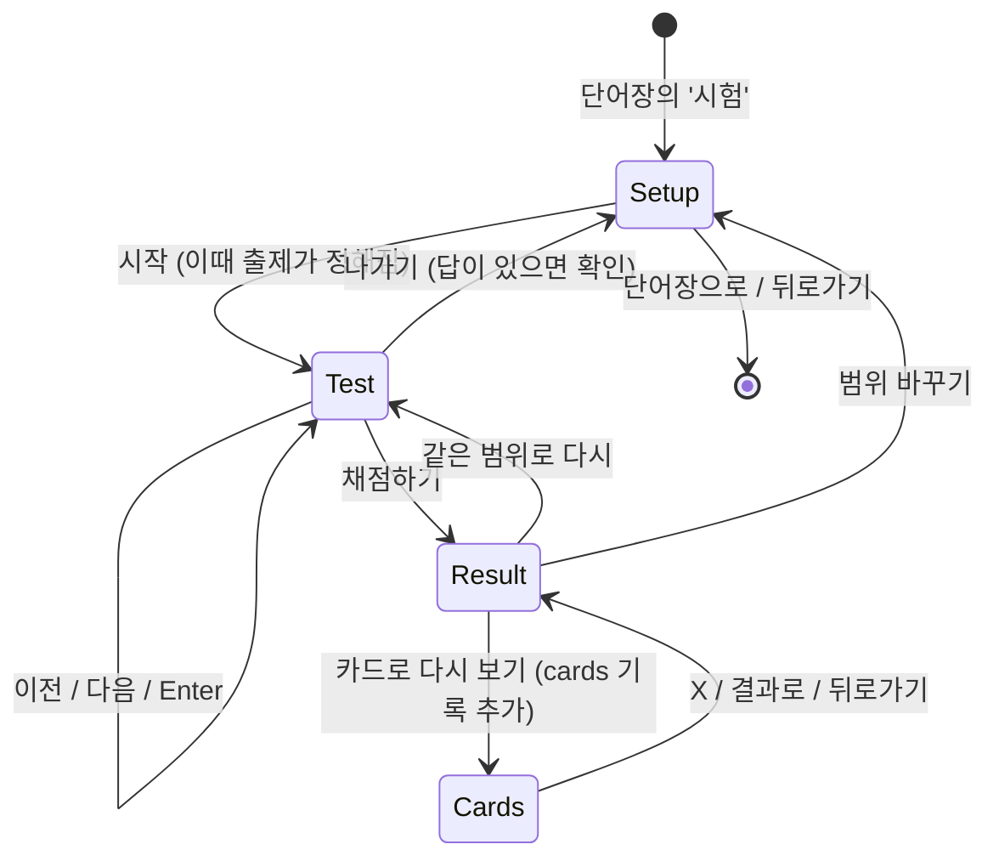
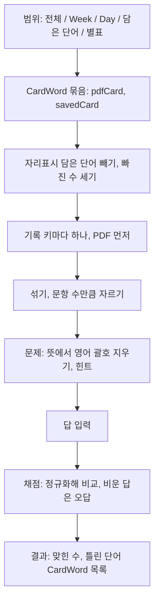

# 토익 학습앱 단어시험 - Plan

## Goal Capsule

- **Objective:** 학습자가 단어장 단어를 무작위로 받아 뜻만 보고 영어 철자를 직접 써 본다. 제출하면 몇 개 맞혔는지와 틀린 단어를 바로 확인하고, 틀린 단어만 카드로 다시 외울 수 있다.
- **Means:** 새 주소 `/words/test`에서 설정 → 시험 → 결과를 한 화면의 상태로 바꾼다 (KTD1). 출제·힌트·채점은 순수 모듈 하나에 둔다 (KTD2). 틀린 단어 카드는 기존 카드 세션을 그대로 연다 (KTD6).
- **Authority:** 제품 동작은 Requirements(R)가, 구현 방식은 Key Technical Decisions(KTD)가 정한다.
- **Stop conditions:** 다음 중 하나가 생기면 멈추고 보고한다.
  - 기존 단어 기록(`toeicBasic.words`)이나 문제집 기록(`toeicBasic.v2`)의 형식이나 값이 바뀐다.
  - 단어 데이터(`src/lib/content/words/`)나 문항 데이터(`src/lib/content/days/`)를 고쳐야 한다.
  - 새 npm 의존성이 필요하다.
  - `CardSession.svelte`의 동작을 바꿔야 한다.
- **Execution profile:** git 저장소다. 기능 브랜치에서 작업한다. 사용자 전역 규칙에 따라 파일을 고치기 전에 목록을 보여 주고 승인을 받는다. 모든 실행은 로컬에서 한다.
- **Finish:** 구현, 로컬 검증, 코드 리뷰까지가 이 계획이다. `main` 병합은 사용자 확인 뒤에 하고, push(배포)는 사용자가 직접 한다.

---

## Product Contract

### Summary

단어장 화면에 '시험'을 두고, 범위(전체·Week·Day·담은 단어·별표)와 문항 수(10/20/50)를 골라 시작한다. 한 화면에 한 문제씩 뜻과 힌트를 보고 영어를 입력하고, 다 푼 뒤 한 번에 채점한다. 결과에서 점수와 틀린 단어를 보고, 틀린 단어만 카드로 다시 본다. 시험은 아무 기록도 저장하지 않는다.

### Problem Frame

단어장 2차로 1,000단어를 보고 듣고 카드로 외울 수 있게 됐다. 하지만 카드는 학습자가 스스로 '처음·애매·완벽'을 매기는 방식이라, 단어를 정말 쓸 수 있는지 확인할 방법이 없다. 토익은 철자를 직접 쓰지 않지만, 뜻에서 영어를 떠올려 쓰는 연습은 단어를 확실히 아는지 가리는 가장 엄격한 확인이다.

뜻만으로는 답이 하나로 정해지지 않는 경우가 많다. 1,000단어 가운데 576개는 다른 단어와 뜻이 하나 이상 겹치고, forbid·prohibit('금지하다, 방해하다')처럼 뜻이 통째로 같은 쌍도 있다. 또 PDF 단어 52개는 뜻의 괄호 안에 정답 영어가 그대로 들어 있다(`conscious` → `자각하는 (be conscious of)`).

### Requirements

**시작과 범위**

- R1. 단어장 화면에 '시험' 줄이 있고, 누르면 `/words/test`의 설정 화면이 열린다.
- R2. 범위는 전체 / Week / Day / 담은 단어 / 별표 중 하나를 고른다. Week와 Day는 그 안에서 하나를 더 고르고, 처음에는 오늘의 단어 Day와 그 Week가 골라져 있다.
- R3. 문항 수는 10 / 20 / 50 중에서 고르고 기본은 20이다. 범위에 낼 단어가 더 적으면 있는 만큼 내고, 시작 버튼이 실제 문항 수를 보여 준다.
- R4. 담은 단어 중 영어 표기에 자리표시가 든 단어는 시험에 내지 않는다: `~`, 홀로 쓰인 A·B, `-ing`, `one's`·`oneself`, 한글, `?`·`.`. 담은 단어와 별표 범위는 빠진 단어 수를 알린다.
- R5. 범위에 낼 단어가 하나도 없으면 시작 버튼이 꺼지고 이유를 보여 준다: 담은 단어가 없음, 담은 단어가 모두 빠짐, 별표 단어가 없음.
- R6. '전체'는 PDF 1,000단어다. '별표'는 별표가 켜진 PDF 단어와 담은 단어다. 같은 기록을 쓰는 단어는 PDF 단어로 한 번만 센다.

**출제와 풀기**

- R7. 고른 범위에서 단어를 무작위로 섞어 문항 수만큼 낸다. 같은 기록 키의 단어는 한 시험에 한 번만 나온다.
- R8. 한 화면에 한 문제를 보여 준다: 뜻(품사 포함), 힌트, 영어 입력칸, "n / N".
- R9. 문제의 뜻에서 영어가 든 괄호는 지운다. 한글만 든 괄호(`(이목, 관심을) 끌다`, `보증(서)`)는 남긴다.
- R10. 힌트는 단어마다 첫 글자와 나머지 글자 자리를 보여 준다. 공백, 하이픈, 아포스트로피는 그 자리에 그대로 보인다: `t _ _ _   o _ _`, `p _ _ _ - t _ _ _`.
- R11. 이전/다음으로 오가며 답을 고칠 수 있다. Enter는 다음 문제로 간다. 한글 조합을 끝내는 Enter는 넘기지 않는다. 마지막 문제의 Enter는 채점하지 않고 '채점하기' 버튼으로 간다.
- R12. 마지막 화면의 '채점하기'로 한 번에 채점한다. 비운 답이 있으면 몇 개인지 알리고, 비운 답은 틀린 것으로 친다. 공백만 쓴 답도 비운 답이다.
- R13. 시험 중 '나가기'는 쓴 답이 하나라도 있으면 확인을 받고 설정 화면으로 간다. 새로고침하거나 다른 화면으로 가면 시험은 사라진다.

**채점과 결과**

- R14. 대소문자, 앞뒤·여러 칸 공백, 둥근 따옴표(’ ‘)와 곧은 따옴표('), 악센트(é와 e)의 차이는 무시한다. 나머지 철자는 정확히 같아야 정답이다. 단, 힌트와 문제에 보이는 뜻이 똑같은 다른 단어를 써도 정답이다(refuse·reject).
- R15. 결과 화면은 "맞힌 수 / 문항 수"와 틀린 단어 목록을 보여 준다. 줄마다 내 답, 정답, 괄호를 지우지 않은 원래 뜻이 있고, 비운 답은 '(쓰지 않음)'으로 보인다.
- R16. 틀린 단어가 있으면 '카드로 다시 보기'로 틀린 단어만 카드로 본다. 카드에서 평가하면 다른 카드와 같이 학습 상태와 복습 일정이 바뀌고, 버튼 옆에 그렇다고 적는다. 카드를 닫으면 같은 결과로 돌아온다.
- R17. 결과에서 '같은 범위로 다시'(새로 섞음)와 '범위 바꾸기'(설정 화면, 고른 값 유지)를 고를 수 있다. 다 맞히면 카드 버튼 대신 다 맞혔다는 문구를 보여 준다.
- R18. 시험은 학습 상태, 복습 일정, 점수 기록을 하나도 저장하지 않는다. (2026-10-28 변경: 단어마다 마지막 합격/불합격은 저장한다. 학습 상태와 복습 일정은 여전히 바꾸지 않는다. `docs/plans/2026-10-28-1945-feat-word-test-pass-badge-plan.md`)

**공통**

- R19. 휴대폰·아이패드·PC에서 쓸 수 있다. 휴대폰에서는 `/words/test`에 있는 동안 하단 탭바를 숨기고, 화면마다 단어장으로 가는 링크가 있다. 한 번 연 뒤에는 오프라인에서도 열린다.
- R20. 스크린리더로 풀 수 있다. 입력칸 이름은 그 문제의 뜻이다. 문제가 바뀌면 "문제 n / N"과 뜻을 알린다. 힌트는 "t로 시작하는 4글자"처럼 읽힌다. 정답·오답은 색만이 아니라 글자로도 구분한다.

### Key Decisions

- **뜻 보고 영어 입력.** (session-settled: user-directed — chosen over 4지선다와 한글 뜻 입력: 한글 뜻은 표현이 여러 가지라 자동 채점이 안 되고, 철자를 직접 쓰는 쪽을 골랐다) Governs R8, R14.
- **문항 수 10/20/50.** 사용자가 정했다. Governs R3.
- **결과에서 틀린 단어 확인과 카드로 다시 보기.** 사용자가 정했다. 틀린 단어를 바로 다시 외우게 한다. Governs R15, R16.
- **자리표시가 든 담은 단어는 시험에서 뺀다.** (session-settled: user-directed — chosen over 자리표시를 지우고 채점하기와 담은 단어를 범위에서 빼기: 철자 그대로 쓰게 할 수 없는 단어만 뺀다) Governs R4.
- **힌트로 첫 글자와 글자 수를 보여 준다.** (session-settled: user-approved — chosen over 힌트 없이 뜻이 같은 단어를 모두 정답으로 인정하기: 뜻이 겹치는 단어가 576개라 답을 하나로 정해 준다) Governs R8, R10.
- **시험은 아무것도 저장하지 않는다.** (session-settled: user-approved — chosen over 틀린 단어를 '처음'으로 돌리기: 상태 변경은 카드 평가에만 맡긴다) Governs R16, R18. 2026-10-28에 합격/불합격만 저장하는 것으로 바뀌었다 (R18).
- **힌트와 보이는 뜻이 똑같은 단어는 서로 정답으로 인정한다.** (session-settled: user-directed — chosen over 문제의 단어 하나만 정답: refuse·reject처럼 힌트로도 구별할 수 없는 쌍에서 맞는 답이 오답이 되지 않게 한다) Governs R14.
- **문제의 뜻에서 영어가 든 괄호는 모두 지운다.** (session-settled: user-directed — chosen over 정답이 든 괄호만 지우고 '(to R)' 같은 쓰는 법 힌트는 남기기: 문제 화면을 뜻만으로 깔끔하게 둔다) Governs R9.
- **악센트와 둥근 따옴표는 철자로 치지 않는다.** 담은 단어 `résumé`는 한국어 자판으로 é를 치기 어렵고, iOS는 '를 ’로 바꿔 넣는다. Governs R14.
- **'전체'는 PDF 1,000단어만이다.** 단어장 화면의 "1,000단어"와 같은 뜻으로 쓴다. 담은 단어는 자기 범위가 따로 있다. Governs R6.

### Acceptance Examples

- AE1. **Covers R3.** **Given** 49단어인 Day w1d4와 50문항, **When** 설정 화면을 보면, **Then** 시작 버튼이 '49문제로 시작'이고 시험은 49문제다.
- AE2. **Covers R4, R5.** **Given** 담은 단어가 `let ~ know` 하나뿐, **When** 담은 단어 범위를 보면, **Then** 시작할 수 없고 "담은 단어 1개 모두 ~·A/B 같은 표현이라 빠져요"가 보인다.
- AE3. **Covers R9, R15.** **Given** conscious가 나온 시험, **When** 그 문제를 보면, **Then** 뜻은 '자각하는'만 보인다. 결과의 틀린 단어 줄에는 '자각하는 (be conscious of)'가 그대로 보인다.
- AE4. **Covers R14.** 'Resume'는 `résumé`의 정답이고, 'I’m afraid'는 `I'm afraid`의 정답이다. 'part time'은 `part-time`의 오답이다. refuse 문제에 'reject'를 쓰면 정답이다.
- AE5. **Covers R11.** 한글 조합을 끝내는 Enter는 문제를 넘기지 않는다. 마지막 문제의 Enter는 채점하지 않고 '채점하기'로 포커스를 옮긴다.
- AE6. **Covers R16.** **Given** 2개 틀린 결과, **When** '카드로 다시 보기'에서 한 장을 '완벽'으로 매기고 카드를 닫으면, **Then** 같은 결과 화면이 보이고 그 단어의 상태는 완벽이다.
- AE7. **Covers R16, R19.** **Given** 틀린 단어 카드를 연 상태, **When** 아이패드·PC에서 왼쪽 메뉴로 다른 화면에 갔다가 뒤로 가면, **Then** 빈 카드가 아니라 설정 화면이 보인다.

### Success Criteria

- `/`의 첫 로드 JS가 gzip으로 2KB 넘게 늘지 않는다. 시험 화면 코드는 `/words/test` 청크에만 들어간다.

### Scope Boundaries

- 4지선다와 한글 뜻 입력은 만들지 않는다 (Key Decisions 첫 항목).
- '틀린 것만 다시 시험'과 점수 이력·통계는 만들지 않는다. 요청 범위 밖이다.
- 고려했지만 만들지 않는 것:
  - **뜻이 일부만 겹치는 단어를 정답으로 인정하기.** 힌트와 보이는 뜻이 똑같은 쌍만 인정한다 (R14). restore 문제에 recover처럼 품사나 뜻이 다른 단어는 오답이다. 힌트가 답을 가려 주므로, 헷갈린다는 말이 나올 때 다시 본다.
  - **뒤로가기·탭 이동 때 확인 창.** 앱에 이동을 막는 장치가 없고, R13이 "다른 화면으로 가면 사라진다"로 정했다. 풀던 답을 잃었다는 불만이 나오면 다시 본다.
  - **키보드 위로 버튼 띄우기(`visualViewport`).** 버튼을 입력칸 바로 아래에 두면 필요 없다 (KTD4). 실제 기기에서 가려지면 다시 본다.

#### Deferred to Follow-Up Work

- 카드를 '뜻 → 영어' 방향으로 볼 때도 앞면 뜻에서 영어 괄호를 지운다. R9의 정리 함수를 쓰면 되지만, 카드 동작은 이번 범위가 아니다.

---

## Planning Contract

### Key Technical Decisions

- KTD1. **새 주소 `/words/test`와 화면 상태 기계.** 페이지 하나가 `setup → test → result` 상태를 든다. 이 셋 사이를 오갈 때는 기록(history)을 쌓지 않고, 틀린 단어 카드를 열 때만 얕은 기록 항목을 하나 쌓는다 (KTD6). `src/routes/review/+page.svelte`의 `view` 상태 기계를 따른다. 경로로 두는 이유:
  - `AppNav`가 경로로 휴대폰 탭바를 숨긴다 (R19).
  - 미리 렌더된 페이지라 서비스 워커가 따로 손대지 않아도 캐시한다.
  - 뒤로가기가 단어장으로 간다.
- KTD2. **출제·힌트·채점은 순수 모듈 `src/lib/components/words/word-test.ts`.** `card-session.ts`, `review-screens.ts`처럼 기능 폴더 옆에 둔다. 저장된 상태를 다루지 않으므로 `src/lib/progress/`에 두지 않는다. 무작위는 `random: () => number = Math.random`으로 받아 Fisher–Yates로 섞는다. 앱에 다른 섞기 코드는 없다.
- KTD3. **문제 하나는 `CardWord`를 그대로 쓴다.** `word`가 정답, `lines`가 뜻, `key`가 중복 제거 키다. 범위의 단어 묶음은 기존 `pdfCard`, `savedCard`로 만들고 "PDF 먼저, 기록 키마다 하나"로 합친다 (R6, R7).
  - `src/lib/components/review/WordReviewList.svelte` 모듈 안에만 있는 `pdfCards`를 `card-session.ts`로 옮겨 내보낸다.
  - `src/lib/progress/words.ts`의 `uniqueByKey`를 내보낸다.
- KTD4. **입력칸 하나를 시험 내내 그대로 두고, 이전/다음/채점하기는 입력칸 바로 아래에 둔다.** 화면 아래 고정 바(`ActionBar`)는 휴대폰 키보드에 가린다. 문제마다 다시 그리는 `{#key}`로 감싸지 않아야 키보드가 닫히지 않는다.
  - 입력 글자는 16px 이상이다. iOS는 그보다 작은 입력칸에 포커스하면 화면을 확대한다.
  - 입력칸 속성: `lang="en"`, `autocapitalize="none"`, `autocorrect="off"`, `spellcheck="false"`, `autocomplete="off"`.
  - `enterkeyhint`는 두지 않는다. Android Chrome은 `next`를 Enter 대신 다음 칸으로 포커스를 옮기는 동작으로 처리할 수 있어, 입력칸이 하나뿐인 시험에서 Enter가 문제를 넘기지 못한다.
- KTD5. **Enter는 `keydown`에서 처리하고, 한글 조합에서 나온 Enter는 무시한다** (R11).
  - `event.isComposing`이나 `keyCode === 229`이면 무시한다. WebKit은 `compositionend`를 Enter의 `keydown`보다 먼저 보내서 `isComposing`만으로는 Safari의 조합 마침 Enter를 거르지 못한다.
  - `compositionend` 뒤 다음 `keyup` 전까지 오는 보통 Enter `keydown`도 무시한다. Chrome의 한국어 IME는 조합을 끝낸 Enter를 그대로 한 번 더 보낸다.
- KTD6. **틀린 단어 카드는 결과의 `CardWord[]`를 페이지 수준 상태에 두고 `openCards()`로 연다.** 결과 컴포넌트 안에 두면 카드 분기가 그 컴포넌트를 내려 상태가 사라진다.
  - `CardSession`은 `page.state.cards`이고 상태가 `result`일 때만 그린다. SvelteKit은 다른 화면에서 뒤로 올 때 새로 마운트한 페이지에도 `page.state`를 되살리기 때문이다 (AE7).
  - 페이지가 `page.state.cards`가 켜진 채 마운트되면 얕은 replace 이동으로 그 표시를 지운다. 그대로 두면 설정·시험·결과 전환이 기록을 바꾸지 않아, 다음 채점 때 누르지 않은 카드가 결과 위에 열린다.
  - 제목은 '틀린 단어 카드', `backLabel`은 '결과로', `backHref`는 `/words/test`다.
  - `CardSession`, `PageState`는 고치지 않는다. `AppNav`는 경로 목록에 `/words/test`만 더한다.
- KTD7. **정답 비교 함수는 `word-test.ts`에 따로 둔다** (R14). `normalizeEnglish`의 결과에서 둥근 따옴표를 '로 바꾸고, NFD로 나눠 결합 부호를 지운 뒤 NFC로 되돌린다. 입력과 정답 양쪽에 같은 함수를 쓴다.
  - `normalizeEnglish`는 고치지 않는다. 담은 단어의 저장 키(`saveVocab`, `vocabChip`)로 쓰여서, 바꾸면 이미 담은 `résumé` 같은 단어의 키가 어긋난다.
  - `normalizeEnglish`는 `\s`로 공백을 다뤄 줄바꿈 없는 공백도 이미 처리한다.
  - 같이 인정하는 답은 시험을 시작할 때 한 번 정한다: 출제 후보(PDF 1,000단어와 담은 단어) 가운데 힌트 모양이 같고, 품사와 함께 본 뜻 목록(KTD8로 정리한 뒤)이 집합으로 같은 단어다.
- KTD8. **영어 괄호 지우기는 영어 글자가 든 가장 안쪽 괄호 묶음부터 되풀이해 지우고 공백을 정리한다** (R9). 중첩 괄호(`계약 (under (no) obligation)`)도 처리된다. 데이터 테스트로 고정한다:
  - 정답이 새던 PDF 52단어가 정리된다.
  - 빈 뜻이 생기지 않는다.
  - 영어 글자가 남지 않는다.
- KTD9. **자리표시 판정은 정규식 하나로 한다** (R4). 문항 데이터의 어휘 1,445개(고유 영어) 가운데 59개가 걸리는 것을 단위 테스트로 고정한다. 담은 단어는 해설 어휘 칩에서만 들어오므로 이 목록이 담을 수 있는 단어 전부다.
- KTD10. **문제가 바뀌어도 포커스는 입력칸에 둔다** (R20).
  - polite `role="status"` 한 곳이 "문제 n / N · 뜻"을 알린다.
  - 입력칸은 `aria-labelledby`로 뜻을 이름으로 쓴다.
  - 힌트는 보이는 부분을 `aria-hidden`으로 숨기고 sr-only 문장으로 읽힌다.
  - 시험 시작 때 입력칸에 포커스하고, 결과로 넘어갈 때 제목에 포커스한다(`focusMainHeading`). 카드에서 결과로 돌아오면 '카드로 다시 보기' 버튼에 포커스한다.
- KTD11. **범위는 `src/lib/components/study/DayStart.svelte`의 라디오 카드 5개로 고른다.**
  - Week나 Day를 고르면 그 카드 아래 칩 줄이 펼쳐진다 (`ToggleGroup`).
  - 문항 수는 `src/lib/components/SegmentedSetting.svelte`를 쓴다.
  - 처음 고른 값은 `todayWordDay`로 정한다.
  - 꺼진 시작 버튼은 `WordListView.svelte`처럼 `aria-describedby`로 이유를 잇는다.
- KTD12. **'나가기' 확인은 기존처럼 브라우저 `confirm()`에 한국어 문구로 한다** (R13). 쓴 답이 있을 때만 묻는다.

### High-Level Technical Design

화면 상태와 기록(history). 설정·시험·결과는 한 기록 항목 안의 상태이고, 카드만 얕은 기록 항목을 하나 더한다.

출제와 채점의 흐름. 모두 `word-test.ts`의 순수 함수다.

### Sequencing

U1 → U2 → U3 → U4 → U5 순서다. U1의 순수 함수가 나머지 화면의 기반이고, U3과 U4는 U2의 페이지 상태 기계 위에 붙는다.

---

## Implementation Units

### U1. Word test rules

- **Goal:** 출제, 힌트, 뜻 정리, 자리표시 판정, 채점을 순수 함수로 만든다.
- **Requirements:** R4, R6, R7, R9, R10, R12, R14, R18
- **Dependencies:** 없음
- **Files:**
  - `src/lib/components/words/word-test.ts` (새 파일)
  - `src/lib/components/words/word-test.test.ts` (새 파일)
  - `src/lib/components/words/card-session.ts` (`pdfCards` 옮겨 옴)
  - `src/lib/components/review/WordReviewList.svelte` (`pdfCards` 가져다 씀)
  - `src/lib/progress/words.ts` (`uniqueByKey` 내보내기)
- **Approach:**
  1. 범위마다 `CardWord` 묶음을 돌려주는 함수와, 빠진 담은 단어 수를 함께 돌려주는 형태를 정한다 (KTD3, KTD9).
  2. 섞기와 자르기는 무작위 소스를 받는다 (KTD2).
  3. 뜻 정리(KTD8), 힌트(R10), 정규화와 채점(KTD7)을 각각 함수로 둔다. 채점 결과는 `{ total, correct, wrong }` 모양이고 `wrong`은 `CardWord`와 내 답을 함께 담는다.
- **Patterns to follow:** `src/lib/components/words/card-session.ts`와 그 테스트, `src/lib/progress/words.ts`의 `dueItems(entries, items, today)`처럼 의존성을 인자로 받는 방식.
- **Test scenarios:**
  - 같은 무작위 소스를 주면 같은 순서가 나오고, 결과는 입력의 순열이다.
  - Week 3 범위는 253줄에서 고유 249단어가 된다. 겹치는 6단어는 한 번만 나온다.
  - Day w1d4(49단어)에 50문항을 고르면 49문제다. Covers AE1.
  - 별표 범위는 별표가 켜진 PDF 단어와 담은 단어를 합친다. PDF 단어와 기록을 같이 쓰는 담은 단어는 PDF 단어 하나로 나온다.
  - 기록에서 별표를 끈 PDF 단어는 별표 범위에서 빠진다.
  - 문항 데이터 어휘 1,445개 가운데 자리표시로 빠지는 단어는 59개다. `let ~ know`, `replace A with B`, `look forward to -ing`, `spend 시간 -ing`, `Keep the change.`는 빠지고, `part-time`, `I'm afraid`, `résumé`, `City Hall`은 남는다.
  - PDF 1,000단어의 뜻을 모두 정리하면 영어 글자가 남지 않고 빈 뜻이 없다. `conscious`는 '자각하는'이 되고, `obligation`의 중첩 괄호도 지워진다. 한글만 든 괄호는 남는다. Covers AE3.
  - 힌트: `take off` → `t _ _ _   o _ _`, `part-time` → `p _ _ _ - t _ _ _`, `I'm afraid`는 아포스트로피가 그대로 보인다. 읽는 문장은 "t로 시작하는 4글자"처럼 단어마다 나온다.
  - 채점: 'ADDITIONAL ', 'take off', 'I’m afraid', 'Resume'은 정답이고, 'part time', 'additonal', 빈 답, 공백만 쓴 답은 오답이다. Covers AE4.
  - PDF 1,000단어에서 서로 정답으로 인정되는 쌍은 refuse·reject 하나다 (데이터에서 다시 계산). refuse 문제에 'reject'는 정답이고, restore 문제에 'recover'는 오답이다. Covers AE4.
  - 담은 단어 involve('포함하다')와 include('포함하다')를 둘 다 담은 기록이면 서로 정답이다.
  - 채점은 단어 기록을 바꾸지 않는다 (입력 기록 객체가 그대로다).
  - `normalizeEnglish('résumé')`와 `normalizeEnglish('spend 시간 -ing')`는 지금 값 그대로다. 담은 단어 저장 키가 바뀌지 않는다.
- **Verification:** 새 단위 테스트와 기존 `card-session.test.ts`, `words.test.ts`, 복습 탭 e2e가 통과한다.

### U2. Test route and setup screen

- **Goal:** 단어장에서 '시험'으로 들어와 범위와 문항 수를 고르고 시작할 수 있다.
- **Requirements:** R1, R2, R3, R4, R5, R19
- **Dependencies:** U1
- **Files:**
  - `src/routes/words/test/+page.svelte` (새 파일)
  - `src/lib/components/words/WordTestSetup.svelte` (새 파일)
  - `src/lib/components/words/WordbookView.svelte` ('시험' 줄)
  - `src/lib/components/shell/AppNav.svelte` (단어장 탭 `routes`와 `studying`에 `/words/test`)
  - `e2e/word-test.e2e.ts` (새 파일)
- **Approach:**
  1. 페이지가 `setup | test | result` 상태를 들고, 화면을 바꿀 때 `scrollContentToTop`과 포커스를 처리한다 (KTD1, KTD10).
  2. '시험' 줄은 단어장 화면의 담은 단어 줄과 같은 모양으로 Week 목록 위에 둔다.
  3. 설정 화면은 KTD11대로 만들고, 고른 값은 시험·결과를 오가도 페이지 상태에 남긴다 (R17).
  4. 화면 위에 단어장으로 가는 고정 링크와 `<svelte:head>` 제목을 둔다.
- **Patterns to follow:** `src/routes/review/+page.svelte`의 상태 기계, `DayStart.svelte`의 라디오 카드, `WordListView.svelte`의 고정 뒤로 링크와 꺼진 버튼.
- **Test scenarios:**
  - 단어장의 '시험'을 누르면 `/words/test`에 설정 화면이 열리고, 오늘의 단어 Day와 20문항이 골라져 있다.
  - Day w1d4와 50문항을 고르면 시작 버튼이 '49문제로 시작'이다. Covers AE1.
  - 담은 단어가 없으면 담은 단어 범위의 시작 버튼이 꺼지고 '담은 단어가 없어요'가 버튼 설명으로 이어진다.
  - 담은 단어가 `let ~ know` 하나면 시작할 수 없고 모두 빠진다는 문구가 보인다. Covers AE2.
  - 담은 단어 `delay`와 `let ~ know`가 있으면 1문제로 시작할 수 있고 1개가 빠진다고 알린다.
  - 별표를 모두 끈 기록이면 별표 범위의 시작 버튼이 꺼진다.
  - 휴대폰에서 `/words/test`에는 하단 탭바가 없고, 단어장 탭은 아이패드·PC 메뉴에서 현재 위치로 표시된다.
- **Verification:** 설정 화면의 모든 범위와 꺼짐 상태가 세 화면 크기에서 e2e로 통과한다.

### U3. Question screen

- **Goal:** 한 문제씩 뜻과 힌트를 보고 영어를 입력하고, 다 푼 뒤 채점할 수 있다.
- **Requirements:** R8, R9, R10, R11, R12, R13, R20
- **Dependencies:** U2
- **Files:**
  - `src/lib/components/words/WordTestRun.svelte` (새 파일)
  - `src/routes/words/test/+page.svelte`
  - `e2e/word-test.e2e.ts`
- **Approach:**
  1. 시작할 때 U1로 문제를 정하고, 답 배열은 이 컴포넌트의 상태로 둔다.
  2. 입력칸과 버튼 배치, 입력 속성은 KTD4, Enter는 KTD5, 알림과 포커스는 KTD10을 따른다.
  3. 마지막 화면에서 '다음'이 '채점하기'가 되고, 비운 답 수를 `ResultPage.svelte`처럼 알린다.
  4. '나가기'는 KTD12대로 묻고 설정 화면으로 간다.
- **Execution note:** e2e에서 순서를 정하려면 서로 다른 뜻의 담은 단어 2~3개를 넣고, 화면의 뜻을 읽어 맞는 답을 친다. `Math.random`을 덮어쓰지 않는다.
- **Patterns to follow:** `src/lib/components/review/ReviewSession.svelte`의 이동과 마치기(단, `{#key}`로 입력칸을 다시 그리지 않는다), `CardSession.svelte`의 `role="status"` 순번.
- **Test scenarios:**
  - 문제 화면에 "1 / N", 뜻, 힌트가 보이고, 입력칸 이름이 뜻이며 포커스가 입력칸에 있다.
  - 답을 쓰고 Enter를 누르면 다음 문제로 가고, 포커스는 입력칸에 남고 값은 비어 있다. 이전으로 돌아가면 쓴 답이 그대로 있다.
  - `isComposing`이 참이거나 `keyCode`가 229인 Enter `keydown`은 문제를 넘기지 않는다. Covers AE5.
  - `compositionend` 바로 뒤에 오는 `keyCode` 13인 Enter `keydown`도 문제를 넘기지 않는다. Covers AE5.
  - 마지막 문제에서 Enter를 누르면 채점하지 않고 '채점하기'에 포커스가 간다. Covers AE5.
  - 답을 하나 비우고 마지막 화면에 가면 "1개를 쓰지 않았어요" 같은 알림이 보이고, 채점하면 결과로 간다.
  - 답을 하나 쓰고 '나가기'를 누르면 확인 창이 뜨고, 수락하면 설정 화면으로 간다. 답이 없으면 묻지 않는다.
  - 시험 중 새로고침하면 설정 화면이 열린다.
  - conscious가 나오는 Day를 고르면 그 문제의 뜻에 '(be conscious of)'가 없다. Covers AE3.
- **Verification:** 문제 풀기 e2e가 세 화면 크기에서 통과하고, 휴대폰 크기에서 버튼이 입력칸 바로 아래에 보인다.

### U4. Result screen and wrong-word cards

- **Goal:** 채점 결과와 틀린 단어를 보고, 틀린 단어만 카드로 다시 보고, 다시 시험을 볼 수 있다.
- **Requirements:** R15, R16, R17, R18, R20
- **Dependencies:** U3
- **Files:**
  - `src/lib/components/words/WordTestResult.svelte` (새 파일)
  - `src/routes/words/test/+page.svelte`
  - `e2e/word-test.e2e.ts`, 300줄을 넘으면 `e2e/word-test-result.e2e.ts` (새 파일)로 나눈다
- **Approach:**
  1. 점수와 틀린 단어 줄의 모양은 `ResultPage.svelte`의 점수 카드와 틀린 목록을 따른다. '내 답'·'정답' 글자를 `ok`/`bad` 색과 함께 쓴다.
  2. 틀린 단어 카드는 KTD6대로 연다. 결과를 다시 마운트할 때의 포커스는 KTD10을 따른다.
  3. '같은 범위로 다시'는 같은 설정으로 새로 출제하고, '범위 바꾸기'는 설정 화면으로 간다.
- **Patterns to follow:** `src/lib/components/study/ResultPage.svelte`, `src/routes/review/+page.svelte`의 카드 분기.
- **Test scenarios:**
  - 담은 단어 3개 시험에서 2개를 맞히고 1개를 틀리면 "2 / 3"이 보이고, 틀린 줄에 내 답, 정답, 원래 뜻이 있다. 비운 답은 '(쓰지 않음)'이다.
  - '카드로 다시 보기'를 누르면 '틀린 단어 카드'가 틀린 단어 수만큼 열리고, 한 장을 완벽으로 매긴 뒤 닫으면 같은 결과가 보인다. 그 단어의 기록 상태는 완벽이다. Covers AE6.
  - 결과에서 카드를 연 뒤 아이패드·PC 메뉴로 다른 화면에 갔다가 뒤로 오면 설정 화면이 보인다. 거기서 새 시험을 풀고 채점하면 카드가 아니라 결과 화면이 보인다. Covers AE7.
  - 다 맞히면 카드 버튼이 없고 다 맞혔다는 문구가 보인다.
  - '같은 범위로 다시'는 새 시험의 1번 문제를 열고, '범위 바꾸기'는 고른 범위와 문항 수가 그대로인 설정 화면을 연다.
  - 시험을 끝까지 풀고 채점해도 `toeicBasic.words`의 값이 시작 전과 같다.
- **Verification:** 결과와 카드 e2e가 세 화면 크기에서 통과한다.

### U5. Offline, docs and cleanup

- **Goal:** 새 화면이 오프라인에서 열리는지 확인하고 문서를 고친다.
- **Requirements:** R19
- **Dependencies:** U4
- **Files:**
  - `e2e/offline.e2e.ts`
  - `README.md` (주소 표와 셸 설명)
  - `docs/design/2026-10-21-ui-ux-review.md` (단어시험 화면)
  - 이 계획의 결과 절
- **Approach:**
  1. 오프라인 e2e의 주소 목록과 휴대폰 가로 스크롤 목록에 `/words/test`를 더한다.
  2. README 주소 표에 `/words/test`를 더한다.
  3. 설계 문서에 단어시험 화면(설정·문제·결과)과 KTD4·KTD10의 입력 규칙을 적는다.
  4. 빌드 뒤 `/`의 첫 로드 JS gzip 크기를 단어장 2차 결과(450.8KB)와 비교해 결과 절에 적는다.
- **Test scenarios:**
  - 오프라인에서 `/words/test`를 새로고침해도 설정 화면이 열리고, 담은 단어로 시험을 끝까지 볼 수 있다.
  - 휴대폰 너비에서 설정·문제·결과 화면에 가로 스크롤이 없다.
- **Verification:** Verification Contract 전체가 통과하고, Success Criteria의 크기 기준을 지킨다.

---

## Verification Contract

| 검사        | 명령                                                        | 시점                       |
| ----------- | ----------------------------------------------------------- | -------------------------- |
| 타입        | `npm run check`                                             | 매 단위                    |
| 형식·린트   | `npm run lint`                                              | 매 단위                    |
| 단위 테스트 | `npx vitest run`                                            | 매 단위 (U1에서 새 테스트) |
| e2e         | `npx playwright test` (휴대폰·아이패드·PC, 빌드 후 preview) | U2부터 매 단위             |
| 크기        | `npm run build` 뒤 `/` 첫 로드 JS의 gzip 합계               | U5                         |

- `npm run test:e2e`는 `playwright install`을 먼저 실행해 인터넷이 필요할 수 있으므로 `npx playwright test`를 쓴다.
- 실제 기기에서 확인할 것 (자동 테스트로 대신할 수 없음):
  - iOS Safari와 설치한 앱, Android Chrome(Gboard·삼성 키보드)에서 키보드가 이전/다음/채점하기를 가리지 않는지
  - 입력칸에 포커스할 때 화면이 확대되지 않는지, '시작' 뒤 키보드가 바로 열리는지
  - 한글 자판 상태의 Enter, 자동 대문자·자동 수정이 꺼지는지, 둥근 따옴표, 스페이스 두 번으로 찍히는 마침표
  - Android 키보드(Gboard·삼성)의 Enter 키가 다음 문제로 넘기는지

---

## Definition of Done

- 모든 단위의 Verification을 채웠고, Verification Contract 전체가 통과한다.
- R1–R20과 AE1–AE7이 테스트로 덮여 있다.
- `package.json`의 의존성, 단어 데이터, 문항 데이터, 저장 형식이 그대로다.
- `CardSession.svelte`의 동작이 그대로이고, 기존 카드·복습 e2e가 통과한다.
- 쓰다 만 코드, 임시 로그, TODO, 버린 시도의 코드가 없다.
- 파일은 300줄 안팎이고, 500줄을 넘는 파일은 역할별로 나눴다.
- README, 설계 문서, 이 계획의 결과 절을 고쳤다.
- 작업은 기능 브랜치에 있고, `main` 병합은 사용자 확인을 기다린다.

---

## System-Wide Impact

- **화면 공통:** `AppNav`의 단어장 탭 경로와 휴대폰 탭바 숨김 목록에 `/words/test`가 늘어난다.
- **공유 코드:** `pdfCards`가 `WordReviewList.svelte`에서 `card-session.ts`로 옮겨 가고, `uniqueByKey`가 내보내진다. 복습 탭과 오늘 화면의 복습 단어 수는 그대로여야 한다.
- **저장 데이터:** 바뀌지 않는다. 틀린 단어 카드의 평가만 기존 카드처럼 `toeicBasic.words`에 쓴다.
- **오프라인:** 새 미리 렌더 페이지가 서비스 워커 캐시 목록에 저절로 들어간다.
- **업데이트 알림:** 시험 중 다른 탭에서 '새로고침'을 누르면 모든 탭이 새로고침되어 시험이 사라진다. R13의 "새로고침하면 사라진다"에 해당한다.

## Risks & Dependencies

| 위험                                                       | 대응                                                                      |
| ---------------------------------------------------------- | ------------------------------------------------------------------------- |
| 휴대폰 키보드가 버튼을 가리거나 입력칸 포커스 때 화면 확대 | 입력칸 바로 아래 버튼과 16px 글자 (KTD4), 실제 기기 확인                  |
| 한글 자판의 Enter가 문제를 넘김                            | `isComposing`과 `keyCode 229` 둘 다 확인 (KTD5), 실제 기기 확인           |
| 뜻에 정답 영어가 남음                                      | 괄호 정리와 PDF 1,000단어 데이터 테스트 (KTD8)                            |
| 뒤로가기로 빈 카드 화면이 뜸                               | 결과 상태일 때만 카드를 그림 (KTD6), AE7 e2e                              |
| 무작위 때문에 e2e가 흔들림                                 | 담은 단어로 뜻을 읽어 답하는 방식, 섞기는 단위 테스트에서 주입한 무작위로 |

---

## 결과

- **구현:** U1–U5를 `feat/word-test` 브랜치에 커밋했다 (e5df2c0 규칙, ade645a 화면, d518462 문서·오프라인, 4a78321 정리, 085b1b4 리뷰 반영). `main` 병합은 사용자 확인을 기다리고, push(배포)는 사용자가 직접 한다.
- **검증:** `npx vitest run` 598개 통과, `npm run check` 오류 0, `npm run lint` 통과, `npx playwright test` 343개 통과 · 8개 건너뜀 (휴대폰·아이패드·PC). 건너뛴 것 가운데 1개는 휴대폰에서 메뉴가 숨겨져 해당 없는 AE7 테스트다.
- **회귀 증명:** 남은 카드 표시를 지우는 코드(KTD6)와 한글 Enter 처리(KTD5)를 빼면 해당 e2e가 실패하는 것을 확인했다.
- **첫 로드 크기 (Success Criteria):** 같은 방법(빌드 뒤 `build/index.html`이 불러오는 JS의 gzip 합)으로 `main`은 450.8KB, 이 브랜치는 452.5KB다. 1.7KB 늘어 2KB 예산 안이다. 시험 화면 코드는 `/`가 처음 받는 파일에 들어가지 않는다. 늘어난 몫은 공유 모듈이 더 잘게 나뉜 청크 4개, 서비스 워커의 미리 받는 목록, 메뉴와 단어장 화면의 작은 변경이다.
- **계획과 달라진 것:**
  - KTD5: `compositionend` 뒤 Enter를 거르던 방식을, 조합 중에 들어온 Enter(`isComposing` 또는 `keyCode 229`)만 표시해 두고 다음 `keyup` 전까지 오는 중복 Enter를 거르는 방식으로 바꿨다. 안드로이드 키보드는 영어 단어도 조합하다 확정한 뒤 보통 Enter를 한 번 보내서, 원래 방식이면 문제마다 Enter를 두 번 눌러야 할 수 있었다 (코드 리뷰).
  - KTD6: 카드는 이 결과에서 연 것만 그린다. 앞으로 가기로 돌아온 카드 표시가 다음 채점 때 카드를 열지 않게 하려는 것이다 (코드 리뷰).
  - 길게 눌러 반복되는 Enter는 무시한다. 마지막 문제에서 채점까지 눌리는 것을 막는다 (코드 리뷰).
  - '같은 범위로 다시'에서 범위가 비었으면(카드에서 별표를 모두 끄거나 다른 탭에서 담은 단어를 지운 경우) 설정 화면으로 간다 (코드 리뷰, 검증으로 확인).
- **정리 단계:** 품질 제안 3건을 반영했다 (오늘의 Day를 Day 목록에서 찾기, `flatMap`, 이름 나누기). 주석을 지우자는 제안은 저장소의 기존 주석 방식과 어긋나 따르지 않았다. 뒤로 가기 링크를 공용 컴포넌트로 빼는 제안은 기존 파일 두 개를 건드려야 해 하지 않았다.
- **코드 리뷰:** 로컬 리뷰어 5개(정확성, 반대 관점, 테스트, 유지보수, 화면 이벤트 경합)로 했다. 다른 모델 검토는 사용자 금지로 하지 않았다. 판정 'Not ready'의 두 지적(크기 기록 없음, 빈 범위로 다시 시작할 때 오류)을 모두 해결했다.
- **남은 위험:**
  - 틀린 단어 카드를 연 채 새로고침하면, 그 기록 항목에 카드 표시가 남는다. 나중에 카드를 열고 닫을 때 X를 두 번 눌러야 할 수 있다. 담은 단어·Day 목록 화면도 같은 방식이다.
  - 한글·안드로이드 Enter 처리는 가짜 이벤트로만 확인했다.
- **실제 기기에서 확인할 것:** Verification Contract의 목록 그대로다 (키보드가 버튼을 가리는지, 입력칸 확대, 한글·Android Enter, 자동 대문자·자동 수정, 둥근 따옴표).
