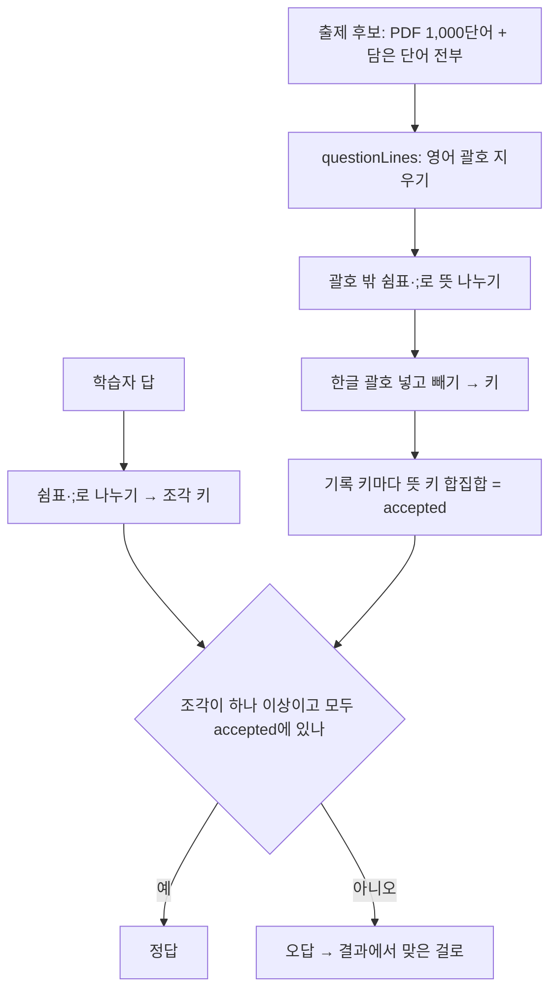
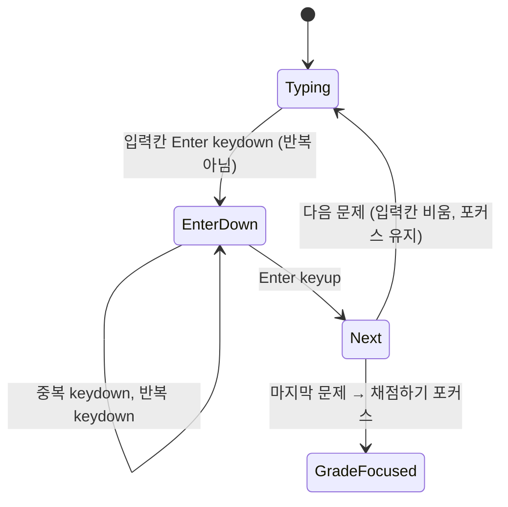

# 토익 학습앱 단어시험 영어 → 뜻 - Plan

## Goal Capsule

- **Objective:** 학습자가 토익 모의시험처럼 영어 단어를 보고 한글 뜻을 써서 채점받는다. 표현이 달라 자동 채점이 틀렸다고 한 답은 결과 화면에서 직접 맞은 것으로 고칠 수 있다.
- **Means:** 배포된 단어시험(`/words/test`)에 방향 선택을 더한다 (KTD4). 한글 뜻 비교는 새 순수 모듈 `word-meaning.ts`에 둔다 (KTD1). '맞은 걸로' 상태는 페이지에 둔다 (KTD7).
- **Authority:** 제품 동작은 Requirements(R)가, 구현 방식은 Key Technical Decisions(KTD)가 정한다. 배포된 단어시험 계획(`docs/plans/2026-10-26-1854-feat-word-test-plan.md`)의 결정은 뜻 → 영어 방향에 그대로 적용된다.
- **Stop conditions:** 다음 중 하나가 생기면 멈추고 보고한다.
  - 단어 기록(`toeicBasic.words`)이나 문제집 기록(`toeicBasic.v2`)의 형식이나 값이 바뀐다.
  - 단어 데이터나 문항 데이터를 고쳐야 한다.
  - 새 npm 의존성이 필요하다.
  - `CardSession.svelte`의 동작이나 뜻 → 영어 방향의 동작을 바꿔야 한다.
- **Execution profile:** git 저장소다. 기능 브랜치에서 작업한다. 파일을 고치기 전에 목록을 보여 주고 승인을 받는다. 모든 실행은 로컬에서 한다.
- **Finish:** 구현, 로컬 검증, 코드 리뷰까지가 이 계획이다. `main` 병합과 배포는 사용자 확인 뒤에 한다.

---

## Product Contract

### Summary

단어시험 설정에 방향(뜻 → 영어 / 영어 → 뜻)을 둔다. 영어 → 뜻은 영어 단어·발음 기호·품사·발음 듣기를 보여 주고 한글 뜻을 입력받는다. 단어의 뜻 중 하나와 같으면 자동으로 정답이다. 틀린 답은 결과에서 정답 뜻과 나란히 보이고 '맞은 걸로'로 고칠 수 있다. 범위, 문항 수, 결과, 틀린 단어 카드는 배포된 단어시험을 그대로 쓴다.

### Problem Frame

배포된 단어시험은 뜻을 보고 영어 철자를 쓰는 한 방향뿐이다. 토익 독해·듣기에서 필요한 것은 영어를 보고 뜻을 바로 떠올리는 힘이라, 반대 방향 시험이 필요하다.

한글 뜻은 표현이 여러 갈래다. 1,000단어의 뜻은 2,868개(단어당 평균 2.9)이고, 928단어가 뜻이 여러 개다. 괄호가 든 뜻이 360개, `~`가 든 뜻이 77개다. '참석하다'와 '참석', '주최(개최)하다'와 '개최하다'처럼 같은 뜻을 다르게 쓰는 경우는 자동 채점이 가려낼 수 없다. 그래서 자동 채점 뒤에 학습자가 직접 바로잡는 단계가 있어야 한다.

### Requirements

**설정과 출제**

- R1. 단어시험 설정에 방향(뜻 → 영어 / 영어 → 뜻)이 있다. 화면을 열 때마다 뜻 → 영어로 시작하고, '같은 범위로 다시'와 '범위 바꾸기'는 고른 방향을 유지한다.
- R2. 범위, 문항 수, 섞기, 한 기록 한 번, 범위가 문항 수보다 적을 때와 빌 때의 동작은 두 방향이 같다. 단, 영어 → 뜻에서는 자리표시가 든 담은 단어도 내고 빠진 수를 알리지 않는다.
- R3. 설정 화면의 설명은 방향에 맞춘다: 뜻 → 영어는 "뜻을 보고 영어로 써요", 영어 → 뜻은 "영어를 보고 뜻을 써요".

**풀기**

- R4. 영어 → 뜻 문제는 영어 단어, 발음 기호, 품사, 발음 듣기 버튼, 한글 입력칸, "n / N"을 보여 준다. 힌트는 없다. 담은 단어는 발음 기호와 품사가 없어 영어만 보인다.
- R5. Enter 한 번이면, 한글을 조합하던 중이라도 마지막 글자까지 답에 담고 다음 문제로 간다. 길게 눌러도 한 문제만 넘어가고, 마지막 문제의 Enter는 채점하지 않고 '채점하기'로 간다.
- R6. 발음 듣기를 눌러도 입력칸 포커스와 휴대폰 키보드가 유지된다. 문제를 옮기거나 나가거나 채점하면 재생을 멈춘다.

**채점과 결과**

- R7. 답이 그 단어의 뜻 중 하나와 같으면 정답이다. 띄어쓰기, `~`, `…`, 끝의 `.?!`, 괄호 안의 쉼표와 가운뎃점은 무시한다. 한글 괄호는 넣어도 빼도 된다(`보증(서)`는 '보증', '보증서' 모두 정답). 쉼표나 `;`로 여러 뜻을 쓰면 모두가 그 단어의 뜻이어야 정답이다. 빈 답은 오답이다.
- R8. "그 단어의 뜻"은 같은 기록을 쓰는 PDF 단어의 뜻과 담은 뜻을 모두 합친 것이다. 담은 뜻에 쉼표나 `;`로 묶인 목록(`회의, 학회`)은 하나하나를 뜻으로 본다. 영어가 든 괄호(`(be conscious of)`)는 뜻에서 뺀다.
- R9. 결과의 틀린 줄은 영어, 내 답(비었으면 '(쓰지 않음)'), 정답 뜻 전부(원래 표기)를 보여 준다. 빈 답이 아닌 줄에는 '맞은 걸로' 버튼이 있다.
- R10. '맞은 걸로'를 켜면 점수가 1 오르고 그 단어는 틀린 단어 카드에서 빠지며, 줄에 "맞음으로 침"이 글자로 보인다. 다시 누르면 되돌린다. 카드를 다녀와도 유지되고, '같은 범위로 다시'나 '범위 바꾸기'로 새로 시작하면 사라진다. 아무것도 저장하지 않는다.
- R11. 남은 틀린 단어가 없으면 카드 버튼 대신 '모두 맞혔어요'를 보여 준다. 틀린 줄과 토글은 그대로 남아 되돌릴 수 있다.

**공통**

- R12. 스크린리더: 입력칸 이름은 "{영어} 뜻", 문제가 바뀌면 "문제 n / N · {영어}"를 알린다. 입력칸은 한국어(`lang="ko"`)다. 토글은 눌림 상태와 어느 단어인지 읽히고, 점수가 바뀌면 알린다.
- R13. 뜻 → 영어 방향의 문제, 채점, Enter, 결과는 지금 그대로다.

### Key Decisions

- **대상은 단어장 단어다.** (session-settled: user-directed — chosen over 문제집 문장 해석: 사용자가 단어 시험으로 정했다) Governs R4, R8.
- **채점은 자동 + 직접 고치기다.** (session-settled: user-directed — chosen over 4지선다와 직접 채점만: 자동으로 맞힐 수 있는 답은 자동으로, 표현이 다른 답은 학습자가 고친다) Governs R7, R9, R10.
- **채점 규칙과 화면 구성.** (session-settled: user-approved — chosen over 글자가 똑같아야 정답: 띄어쓰기와 괄호 차이로 맞은 답이 틀리지 않게 한다) 문제 화면의 구성, 자리표시 담은 단어 포함, 한글 Enter 한 번에 넘기기도 같은 확인으로 정했다. Governs R2, R4, R5, R7.
- **같은 기록의 PDF 뜻과 담은 뜻을 합쳐 채점한다.** 담은 단어 156개가 PDF 단어이기도 하고, 그중 100개의 담은 뜻이 PDF 뜻에 없다(delay '지연시키다'). 어느 범위에서 나와도 같은 단어면 같은 답을 받는다. Governs R8.
- **방향은 저장하지 않는다.** 시험은 아무것도 저장하지 않는다는 배포된 결정을 따른다. Governs R1.

### Acceptance Examples

- AE1. **Covers R2.** **Given** 담은 단어 `delay`(지연)와 `let ~ know`(~에게 알리다), **When** 담은 단어 범위에서 방향을 영어 → 뜻으로 바꾸면, **Then** "1문제로 시작"과 빠진 수 안내가 "2문제로 시작"으로 바뀐다.
- AE2. **Covers R5.** 한글 조합 중 Enter(`keyCode 229`)와 Chrome이 다시 보내는 Enter가 들어와도 문제는 그대로이고, 그 키를 떼면 한 번 넘어간다. 이전으로 돌아가면 쓴 답 전체가 남아 있다.
- AE3. **Covers R7, R8.** 담은 단어 `conference`(회의, 학회)에는 '학회'와 '회의, 학회'가 정답, '회의, 지연'은 오답이다. `delivery`(배송(품))에는 '배송'과 '배송품'이 정답이다. `let ~ know`에는 '에게 알리다'가 정답이다.
- AE4. **Covers R9, R10.** **Given** 3문제 중 1개 맞힘, **When** 틀린 줄 하나에 '맞은 걸로'를 켜면, **Then** 점수가 "2 / 3"이 되고 '카드로 다시 보기'는 남은 1단어만 연다. 카드를 닫으면 점수와 켠 표시가 그대로다.
- AE5. **Covers R11.** 남은 틀린 줄을 모두 켜면 카드 버튼이 사라지고 '모두 맞혔어요'가 보인다. 하나를 끄면 카드 버튼이 돌아온다.

### Success Criteria

- `/`의 첫 로드 JS가 gzip으로 1KB 넘게 늘지 않는다. 새 코드는 `/words/test` 청크에만 들어간다.

### Scope Boundaries

- 문제집 문장 해석 시험, 4지선다는 만들지 않는다 (Key Decisions).
- 고려했지만 만들지 않는 것:
  - **대체어 괄호 펼치기.** `주최(개최)하다`(47개)는 '주최하다'만 자동 정답이고 '개최하다'는 '맞은 걸로'로 고친다. 정한 규칙(괄호를 넣거나 빼기) 밖이고, 결과에서 고칠 수 있다. 자주 고치게 된다는 말이 나오면 다시 본다.
  - **앞 `~`와 조사 빼기.** `~에 영향을 미치다`에 '영향을 미치다'는 오답이다(앞 `~`+조사 70개). 위와 같은 이유다.
  - **한글이 아닌 답 안내.** 한/영 전환을 잊고 친 답은 오답이 되고 결과에서 보인다.
  - **틀린 단어 카드 방향.** 카드는 저장된 카드 방향 설정을 따른다. 시험 방향과 맞추려면 `CardSession`을 고쳐야 한다.

---

## Planning Contract

### Key Technical Decisions

- KTD1. **한글 뜻 비교는 새 순수 모듈 `src/lib/components/words/word-meaning.ts`에 둔다.** 문자열만 다루는 함수 셋이다:
  - 나누기: 괄호 밖의 `,`와 `;`에서만 나누고 빈 조각은 버린다. 답과 뜻 모두에 쓴다.
  - 키: NFC, 소문자, 그리고 공백·`~`·`…`·`.?!`·`,`·`·`·괄호를 지운다.
  - 뜻의 키 묶음: 한글 괄호 묶음마다 넣고 빼는 경우를 모두 만들어 키로 바꾼다. 빈 키는 버린다.
  - `word-test.ts`가 이 모듈을 가져다 쓰고, 이 모듈은 `word-test.ts`를 가져오지 않는다.
- KTD2. **정답 뜻은 `questionLines(card)`를 기준으로 기록 키마다 합친다** (R8). 영어 괄호는 배포된 `withoutEnglish`가 이미 지운다.
  - 기록 키는 단어 기록의 키(`recordKey`, 담은 단어는 `savedItem`이 주는 키)다. PDF 단어와 영어가 같은 담은 단어는 그 PDF 단어의 키를 쓴다.
  - 시험을 시작할 때 출제 후보(PDF 1,000단어와 자리표시를 포함한 담은 단어 전부)를 기록 키로 묶어, 키마다 뜻 키의 합집합을 만든다. 같은 묶음에서 원래 표기의 뜻 줄도 중복 없이 모은다.
  - `TestQuestion.accepted`가 방향에 맞는 키를 담는다. 뜻 → 영어는 지금의 영어 키, 영어 → 뜻은 이 뜻 키 합집합이다. 영어 → 뜻 문제는 합친 뜻 줄도 함께 담고, `gradeTest`의 틀린 줄에 실어 결과가 정답 뜻 전부를 보여 준다 (R9).
  - `gradeTest`는 방향을 받아 비교를 고른다. 영어 → 뜻은 둘 중 하나면 정답이다 (R7):
    - 답 전체의 키(쉼표 포함 기호를 지운 것)가 `accepted`에 있다. 괄호만 빼고 쓴 `이목, 관심을 끌다` 같은 답이 여기서 맞는다.
    - 답을 나눈 조각이 하나 이상이고 모든 조각의 키가 `accepted`에 있다.
- KTD3. **`testWords`에 방향을 넘긴다.** 영어 → 뜻이면 담은 단어를 거르지 않고 `leftOut`이 0이다 (R2). 기본값은 뜻 → 영어라 지금의 호출과 테스트가 그대로 맞다.
- KTD4. **방향 값은 카드의 `CardDirection` 타입(`'ko-en'` / `'en-ko'`)을 다시 쓰고, 페이지의 `TestSetup`에만 둔다.** 저장하지 않고 기본값은 `'ko-en'`이다. 설정 화면은 세 번째 `SegmentedSetting`(`label="방향"`)으로 고른다.
- KTD5. **영어 → 뜻의 Enter는 그 키를 뗄 때 처리한다** (R5).
  - 입력칸에서 Enter의 `keydown`이 오면(반복 제외, 조합 중이든 아니든) 기본 동작을 막고 표시만 한다. PC 한글 입력기는 조합 중 Enter를 `key: 'Process'`, `keyCode 229`로 보내기도 하므로, 그 뒤에 오는 Enter `keyup`도 같은 누름으로 본다.
  - 그 Enter의 `keyup`에서 표시가 있으면 지우고 한 번 넘긴다. 마지막 문제면 '채점하기'로 포커스한다.
  - `keyup` 때는 모든 엔진에서 조합이 끝나 `bind:value`에 마지막 음절이 들어 있다. 조합 중 `keydown`에서 넘기면 확정된 글자가 다음 문제 칸에 들어가거나 잘린다.
  - 표시를 입력칸의 `keydown`만 세우므로, 버튼에서 누른 Enter의 `keyup`이 입력칸에 떨어져도 두 번 넘어가지 않는다.
  - 뜻 → 영어 방향의 처리는 바꾸지 않는다 (R13).
- KTD6. **영어 → 뜻의 문제 영역은 새 컴포넌트 `WordTestWordPrompt.svelte`로 뺀다.** 영어(`lang="en"`, 입력칸 `aria-labelledby`가 가리키는 요소), 발음 기호(`aria-hidden`), 품사 배지, 발음 듣기 버튼, 발음 실패 알림(`role="status"`)을 담는다.
  - 발음은 `WordSpeech`를 쓰고, 버튼의 `pointerdown`에서 기본 동작을 막아 입력칸 포커스와 키보드를 지킨다 (R6).
  - 발음 실패 알림은 이 방향에서만 그린다. 뜻 → 영어 e2e의 `main` 안 `status` 로케이터가 하나만 찾아야 하기 때문이다.
  - `WordTestRun.svelte`는 입력칸 하나, 버튼, 나가기를 그대로 두고 문제 영역, 입력칸 속성(`lang`, 이름), 상태 문구, Enter 처리만 방향으로 가른다.
- KTD7. **'맞은 걸로' 상태는 페이지의 `SvelteSet`(기록 키)에 둔다** (R10). 카드를 열면 결과 컴포넌트가 내려가서, 그 안에 두면 카드를 다녀온 뒤 사라진다.
  - `show()`가 새 화면을 열 때 비운다. 카드에서 돌아올 때는 `show()`를 거치지 않아 유지된다.
  - 점수, 남은 틀린 수, 카드 덱은 순수 함수 `withOverrides(result, keys)`로 계산한다. `gradeTest`의 `{ total, correct, wrong }` 모양은 그대로다.
- KTD8. **결과의 토글은 `aria-pressed` 버튼이다.** 이름은 '맞은 걸로'로 두고 `aria-describedby`로 그 줄의 영어 단어를 잇는다. 점수와 "n개 틀렸어요"는 `role="status"`로 묶어 바뀔 때 읽힌다 (R12). 줄은 목록에서 빼지 않아 포커스를 잃지 않는다.

### High-Level Technical Design

영어 → 뜻의 채점 흐름. 모두 순수 함수다.

영어 → 뜻의 Enter 처리 (KTD5).

### Sequencing

U1 → U2 → U3 → U4. U1의 순수 함수가 바탕이고, U2(풀기)와 U3(결과)는 페이지의 방향 상태 위에 붙는다.

---

## Implementation Units

### U1. Meaning grading rules

- **Goal:** 한글 뜻 나누기·키·괄호 펼치기와, 방향에 따른 출제·채점·'맞은 걸로' 계산을 순수 함수로 만든다.
- **Requirements:** R2, R7, R8, R10
- **Dependencies:** 없음
- **Files:**
  - `src/lib/components/words/word-meaning.ts` (새 파일)
  - `src/lib/components/words/word-meaning.test.ts` (새 파일)
  - `src/lib/components/words/word-test.ts`
  - `src/lib/components/words/word-test.test.ts`
- **Approach:**
  1. `word-meaning.ts`에 KTD1의 세 함수를 둔다.
  2. `word-test.ts`의 `testWords`, `newTest`, `gradeTest`가 방향을 받게 한다 (KTD2, KTD3). 기본값은 뜻 → 영어다.
  3. `withOverrides(result, keys)`를 더한다 (KTD7).
- **Execution note:** 비교 규칙은 데이터 테스트부터 쓴다. PDF 뜻 전부와 문항 어휘 뜻 전부가 실제 입력이다.
- **Patterns to follow:** `word-test.ts`의 순수 함수와 `word-test.test.ts`의 데이터 테스트(문항 어휘 1,445개 모으기).
- **Test scenarios:**
  - PDF 뜻 2,868개를 나눈 조각마다 빈 키가 없고, A/B 말고는 영어 글자가 남지 않는다.
  - `보증(서)`의 키 묶음은 '보증'과 '보증서'를 받고 '서'는 받지 않는다. `(이목, 관심을) 끌다`는 '끌다', '이목 관심을 끌다', '(이목, 관심을) 끌다'를 받는다.
  - `~에게 알리다`는 '에게 알리다'와 '~에게 알리다'를 받고, `잔돈은 가지세요.`는 마침표 없이도 받는다.
  - 담은 뜻 `회의, 학회`는 '회의'와 '학회'로 나뉜다. `확인하다; 수표`도 나뉜다.
  - 영어 → 뜻 채점: conference에 '학회', '회의, 학회', ' 회 의 '는 정답이고 '회의, 지연', '', ' '은 오답이다. Covers AE3.
  - 괄호만 빼고 쓴 답: draw에 '이목, 관심을 끌다', finding에 '조사, 연구 결과'가 정답이다.
  - delay를 PDF 카드로 낸 문제에 담은 뜻 '지연시키다'가 정답이다(담은 단어가 있을 때). 그 문제의 틀린 줄에 실린 뜻 줄에 PDF 뜻과 '지연시키다'가 모두 있다. Covers AE3.
  - 영어 → 뜻의 `testWords`는 담은 단어 `let ~ know`를 넣고 `leftOut`이 0이다. 뜻 → 영어는 지금처럼 뺀다. Covers AE1.
  - `withOverrides`: 틀린 3개 중 1개를 켜면 점수가 1 오르고 남은 틀린 목록에서 빠진다. 켠 키가 없으면 결과가 그대로다.
  - 뜻 → 영어의 기존 채점 테스트가 그대로 통과한다 (R13).
- **Verification:** 새 단위 테스트와 기존 단어시험 단위 테스트가 통과한다.

### U2. Direction setup and question screen

- **Goal:** 설정에서 방향을 고르고, 영어 → 뜻 문제를 풀 수 있다.
- **Requirements:** R1, R2, R3, R4, R5, R6, R12, R13
- **Dependencies:** U1
- **Files:**
  - `src/lib/components/words/WordTestSetup.svelte`
  - `src/lib/components/words/WordTestRun.svelte`
  - `src/lib/components/words/WordTestWordPrompt.svelte` (새 파일)
  - `src/routes/words/test/+page.svelte`
  - `e2e/word-test-meaning.e2e.ts` (새 파일)
- **Approach:**
  1. `TestSetup`에 방향을 더하고 설정 화면에 방향 선택과 방향별 설명을 둔다 (KTD4, R3). 시작 개수와 빠진 수는 방향을 넘겨 계산한다.
  2. 페이지의 `startTest`가 방향에 맞는 출제 후보와 `accepted`를 만든다 (KTD2).
  3. 문제 영역은 KTD6, Enter는 KTD5대로 한다. 입력칸 이름은 영어 단어 요소와 sr-only '뜻'을 함께 가리킨다 (R12).
- **Execution note:** e2e는 담은 단어로 시험을 만들고, 입력칸 이름에서 영어를 읽어 정해 둔 뜻을 쓴다. 발음 기호와 품사는 별표 범위(빈 기록이면 PDF 8단어)로 확인한다.
- **Patterns to follow:** `CardSession.svelte`의 `WordSpeech`와 발음 버튼, `e2e/word-test.e2e.ts`의 가짜 Enter 이벤트(`pressEnter`), `e2e/cards.e2e.ts`의 가짜 음성.
- **Test scenarios:**
  - 설정의 방향은 뜻 → 영어로 시작하고, 영어 → 뜻을 고르면 설명이 "영어를 보고 뜻을 써요"로 바뀐다.
  - 담은 단어 `delay`와 `let ~ know`에서 방향을 바꾸면 "1문제로 시작"과 빠진 수 안내가 "2문제로 시작"으로 바뀐다. Covers AE1.
  - 별표 범위 영어 → 뜻 문제에 영어, 발음 기호, 품사가 보이고 '첫 글자' 힌트는 없으며, 발음 듣기가 그 단어를 읽고 입력칸 포커스가 남는다.
  - 조합 Enter(`keyCode 229`)와 중복 Enter를 보내도 1 / N이고, `keyup`에서 2 / N이 되며, 이전으로 가면 쓴 답이 그대로다. Covers AE2.
  - 반복 Enter 세 번 뒤 `keyup` 한 번이면 한 문제만 넘어간다. 마지막 문제에서는 '채점하기'에 포커스가 가고 채점되지 않는다.
  - 입력칸의 이름이 "{영어} 뜻"이고 `lang="ko"`다. 문제가 바뀌면 `role="status"`가 "문제 n / N · {영어}"를 알린다 (R12).
  - 발음을 재생하는 중에 다음 문제로 가거나 나가거나 채점하면 재생이 멈춘다 (R6, 가짜 음성의 취소 횟수로 확인).
  - '같은 범위로 다시'와 '범위 바꾸기'는 고른 방향 영어 → 뜻을 유지한다 (R1).
  - 뜻 → 영어 시험은 지금처럼 뜻과 힌트를 보여 준다 (R13).
- **Verification:** 새 e2e와 배포된 단어시험 e2e가 세 화면 크기에서 통과한다.

### U3. Result override

- **Goal:** 영어 → 뜻 결과에서 틀린 답을 정답 뜻과 비교하고 '맞은 걸로'로 고칠 수 있다.
- **Requirements:** R9, R10, R11, R12
- **Dependencies:** U2
- **Files:**
  - `src/lib/components/words/WordTestResult.svelte`
  - `src/routes/words/test/+page.svelte`
  - `e2e/word-test-meaning.e2e.ts`, 300줄을 넘으면 `e2e/word-test-meaning-result.e2e.ts` (새 파일)로 나눈다
- **Approach:**
  1. 페이지가 '맞은 걸로' 상태를 들고 점수·남은 틀린 수·카드 덱을 계산한다 (KTD7).
  2. 결과 줄은 방향에 따라 모양을 고른다. 영어 → 뜻은 영어, 내 답, 정답 뜻 전부(KTD2의 합친 뜻 줄), 토글이다 (R9, KTD8).
  3. 남은 틀린 수가 0이면 카드 버튼 대신 '모두 맞혔어요'를 보여 준다 (R11).
- **Patterns to follow:** `WordCard.svelte`의 별표 토글(`aria-pressed`), `WordListView.svelte`의 `SvelteSet`.
- **Test scenarios:**
  - 3문제 중 1개를 맞히면 "1 / 3"이 보이고, 틀린 줄에 영어, 내 답, 정답 뜻이 있으며 빈 답 줄에는 토글이 없다.
  - 토글을 켜면 "2 / 3", 줄에 "맞음으로 침", '카드로 다시 보기'가 남은 1단어만 연다. 카드를 닫으면 점수와 켠 표시가 그대로다. Covers AE4.
  - 남은 틀린 줄을 모두 켜면 카드 버튼 대신 '모두 맞혔어요'가 보이고, 하나를 끄면 카드 버튼이 돌아온다. Covers AE5.
  - '같은 범위로 다시'를 누르면 켠 표시 없이 새 시험이 열린다.
  - 시험을 끝내고 토글을 눌러도 `toeicBasic.words`의 값이 그대로다.
- **Verification:** 결과 e2e가 세 화면 크기에서 통과한다.

### U4. Docs and cleanup

- **Goal:** 문서와 화면 문구를 두 방향에 맞춘다.
- **Requirements:** R1, R3
- **Dependencies:** U3
- **Files:**
  - `src/lib/components/words/WordbookView.svelte` ('단어시험' 줄 설명)
  - `README.md` (주소 표)
  - `docs/design/2026-10-21-ui-ux-review.md` (§6.6)
  - 이 계획의 결과 절
- **Approach:**
  1. 단어장의 '단어시험' 줄 설명을 "뜻과 영어를 서로 맞혀요"로 바꾸고, README 주소 표의 설명을 두 방향으로 고친다.
  2. 설계 문서 §6.6에 영어 → 뜻의 채점 규칙, '맞은 걸로', Enter 처리를 더한다.
  3. 빌드 뒤 `/`의 첫 로드 JS gzip을 지금 `main` 브랜치 빌드(452.5KB)와 같은 방법으로 비교해 결과 절에 적는다.
- **Test scenarios:** Test expectation: none -- 문구와 문서만 바뀐다. 단어장의 '단어시험' 링크는 배포된 e2e가 `/^단어시험/` 이름으로 찾으므로 그대로 통과해야 한다.
- **Verification:** Verification Contract 전체가 통과하고 Success Criteria의 크기 기준을 지킨다.

---

## Verification Contract

| 검사        | 명령                                                        | 시점                       |
| ----------- | ----------------------------------------------------------- | -------------------------- |
| 타입        | `npm run check`                                             | 매 단위                    |
| 형식·린트   | `npm run lint`                                              | 매 단위                    |
| 단위 테스트 | `npx vitest run`                                            | 매 단위 (U1에서 새 테스트) |
| e2e         | `npx playwright test` (휴대폰·아이패드·PC, 빌드 후 preview) | U2부터 매 단위             |
| 크기        | `npm run build` 뒤 `/` 첫 로드 JS의 gzip 합계               | U4                         |

- `npm run test:e2e`는 인터넷이 필요할 수 있으므로 `npx playwright test`를 쓴다.
- 실제 기기에서 확인할 것:
  - iOS 한글 자판, Gboard·삼성 한글 자판에서 Enter 한 번에 마지막 글자까지 담겨 넘어가는지 (삼성 키보드가 Enter `keyup`을 보내는지)
  - 발음 듣기를 눌러도 키보드가 닫히지 않는지
  - PC의 한글 입력기(macOS Safari·Chrome, Windows Chrome·Edge·Firefox)에서도 조합 중 Enter 한 번에 마지막 글자가 담기고 한 문제만 넘어가는지
  - 스크린리더가 영어 단어와 '맞은 걸로' 토글을 어떻게 읽는지

---

## Definition of Done

- 모든 단위의 Verification을 채웠고, Verification Contract 전체가 통과한다.
- R1–R13과 AE1–AE5가 테스트로 덮여 있다.
- `package.json`의 의존성, 단어 데이터, 문항 데이터, 저장 형식, `CardSession.svelte`가 그대로다.
- 배포된 단어시험 e2e(`e2e/word-test.e2e.ts`, `e2e/word-test-result.e2e.ts`)가 고치지 않은 채 통과한다.
- 쓰다 만 코드, 임시 로그, TODO, 버린 시도의 코드가 없다. 파일은 300줄 안팎이다.
- README, 설계 문서, 이 계획의 결과 절을 고쳤다.
- 작업은 기능 브랜치에 있고, `main` 병합은 사용자 확인을 기다린다.

---

## Risks & Dependencies

| 위험                                                                 | 대응                                                                                  |
| -------------------------------------------------------------------- | ------------------------------------------------------------------------------------- |
| 휴대폰 키보드가 Enter `keyup`을 보내지 않아 넘어가지 않음            | 실제 기기 확인. 확인되면 `keyup`이 없을 때의 대안을 따로 정한다                       |
| 표현이 다른 맞는 답이 자주 오답으로 나옴                             | '맞은 걸로'로 고친다. 자주 고친다는 말이 나오면 대체어 괄호와 앞 `~` 규칙을 다시 본다 |
| 같은 한글 뜻을 가진 영어 단어가 많음 (뜻 키가 겹치는 PDF 단어 579개) | 그 단어의 뜻이기도 하므로 정답이다. 다른 기록의 뜻은 받지 않는다 (KTD2)               |
| 발음 버튼이 입력칸 포커스를 빼앗아 키보드가 닫힘                     | `pointerdown` 기본 동작 막기 (KTD6), 실제 기기 확인                                   |

---

## 결과

- **구현:** U1–U4를 `feat/word-test-meaning` 브랜치에 커밋했다 (68f1ad2 채점 규칙, 2d36531 방향 선택·문제 화면, 44cba26 맞은 걸로, 338b1d3 문서, 33e6cc8 이름 정리, 9009619 리뷰 반영). `main` 병합과 배포는 사용자 확인을 기다린다.
- **검증:** `npx vitest run` 617개 통과, `npm run check` 오류 0, `npm run lint` 통과, `npx playwright test` 364개 통과 · 8개 건너뜀 (휴대폰·아이패드·PC). 배포된 단어시험 e2e 두 파일은 고치지 않고 통과한다. U3 때 휴대폰에서 한 번 실패한 '범위가 비면 설정으로' 테스트는 12번 반복과 마지막 전체 실행에서 다시 나지 않았다.
- **회귀 증명:** Enter를 누른 채 다른 키를 떼는 e2e가 리뷰 전 코드에서 실패하고(1 / 3에 머묾) 고친 코드에서 통과하는 것을 확인했다.
- **첫 로드 크기 (Success Criteria):** 같은 방법(빌드 뒤 `build/index.html`이 불러오는 JS의 gzip 합)으로 `main`과 이 브랜치 모두 452.5KB다. 시험 화면 코드는 `/`가 처음 받는 파일에 들어가지 않는다.
- **계획과 달라진 것:**
  - U1: `newTest`에 방향을 넘기는 대신 영어 → 뜻 출제를 `newMeaningTest(words, count, candidates)`로 따로 뒀다. 기록 키마다 뜻 키와 뜻 줄을 합치는 일(KTD2)이 이 함수에 있고, 뜻 → 영어의 `newTest`는 그대로다.
  - KTD5: Enter `keydown`의 기본 동작은 막지 않는다. 입력칸이 폼 밖이라 막을 기본 동작이 없다.
  - KTD5: Enter 표시는 `key` 또는 `code`가 Enter인 `keydown`으로만 세우고 Enter `keyup`에서만 지운다. 처음에는 `keyCode 229`인 키로도 세우고 모든 `keyup`에서 지워서, 마지막 글자 키를 Enter 뒤에 떼면 넘어가지 않았다 (코드 리뷰). 한글 입력기가 'Process'로 보내는 Enter도 `code`는 'Enter'다.
  - U2 테스트: 발음 멈춤은 다음 문제와 나가기로 확인한다. 채점하기는 나가기와 같은 정리(시험 화면이 내려갈 때 멈춤)를 탄다.
  - U3: 결과 e2e는 300줄을 넘지 않아(255줄) `e2e/word-test-meaning.e2e.ts` 한 파일에 둔다.
  - U4: 설계 문서는 §6.6에 더하지 않고 §6.7을 새로 뒀다.
- **정리 단계:** 이름 2개(`left` → `stillWrong`, `on` → `isMarked`)를 반영했다. 뜻 → 영어의 빈 답 판정 변경(배포된 동작), 뜻 줄 거르기 방식 변경(`uniqueByKey`와 같은 방식), 증명 테스트의 주석 삭제, 품사 배지 공용화(승인 범위 밖 `WordLines.svelte`)는 하지 않았다.
- **코드 리뷰:** 로컬 리뷰어 5개(정확성, 반대 관점, 테스트, 유지보수, 화면 이벤트 경합)로 했다. 다른 모델 검토는 사용자 금지로 하지 않았다. 판정 'Ready with fixes'의 지적 1건(Enter 롤오버, P2, 검증에서 확인)을 고쳤고, 테스트 공백 4건('Process' Enter, 버튼 Enter가 두 번 넘기지 않음, 나가기 때 발음 멈춤, 별표 범위의 빠진 수)에 테스트를 더했다.
- **남은 위험:**
  - 한글 Enter 처리는 가짜 이벤트로만 확인했다. 휴대폰 키보드가 Enter `keyup`을 보내지 않거나 'Unidentified'로 보내면, 영어 → 뜻에서는 '다음' 버튼으로만 넘어간다.
  - Enter `keydown`을 `key`도 `code`도 Enter가 아니게 보내는 입력기에서는 Enter로 넘어가지 않는다.
  - 발음 듣기의 포커스 유지는 PC Chromium 마우스로만 확인했다.
- **실제 기기에서 확인할 것:** Verification Contract의 목록 그대로다 (iOS·Gboard·삼성 한글 자판의 Enter, 발음 듣기 뒤 키보드, PC 한글 입력기, 스크린리더).
